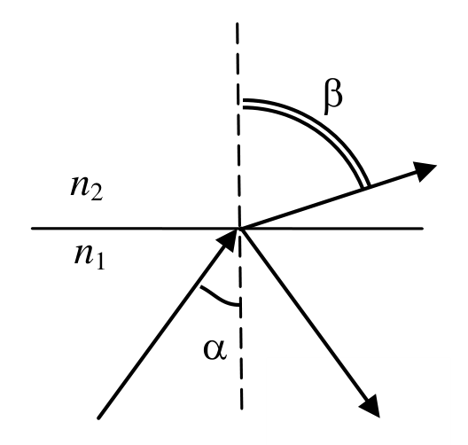
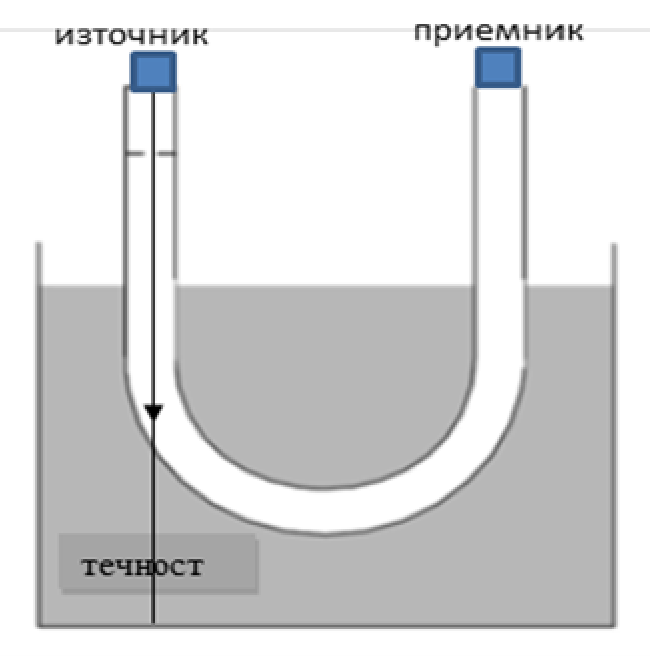
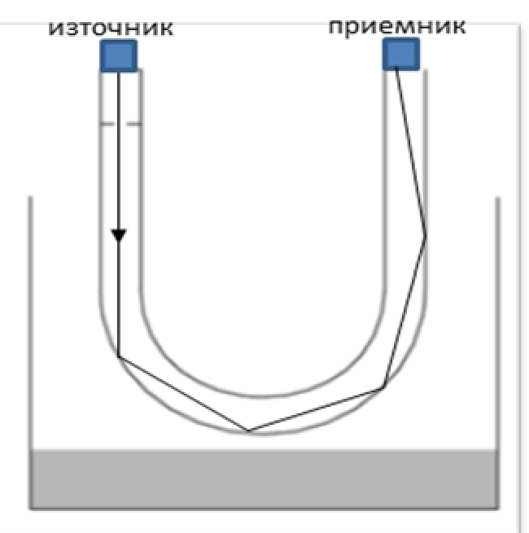
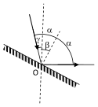

ЗАДАЧА 1. - 10 точки

ЧАСТ 1.

а) Ако от фигурата е ясно, че ъгълът на падане е равен на ъгъла на отражение (1 т.)

Ако от фигурата е ясно, че ъгълът на пречупване е по-голям от ъгъла на падане (1 т.)

б) Законът на Снелиус е $n_1 \sin\alpha = n_2 \sin\beta$ (1 т.)

Посочено е, че при граничния ъгъл $\beta$ = 90$^\circ$ (1 т.)

Използвано е, че sin 90$^\circ$ = 1 и е получено $\sin\alpha_{гр} = \frac{n_2}{n_1}$ (1 т.)

ЧАСТ 2.

а) Лъчът търпи пълно вътрешно отражение във втория случай,
защото пада от оптически по-плътна среда - стъклото, към
оптически по-рядка среда - въздуха. (1 т.)

б) Приемникът ще регистрира светлина при празен съд, защото
тогава светлината, след няколкократни отражения от стените на тръбата, ще достигне
приемника. (1 т.)

в) При пълен съд:
ако е изобразено, че лъчът минава в течността, без да се отрази (1 т.)
ако е ясно, че лъчът не се пречупва на границата стъкло-течност (1 т.)

При празен съд:
ако са изобразени многократните отражения от стените на тръбата (1 т.)

 1

ЗАДАЧА 2. - 10 точки

а) Явлението се нарича дисперсия на светлината. (0,5 т.)

То се състои в това, че показателят на пречупване на светлината в дадена среда зависи от
дължината на светлинната вълна. (0,5 т.)

б) От графиката се вижда, че:
$n_B = 1{,}46$ (0,5 т.)
$n_{\text{Ч}} = 1{,}42$ (0,5 т.)

в) От дефиницията за показател на пречупване:

$n = \frac{c}{u}$ (1 т.)

следва

$u_B = \frac{c}{n_B} = 2{,}05 \cdot 10^8$ m/s (1 т.)

и

$u_{\text{Ч}} = \frac{c}{n_{\text{Ч}}} = 2{,}11 \cdot 10^8$ m/s (1 т.)

г) От закона на Снелиус:
1·$\sin\alpha = n\sin\beta$ (1 т.)
и като вземем предвид, че
$\sin 30^\circ = 0{,}5$ (0,5 т.)
за виолетовата светлина получаваме:

$\sin\beta_B = \frac{0{,}5}{n_B} = 0{,}342$ (0,5 т.)

а за червената

$\sin\beta_{\text{Ч}} = \frac{0{,}5}{n_{\text{Ч}}} = 0{,}352$ (0,5 т.)

От таблицата със синусите намираме:

$\beta_B = 20{,}0^\circ$ (0,25 т.)
$\beta_{\text{Ч}} = 20{,}6^\circ$ (0,25 т.)

д) $\delta_B > \delta_{\text{Ч}}$ (1 т.)
защото показателят на пречупване за виолетовата светлина е по-голям от този за
червената светлина. (1 т.)

Точки се дават и ако на чертеж е изобразен ходът на един виолетов и един червен лъч в
призмата. Виолетовият лъч трябва да минава под червения.

 2

ЗАДАЧА 3. - 10 точки
ЧАСТ 1.

а) Построени са перпендикулярите към огледалата в точките А и B на падане на лъча, като
ъглите $\alpha$ и $\beta$ са означени като ъгли спрямо перпендикулярите. (1 т.)

б) $\theta$ = 2$\alpha$ + 2$\beta$ - външен за триъгълника ABC (1 т.)
(90 - $\alpha$) + (90 - $\beta$) + $\varphi$ = 180$^\circ$ (0,5 т.)
$\Rightarrow\alpha$+$\beta$=$\varphi$ (0,5 т.)
$\Rightarrow \theta$ = 2($\alpha$ + $\beta$) = 2$\varphi$ (1 т.)

ЧАСТ 2.

В случая, изобразен на фиг. 6, ъгълът на падане на лъча върху огледалото е:

$\alpha = \beta - \gamma$ (1 т.)

От закона за отражение следва, че ъгълът между отразения и падащия лъч е 2$\alpha$ = 2$\beta$ - 2$\gamma$ (0,5 т.),
а между отразения лъч и вертикалата: 2$\alpha$ + $\gamma$ = 2$\beta$ - $\gamma$.

Ако отразеният лъч е хоризонтален:

2$\beta$ - $\gamma$ = 90$^\circ$ (0,5 т.)

$\Rightarrow \beta = 45^\circ + \frac{\gamma}{2}$ (1 т.)
В случая, изобразен на фиг. 7, ъгълът на падане на лъча върху огледалото е:

$\alpha = \beta + \gamma$ (1 т.)

От закона за отражение следва, че ъгълът между отразения и падащия лъч е 2$\alpha$ = 2$\beta$ + 2$\gamma$ (0,5 т.),
а между отразения лъч и вертикалата: 2$\alpha$ - $\gamma$ = 2$\beta$ + $\gamma$.

Ако отразеният лъч е хоризонтален:

2$\beta$ + $\gamma$ = 90$^\circ$ (0,5 т.)

$\Rightarrow \beta = 45^\circ - \frac{\gamma}{2}$ (1 т.)

