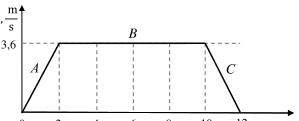

ЗАДАЧА 1. - 10 точки
 Триатлон е спорт, в който участниците се състезават последователно в три
дисциплини. Резултатите на победителката в състезание по триатлон (спринтова
дисциплина) за момичетa са:
| № | Дисциплина | Разстояние | Време |
|---|------------|------------|-------|
| 1 | Плуване | 50 m | 2 min 05 s |
| 2 | Колоездене | 5 km | 11 min 41 s |
| 3 | Бягане | 500 m | 3 min 20 s |

 Пресмeтнете средната скорост на движение в km/h за всяка от дисциплините
(съответно $v_1$, $v_2$ и $v_3$) и средната скорост за цялото състезание $v_{ср}$.

ЗАДАЧА 2. - 10 точки
 От земната повърхност вертикално нагоре е хвърлено тяло с начална скорост $v_0$ . В
същия момент от неизвестна височина h, е хвърлено вертикално надолу второ тяло с
начална скорост $0,5 v_0$ . В момента, когато двете тела се разминават във въздуха, техните
скорости са равни по големина. Като пренебрегнете съпротивлението на въздуха,
определете:

 а) времето $t_1$ , за което първото тяло ще достигне максимална височина;

 б) максималната височина H, на която се издига първото тяло;

 в) скоростта $v_1$ , с която първото тяло ще падне на земята;

 г) височината h, от която е хвърлено второто тяло;

 д) скоростта $v_2$, с която второто тяло ще достигне земната повърхност.

 Приемете, че началната скорост е $v_0$ = 20 m/s, а земното ускорение е $g \approx 10\ m/s^2$.
 Предайте на квесторите листа с условията на задачите, писмената си работа и работния лист!

ЗАДАЧА 3. - 10 точки
 Бързите асансьори във високи сгради могат да се движат със скорост 3,6 m/s. На фиг.
1 е показана графиката на скоростта v на асансьора в зависимост от времето t. За всеки от
участъците A, B и C определете:

 а) характера на движение на асансьора;

 б) числените стойности на основните величини, описващи движението на асансьора:
 - начална скорост $v_0$
 - крайна скорост v
 - продължителност на движението $\Delta$t
 - ускорение a
 - изминат път s

 в) за всеки от трите етапа на движението сравнете големините на силата F, с която
 въжето действа на асансьора, и силата на тежестта G, приложена върху него.

 Използвайте знаците за сравнение ( =, <, > )

 Резултатите нанесете в таблицата от работния лист.

Предайте на квесторите листа с условията на задачите, писмената си работа и работния лист!

 РАБОТЕН ЛИСТ

ЗАДАЧА 3.

| | Част А | Част В | Част С |
|---|--------|--------|--------|
| а) характер на движението |  |  |  |
| б) начална скорост $v_0$ |  |  |  |
| крайна скорост v |  |  |  |
| продължителност на движението $\Delta t$ |  |  |  |
| ускорение a |  |  |  |
| изминат път s |  |  |  |
| в) сравняване на силите F и G |  |  |  |

Предайте на квесторите листа с условията на задачите, писмената си работа и работния лист!
