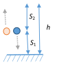

ЗАДАЧА 1.
Средната скорост се пресмята по формулата

$$v = \frac{s}{t},$$

където $s$ е изминатият път за време $t$. Тогава имаме

$$v_1 = \frac{50}{125} = 0,4 \frac{\text{m}}{\text{s}}, \quad v_2 = \frac{5000}{701} \approx 7,1 \frac{\text{m}}{\text{s}}, \quad v_3 = \frac{500}{200} = 2,5 \frac{\text{m}}{\text{s}}$$

Като отчетем, че

$$1 \frac{\text{m}}{\text{s}} = \frac{1 \cdot 10^{-3} \text{ km}}{1/3600 \text{ h}} = 3,6 \frac{\text{km}}{\text{h}},$$

получаваме

$$v_1 = 0,4 \cdot 3,6 \frac{\text{km}}{\text{h}} = 1,44 \frac{\text{km}}{\text{h}},$$

$$v_2 \approx 7,1 \cdot 3,6 \frac{\text{km}}{\text{h}} \approx 25,6 \frac{\text{km}}{\text{h}},$$

$$v_3 = 2,5 \cdot 3,6 \frac{\text{km}}{\text{h}} = 9 \frac{\text{km}}{\text{h}}.$$

Аналогично намираме

$$v_{\text{ср}} = \frac{s_1 + s_2 + s_3}{t_1 + t_2 + t_3} = \frac{5550}{1026} \approx 5,4 \frac{\text{m}}{\text{s}},$$

$$v_{\text{ср}} \approx 5,4 \cdot 3,6 \frac{\text{km}}{\text{h}} \approx 19,4 \frac{\text{km}}{\text{h}}$$

ЗАДАЧА 2.
a) При достигане на максимална височина скоростта

$$v = v_0 - gt_1 = 0,$$

откъдето намираме

$$t_1 = \frac{v_0}{g} = 2 \text{ s}.$$
б) Максималната височина на издигане на тялото е

$$ H = v_{0_1} - \frac{gt^2}{2} = \frac{v_0^2}{2g} = 20 \text{ m}. $$
 \[1 т.\]

в) Скоростта $v_1$, с която първото тяло ще падне на земята, определяме от израза

$$ H = \frac{v_1^2}{2g} \longrightarrow v_1 = \sqrt{2gH} = 20 \frac{\text{m}}{\text{s}}. $$
 \[1 т.\]

г) Височината $h$, от която е хвърлено второто тяло е

$$ h = s_1 + s_2, $$
 \[1 т.\]

където

$$ s_1 = \frac{v_0^2 - v^2}{2g}, \quad s_2 = \frac{v^2 - v_0^2/4}{2g}. $$
 \[1 т.\]

Тогава имаме

$$ h = \frac{3v_0^2}{8g} = 15 \text{ m}. $$
 \[1 т.\]

д) Скоростта $v_2$, с която второто тяло ще достигне земната повърхност, определяме от равенството

$$ h = \frac{3v_0^2}{8g} = \frac{v_2^2 - v_0^2/4}{2g}, $$
 \[1 т.\]

откъдето намираме $v_2 = v_0 = 20 \frac{\text{m}}{\text{s}}$.
\[0,5 т.\]

ЗАДАЧА 3.

а) Характерът на движението за отделните участъци е:

Участък $A$ – равноускорително движение
Участък $B$ – равномерно движение
Участък $C$ – равнозакъснително движение

б) Стойностите на основните величини са:

Участък $A$ – $v_0 = 0, \quad v = 3.6 \frac{\text{m}}{\text{s}}, \quad \Delta t = 2 \text{ s}, \quad a = \frac{v - v_0}{\Delta t} = 1.8 \frac{\text{m}}{\text{s}^2}, \quad s = \frac{v}{2}\Delta t = 3.6 \text{ m};$

Участък $B$ – $v_0 = v = 3.6 \frac{\text{m}}{\text{s}}, \quad \Delta t = 8 \text{ s}, \quad a = 0, \quad s = v_0 \Delta t = 28.8 \text{ m};$

 Участък С - v 0 = 3,6 , v = 0, $\Delta$t = 2 s, a = 0 = 1,8 2 , s = 0 $\Delta$t = 3,6 m .
 s $\Delta$t $s_2$
в) Участък А - F > G
 Участък В - F = G
 Участък С - F < G

Участък $C$ – $v_0 = 3,6 \, \text{m/s}$, $v = 0$, $\Delta t = 2 \, \text{s}$, $a = \frac{v_0 - v}{\Delta t} = 1,8 \, \text{m/s}^2$, $s = \frac{v_0}{2} \Delta t = 3,6 \, \text{m}$.

в)

Участък $A$ – $F > G$

Участък $B$ – $F = G$

Участък $C$ – $F < G$

|                                              | Част $A$                   | Част $B$                 | Част $C$                   |
| :------------------------------------------- | :----------------------------- | :--------------------------- | :----------------------------- |
| а) характер на движението                | Равноускорително [0,5 т.]      | Равномерно [0,5 т.]          | Равнозакъснително [0,5 т.]     |
| б) начална скорост $v_0$                 | $0 \, \text{m/s}$ [0,4 т.]     | $3,6 \, \text{m/s}$ [0,4 т.] | $3,6 \, \text{m/s}$ [0,4 т.]   |
| крайна скорост $v$                       | $3,6 \, \text{m/s}$ [0,4 т.]   | $3,6 \, \text{m/s}$ [0,4 т.] | $0 \, \text{m/s}$ [0,4 т.]     |
| продължителност на движението $\Delta t$ | $2 \, \text{s}$ [0,4 т.]       | $8 \, \text{s}$ [0,4 т.]     | $2 \, \text{s}$ [0,4 т.]       |
| ускорение $a$                            | $1,8 \, \text{m/s}^2$ [0,6 т.] | $0 \, \text{m/s}^2$ [0,5 т.] | $1,8 \, \text{m/s}^2$ [0,6 т.] |
| изминат път $s$                          | $3,6 \, \text{m}$ [0,6 т.]     | $28,8 \, \text{m}$ [0,6 т.]  | $3,6 \, \text{m}$ [0,5 т.]     |
| в) сравняване на силите $F$ и $G$        | $F > G$ [0,5 т.]               | $F = G$ [0,5 т.]             | $F < G$ [0,5 т.]               |
