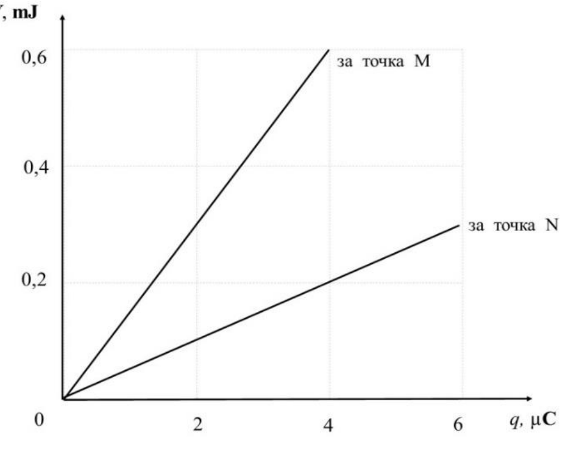
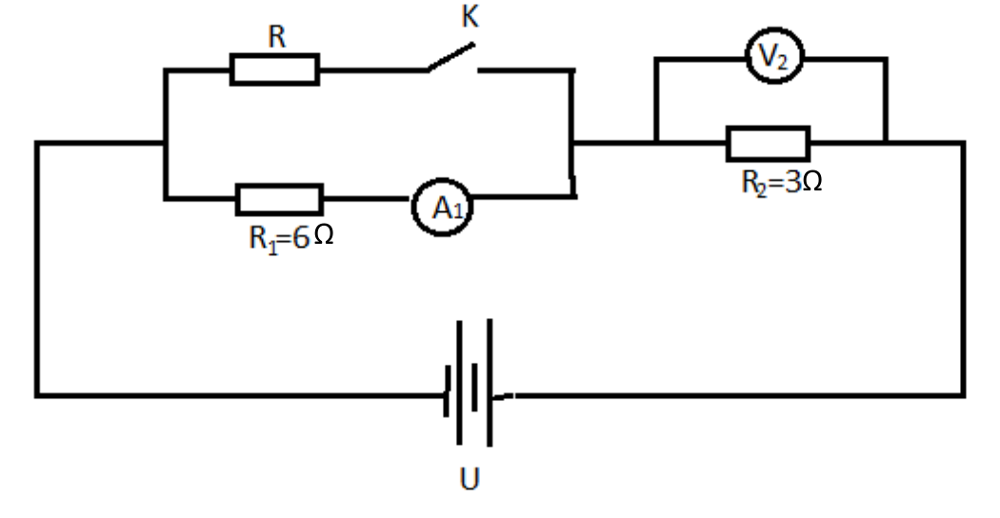

ЗАДАЧА 1. - 10 точки
 Пресметнете силата на привличане между два разноименни точкови заряда с
големина $q_1$ $= q_2$ = 1C , които се намират на разстояние r = 1m един от друг. Сравнете
тази сила със силата на тежестта G, действаща на слон с маса равна на 3 тона. Колко
слона трябва да привлича Земята със сила равна по големина на силата на привличане
между зарядите $q_1$ и $q_2$ ? Земното ускорение приемете за g $= 10 \left(\text{m/s}\right)^{2}$. Коефицентът k =
 $N \cdot \text{m}^{2}$
$9\cdot 10^{9} c_2$ .

ЗАДАЧА 2. - 10 точки
(Част 1 и Част 2 са независими)

Част 1.

 В еднородно електрично поле електрон се ускорява от покой от точка М с
потенциал $\varphi$M = 0V и в края на ускоряването достига до точка N с потенциал

$\varphi$N $= 1\cdot 10^{5} V$.

 а) Опишете движението на електрона;

 б) Ако интензитетът на еднородното електрично поле е Е $= 5\cdot 10^{5} N / C$, определете
големината на електричната сила, която действа на електрона;

 в) Определете разстоянието между точките М и N;

 г) Направете чертеж, като означите и аргументирате:
 - посоката на силовата линия, която минава през т. M и т. N ;
 - посоката на силата, която действа на електрона.

Елементарният електричния заряд е е $= 1,6\cdot 10^{-19}$ С.

 1
Част 2.

 В електростатичното поле се поставят в точките М и N последователно
електрични заряди с различна големина. На фигурата е показана зависимостта на
потенциалната енергия на зарядите от тяхната големина. Определете:

 a) Потенциала на полето $\varphi$M в точка M.

 б) Потенциала на полето $\varphi$N в точка N.

ЗАДАЧА 3. - 10 точки
 На фигурата е показана схема на електрическа верига. Волтметърът $V_2$ показва
напрежение 12V, a амперметърът $A_1$ ток 1A.

 $\Omega$
 $\Omega$

Част 1.

Ключът К е затворен. Като използвате данните от схемата, определете:

 2

 а) тока, протичащ през резистор $R_2$;

 б) заряда, преминал през $R_2$ за време 2 min;

 в) пада на напрежение във външната част на веригата $U_0$;

 г) съпротивлението на резистор R;

 д) еквивалентното съпротивление на веригата;

 е) ако резистор R е навит от канталов проводник със сечение 0,35mm2 (р=1,4 $\Omega$mm2/m),
проводник с каква дължина е използван?

Част 2.

Ключът К се отваря. Какви ще бъдат показанията на волтметъра и амперметъра?

 3
