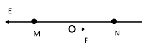

ЗАДАЧА 1. - 10 точки
За превръщане на масата на слона в основна мерна единица m = 3t = 3000 kg ( 1 т.)

Изпозваме закона на Кулон
 $N \cdot \text{m}^{2}$
 $q_1 q_2( 9\cdot 10^{9})$.1C.1C
 $c_2$

 F $= k r_2$ = (1m)2
 = 9. 109 N ( 2 т.)

 Силата на тежестта G = mg ( 2 т.)

 G $= 3000 \text{kg} \cdot 10 \left(\text{m/s}\right)^{2}$ = 3000N = 3. 104 N ( 1 т.)
 $F 9\cdot 10^{9} N$
 $= 3\cdot 10^{4} N$ = 3. 105 ( 2 т.)

 G

 Двата заряда се привличат със сила, равна по големина на силата, с която Земята привлича
300 000 слона ( 2 т.)

ЗАДАЧА 2. - 10 точки
Част 1:

а) равноускорително движение ( 0,5 т.)

б) F=E.q ( 1 т.)

 F$= 5\cdot 10^{5} N / C \cdot 1,6\cdot 10^{-19} C$= $8\cdot 10^{-14}$ N ( 0,5 т.)

в) F.d =q.U; U = $\varphi$N - $\varphi$M ; $d = \frac{qU}{F} = \frac{ 1,6\cdot 10^{-19} \text{C} \cdot 1\cdot 10^{5} \text{V}}{ 8\cdot 10^{-14} \text{N}}$ = 0,2 m ( 3 т.)

г) за правилен чертеж ( 1 т.)

 E

 M N
 F
- потенциалът намалява по посока на силовите линии на електростатичното поле ( 0,5
т.)

- електронът се движи от точки с по-нисък потенциал към точки с по-висок потенциал ( 0,5 т.)

Част 2:

a) $\varphi$M = $\frac{W}{q}$ = $\frac{ 0,6 \text{mJ}}{ 4\cdot 10^{-6} \text{C}}$ = $1,5\cdot 10^{2}$ V = 150 V ( 1,5 т.)

б) $\varphi$N = $\frac{W}{q}$ = $\frac{ 0,2 \text{mJ}}{ 4\cdot 10^{-6} \text{C}}$ = $0,5\cdot 10^{2}$ V = 50 V ( 1,5 т.)

ЗАДАЧА 3. - 10 точки
ЧАСТ 1:

 U

а) $I_2$ $= R_2$ = 4 А ( 1 т.)
 2

б) t = 2 min q = I . t = 4 . 120 = 480 C ( 1 т.)

 t = 120 s

в) $U_0$ $= U_1$ + $U_2$ ( 0,5 т.)

$U_1$ $= I_1 R_1$ = 1.6 = 6 V ( 1 т.)

$U_0$ = 6 + 12 = 18 V ( 0,5 т.)

 U

г) U=$U_1$ = const ( 0,5 т.) R $= I_1$ ; ( 0,5 т.) I $= I_2$ $- I_1$ = 3A ( 0,5 т.)

 U
 R $= I_1$ = 2 $\Omega$ ( 0,5 т.)

 U 18

д) Rекв. = I 0 = 4 = 4,5 $\Omega$ ( 0,5 т.)
 2

 1 R.R
 или Rекв. = R +R $+ R_2$ = 4,5 $\Omega$
 1

 R.S

е) l = $\rho$ = 0,5 m ( 1 т.)

Част 2:

 Rекв. $= R_1$ $+ R_2$ = 9 $\Omega$ ( 1 т.)
 0U 18
 I = R екв. = 9 =2А ( 0,5 т.)

 $U_2$ $= I_2 \cdot R_2$ = 6 V ( 1 т.)

