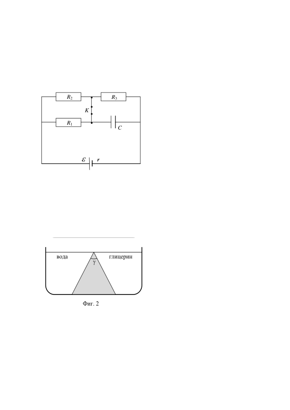

[[Състезания/2/10-12/2013|◂ 2013]] | [[Състезания/2/10-12r/2014|решения]] | [[Състезания/2/10-12/2015| 2015 ▸]]

Задача 1. На фиг. 1 е показана електрическа схема, в която при затворен ключ K
напрежението на кондензатора е $U_1$ = 27 V . Резисторите имат съпротивления $R_1$ = r ,
 $R_2$ = 2r и $R_3$ = 3r , където r е вътрешното
 $R_2 R_3$
 съпротивление на източника.

 K

 а) Намерете електродвижещото напреже-
 $R_1 C$ ние $\varepsilon$ на източника.

 б) На колко ще бъде равно напрежението
 U 2 на кондензатора при отворен ключ K ?

Задача 2. Аеростат (балон с кабина) се издига равноускорително без начална скорост с
ускорение a $= 0,2 \left(\text{m/s}\right)^{2}$ . В кабината на аеростата е окачен часовник с махало. Намерете
на каква височина h спрямо Земята ще се намира аеростатът, когато по часовника е
изминал интервал от време $t_0$ = 1 min . Земното ускорение е g $= 9,8 \left(\text{m/s}\right)^{2}$ .

Забележка. Махалото на часовника да се разглежда като математическо.

Задача 3. В съд е поставена призма с пречупващ ъгъл $\gamma$ = 60 0 . От едната страна на
 призмата е налята вода, а от другата -
 глицерин (фиг. 2). От страната на
 водата върху призмата пада лъч,
 вода глицерин успореден на основата ѝ, който се
 $\gamma$ пречупва под ъгъл $\beta$ . Лъчът се
 разпространява в призмата и пада
 върху граничната повърхност призма-
 глицерин под ъгъл $\alpha_1$ и излиза от
 призмата под ъгъл $\beta_1$ . Всички ъгли се
 Фиг. 2 отчитат спрямо перпендикуляра в
точката на падане.

 а) Начертайте хода на лъча.

 б) Намерете ъгъла $\beta$ .

 в) Определете ъгълa $\beta_1$ .

Показателите на пречупване на водата, материала на призмата и глицерина са
съответно $n_1$ = 1,33 , $n_2$ = 1,80 , $n_3$ = 1,47 . Ъглите пресметнете с точност до градус.
