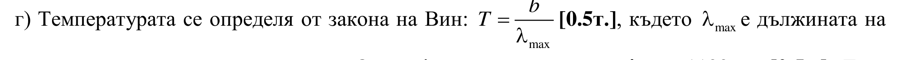
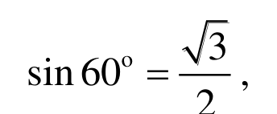
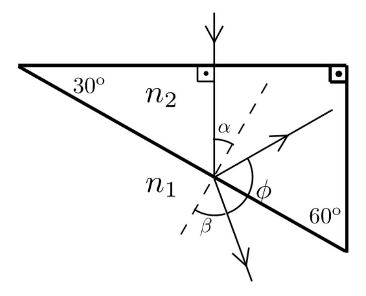

[[Състезания/2/10-12/2015|◂ 2015]] | [[Състезания/2/10-12/2016|условия]] | [[Състезания/2/10-12/2017| 2017 ▸]]

Задача 1. Механика

а) Разлагаме силата на тежестта на шейната на тангенциална (по направление на скоростта V) и нормална (по перпендикулярно на V направление) компоненти. Тангенциалната компонента е Gt = mg sin $\alpha$ \[1т.\]. Тъй като шейната се движи праволинейно с постоянна скорост, силата на опън Т уравновесява тангенциалната компонента, т.е.

Т = mg sin $\alpha$ . \[1т.\]

б) Еленът прилага такава сила, че да движи своята маса, както и масата на шейната,
равномерно по наклонената равнина. Разстоянието L по наклонената равнина съответства на издигане с височина H = L sin $\alpha$ \[1.5т.\]. Търсената работа е разлика в потенциалните енергии:

A = (m + M ) gL sin $\alpha$ . \[1.5т.\]

в) Законът за движението на шейната е $x(t ) = L + Vt - \frac{1}{2} g \sin \alpha t^2$ \[1т.\], където x е разстоянието между долния край на шейната и началото на наклонената равнина.

Времето $\tau$ е положителният корен на уравнението L + V $\tau$ - g sin $\alpha\tau_2$ = 0 \[0.5т.\]:
 2

$\tau = \frac{V + \sqrt{V^2 + 2gL\sin\alpha}}{g\sin\alpha}$. \[0.5т.\]

Скоростта намираме от закона за запазване на енергията. В момента на скъсването енергията е $E_1 = \frac{mV^2}{2} + mgL\sin\alpha$ \[0.5т.\], а в момента $\tau$ е $E_2 = \frac{mV_2{}^2}{2}$ \[0.5т.\]. От $\frac{mV^2}{2} + mgL\sin\alpha = \frac{mV_2{}^2}{2}$ \[1т.\] намираме $V_2 = \sqrt{V^2 + 2gL\sin\alpha}$. \[1т.\]

**Задача 2. Електричество**
**Част 1**

а) Еквивалентното съпротивление на крушките е $\frac{R}{N}$ \[0.5т.\], а мощността е $P = I^2 \frac{R}{N}$ \[0.5т.\], където $I$ е токът във веригата. Имаме $I = \frac{\varepsilon}{r + R/N} = \frac{N\varepsilon}{R + Nr}$ \[1т.\]. Така намираме

$P = \frac{\varepsilon^2 NR}{(R + Nr)^2}$ \[1т.\]

б) Мощността можем да запишем така: $P = \frac{\varepsilon^2}{r} \frac{Nr / R}{(1 + Nr / R)^2}$ \[1т.\]
 
Правим субституция: $P = \frac{\varepsilon^2}{r} \frac{x}{(1+x)^2}$ \[1т.\], където $x = Nr/R$. Така намираме, че $P$ има максимум при $x=1$, т.е. $N = R/r=5$. \[1т.\]

**Част 2**

в) Работата на външната сила е равна на промяната на потенциалната енергия $W$ на подвижния заряд в полето на неподвижния, тъй като кинетичната енергия на първия не се изменя, $A = \Delta W$ \[1 т.\]. Имаме $W = \frac{kq^2}{R}$, където $R$ е разстоянието между зарядите.

За участъка 1-2 извършената работа е $A_{12} = kq^2 \left( \frac{1}{r} - \frac{1}{r+d} \right)$. \[1 т.\]

За участъка 2-3 извършената работа е $A_{23} = kq^2 \left( \frac{1}{r} - \frac{1}{r} \right) = 0$. \[1 т.\]

За участъка 3-1 извършената работа е $A_{31} = kq^2 \left( \frac{1}{r+d} - \frac{1}{r} \right)$. \[1 т.\]

Задача 3. Оптика

Част 1
а) За ъгъла $\varphi$ намираме $\varphi$ = 180о - $\alpha$ - $\beta$, където $\alpha$ = 30о .
За верен отговор се зачита и $\varphi$ = 150о - $\beta$.\[1т.\]

б) При $\beta$ = 90о ъгълът $\varphi$ приема минималната си
стойност, която е $\varphi$ = 60о \[0.5т.\]. Използваме закона на Снелиус: $n_2 \sin 30^\circ = n_1 \sin \beta$. Тъй като $\sin 30^\circ = \frac{1}{2}$, имаме $\frac{n_2}{n_1} = 2 \sin \beta$ \[0.5т.\]. Но $\beta = 90^\circ$, следователно $\frac{n_2}{n_1} = 2$. \[1т.\]

в) Отново имаме $\frac{n_2}{n_1} = 2 \sin \beta$. Имаме $\phi = 90^\circ$ при $\beta = 60^\circ$ \[1т.\]. Тъй като $\sin 60^\circ = \frac{\sqrt{3}}{2}$, получаваме $\frac{n_2}{n_1} = \sqrt{3}$. \[1т.\]

**Част 2**

г) Температурата се определя от закона на Вин: $T = \frac{b}{\lambda_{\max}}$ \[0.5т.\], където $\lambda_{\max}$ е дължината на вълната с максимален интензитет. От графиката се вижда, че $\lambda_{\max} \approx 1100\text{nm}$ \[0.5т.\]. Така получаваме $T \approx 2635\text{ K}$. \[1т.\]

д) За излъчваната мощност имаме $P = \sigma T^4 S$ \[2т.\], където S е търсената площ. Така намираме

$S = \frac{P}{\sigma T^4} \approx 5.5 \cdot 10^{-6} \text{ m}^2$. \[1т.\]
