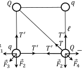
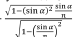

[[Състезания/2/10-12/2016|◂ 2016]] | [[Състезания/2/10-12/2017|условия]] | [[Състезания/2/10-12/2018| 2018 ▸]]

Задача 1. Коктейл от движения
а) Тялото достига максималната си скорост в точка В \[0,5 т.\].
Понеже при движението му по улея, на тялото не действа сила на триене, можем да
приложим закона за запазване на механичната енергия:
$mgh = \frac{mv_m^2}{2}$, \[0,5 т.\]
откъдето намираме:
$v_m = \sqrt{2gh} = 2\text{ m/s}$. \[1,0 т.\]
б) Понеже в участъка ВС няма триене, тялото достига точка С със скорост $v_m$. Можем
да определим силата $f$ на триене между тялото и грапавия участък по два алтернативни начина (точки се дават само за едното от решенията).

Вариант I. Енергетичен подход

За гравия участък можем да приложим връзката:

$$\Delta E_k = A,$$ \[0,5 т.\]

където $A$ е работата на силата на триене, а $\Delta E_k$ е промяната на кинетичната енергия на тялото. Силата $f$ на триене действа в посока, противоположна на посоката на движение и върши отрицателна работа:

$$A = -fs$$ \[0,5 т.\]

Промяната на кинетичната енергия е:

$$\Delta E_k = 0 - \frac{mv_2^2}{2} = -mgh$$ \[0,5 т.\]

Така намираме:

$$f = \frac{mgh}{s}$$ \[0,5 т.\]

Вариант II. Динамичен подход

Понеже в участъка $BC$ няма триене,
тялото достига точка $C$ със скорост $v_m$.
Върху гравиящ участък тялото се
движи равнозакъснително, докато спре.
От връзката:
$s = v_m t - at^2 / 2$ \[0,5 т.\]
и
$0 = v_m - at$ \[0,5 т.\]
определяме ускорението на равнозакъсн-
ителното движение:
$a = \frac{v_m^2}{2s} = \frac{gh}{s}$ \[0,5 т.\]
Върху гравиящ участък на тялото
действа в хоризонтална посока единст-
вено силата $f$ на триене. От втория
принцип на механиката следва:
$f = ma = \frac{mgh}{s}$ \[0,5 т.\]

 След като сме определили силата на триене (вариант I или вариант II), намираме
коефииента на триене:
 \[1,0 т.\]
в) Общото време на движение може да се представи като: където е
времето за спускане по наклонения участък АВ, е времето за движение по гладкия
участък ВС и е времето за спиране по грапавия участък.
По гладкия участък ВС тялото се движи равномерно, защото не му действа триене.
Следователно:
$$t_2 = \frac{L}{v_m} = 1\text{ s}$$ \[1,0 т.\]

По грапавия участък тялото се движи равнозакъснително с начална скорост $v_m$ и с ускорение $a = f/m = gh/s$. Следователно времето за спиране е:

$$t_3 = \frac{v_m}{a} = s \sqrt{\frac{2}{gh}} = 0,5\text{ s}$$ \[1,0 т.\]

По участъка $AB$ движението на тялото е еквивалентно на движение на математичко махало с дължина $R$. \[1,0 т.\]

Времето за движение е една четвърт от периода на трептене:

$$t_1 = \frac{T}{4}$$ \[0,5 т.\]

Като вземем предвид, че:

$$T = 2\pi \sqrt{\frac{R}{g}}$$ \[0,5 т.\]

намираме:

$$t_1 = \frac{\pi}{2} \sqrt{\frac{R}{g}} \approx 0,5\text{ s}$$ \[0,5 т.\]

Следователно общото време за движение е:

$$t = 0,5\text{ s} + 1\text{ s} + 0,5\text{ s} = 2\text{ s}$$ \[0,5 т.\]

Задача 2. Електростатика.
а) Сумарната електрична сила, която действа на едно от топчетата, е векторна сума от силите, с които му действат зарядите на останалите три топчета. Силите са означени на фигурата вляво. Електричните сили, които действат на долното ляво топче, са с големини: $F_1 = F_2 = \frac{kqQ}{\ell^2}$ и $F_3 = \frac{kq^2}{2\ell^2}$, \[1 т.\] като сме изразили дължината на диагонала на квадрата чрез  дължината на страните. Поради симетрията векторната сума на силите и е насочена по диагонала на квадрата. Тъй като , големината на сумата е равна на . За големината на резултантната електрична сила, която действа на долното ляво топче, се получава: $F_{\text{дл}} = \sqrt{2}F_1 + F_3 = \frac{\sqrt{2}kqQ}{\ell^2} + \frac{kq^2}{2\ell^2}$. \[1 т.\] По аналогичен начин, на долното дясно топче действат електрични сили с големини $F_1 = F_2 = \frac{kqQ}{\ell^2}$ и $F_4 = \frac{kQ^2}{2\ell^2}$. \[1 т.\]
Големината на резултантната електрична сила, която действа на долното дясно
топче, е: $F_{\text{дд}} = \sqrt{2}F_1 + F_4 = \frac{\sqrt{2}kqQ}{\ell^2} + \frac{kQ^2}{2\ell^2}$. \[1 т.\]

б) Потенциалът в средата на квадрата е алгебрична сума от потенциалите, които съз-
дават зарядите на четирите топчета в тази точка: $\varphi = \frac{2\sqrt{2}kQ}{\ell} + \frac{2\sqrt{2}kq}{\ell} = \frac{2\sqrt{2}k(Q+q)}{\ell}$. \[2 т.\]

в) Системата е симетрична спрямо двата диагонала на квадрата. \[0,5 т.\] Tърсената сила на опън означаваме с . Силата на опън на останалите четири нишки по страните на квадрата е с една и съща големина . \[0,5 т.\] От условието за равновесие на системата
следват две независими уравнения, които свързват големините на силите на опън с
големините на кулоновите сили, които действат на топчетата. Освен електричните
сили, на долното ляво топче действат две перпендикулярни сили на опън с големина ,
както е показано на фигурата. Тяхната геометрична сума е вектор, насочен по
диагонала на квадрата, с големина , което може да се получи, като се използва
питагоровата теорема. \[0,5 т.\] От условието за равновесие на долното ляво топче
имаме, че $F_{\text{дл}} = \frac{\sqrt{2}kqQ}{\ell^2} + \frac{kq^2}{2\ell^2} = \sqrt{2}T'$. \[0,5 т.\] Аналогично, освен електричните сили, на
долното дясно топче действа силата на опън на диагоналната нишка с големина и две
сили на опън с големина , които са взаимно перпендикулярни, както е показано на
фигурата. \[0,5 т.\] От условието за равновесие на долното дясно топче следва, че
 $F_{\text{дд}} = \frac{\sqrt{2}kqQ}{\ell^2} + \frac{kQ^2}{2\ell^2} = T + \sqrt{2}T'$. \[0,5 т.\] Като извадим двете уравнения, които дават
условията за равновесие на топчетата, едно от друго, за да изключим , ще получим: $T = F_{\text{дд}} - F_{\text{дл}} = \frac{k(Q^2 - q^2)}{2\ell^2}$. \[1 т.\]

Задача 3. Преминаване на лъч през пластинки.
а) От правоъгълния $\Delta ACD$ следва, че $\frac{d}{x} = \sin(\alpha - \gamma)$. (3.1) \[0,4 т.\] От правоъгълния $\Delta ABC$ следва, че $\frac{h}{x} = \cos \gamma$. (3.2) \[0,4 т.\]

Разделяйки (3.1) на (3.2), се получава $\frac{d}{h} = \frac{\sin(\alpha - \gamma)}{\cos \gamma}$. (3.3) \[0,3 т.\] (3.3) може да се преобразува (използвайки дадената в условието тригонометрична формула) до $\frac{d}{h} = \frac{\sin \alpha \cos \gamma - \cos \alpha \sin \gamma}{\cos \gamma} = \sin \alpha - \frac{\cos \alpha \sin \gamma}{\cos \gamma}$. (3.4)
 \[0,4 т.\] От закона на Снелиус следва, че
$\frac{\sin\alpha}{\sin\gamma}=n$ (3.5). \[1 т.\] Замествайки (3.5) в (3.4), се получава $\frac{d}{h} = \sin \alpha - \frac{\sqrt{1-(\sin \alpha)^2} \frac{\sin \alpha}{n}}{\sqrt{1-(\frac{\sin \alpha}{n})^2}}$.

След преобразования, $d = h \sin \alpha \left( 1 - \frac{\sqrt{1-(\sin \alpha)^2}}{\sqrt{n^2-(\sin \alpha)^2}} \right)$. (3.6) \[1,5 т.\]
 б) Лъчът, пречупвайки се, остава винаги в горната половина на системата.
Следователно лъчът ще премине само през тези пластинки, които са в горната половина
на системата, т.е. тези, които сключват ъгъл с вертикалата между 0 и 90 . \[0,2 т.\]
Първата е вертикална, втората сключва ъгъл 20 , третата - 40 , четвъртата - 60 , петата -
80 , а шестата лежи в долната половина на системата (сключва ъгъл 100 ) и лъчът
никога няма да я достигне. \[0,3 т.\] Следователно числото k = 5. \[0,5 т.\]

| Номер (i) на пластинката | Ъгъл на падане, $^\circ$ | $d_i, \text{ mm}$ |
| :----------------------: | :----------------------: | :---------------: |
|            1             |            0             |         0         |
|            2             |            20            | 0,1220 \[0,5 т.\] |
|            3             |            40            | 0,2795 \[0,5 т.\] |
|            4             |            60            | 0,5125 \[0,5 т.\] |
|            5             |            80            | 0,8337 \[0,5 т.\] |

в) Отместването на лъча при преминаване през всяка една от първите 5 пластинки се изчислява, използвайки вече получената формула (3.6). Получените стойности са дадени в таблицата (за всяка вярно получена стойност (без нулата) по $[0,5 \text{ т.}]$). Сумарното отместване $D \approx 1,75 \text{ mm}$ $[1 \text{ т.}]$.

г) При първото си падане върху втората пластинка лъчът пада под ъгъл 20 . \[0,4 т.\]
Връщайки се към първата пластинка, пада върху нея под ъгъл 40 . \[0,4 т.\] Падайки за
втори път върху втората пластинка, лъчът пада под ъгъл 60 . \[0,4 т.\] Падайки за втори
път върху първата пластинка, лъчът пада под ъгъл 80 . \[0,4 т.\] Отразеният лъч повече
няма да падне върху втората пластинка, защото се отдалечава от нея. Следователно
общият брой отражения m, които ще претърпи от тези две пластинки лъчът, преди да напусне системата, е 4. \[0,4 т.\]
