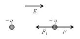
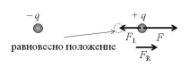
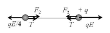
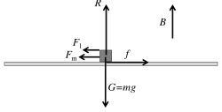
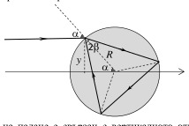

[[Състезания/2/10-12/2019|◂ 2019]] | [[Състезания/2/10-12/2020|условия]] | [[Състезания/2/12/2021| 2021 ▸]]

Общи указания
 1. Дадените решения са примерни. Всяко алтернативно решение се оценява, като се
 спазва максималният брой точки по всяко подусловие.
 2. Решенията използват материал от задължителната подготовка по физика и
 астрономия. Следва обаче да се признават и решения, които се основават на
 материал по физика и астрономия или математика извън задължителната учебна програма (вектори, принцип на суперпозиция, диференциране и интегриране, и
 т.н.).
 3. Числените отговори се приемат за верни, ако се различават с не-повече от 5% от
 дадените в примерното решение.
Задача 1. Свързани заряди
а) На фигурата са дадени силите, действащи на положително зареденото топче в
състояние на равновесие: $F_1$ на привличане към отрицателно зареденото топче и F, с която
му действа външното поле.

Силата F има същата посока като интензитета на външното поле. Следователно
интензитетът е успореден на правата, свързваща топчетата, и е с посока от отрицателното
към положителното топче.
Големините на силите са съответно:

$F_1 = \frac{kq^2}{l^2}$;

$F = qE$.

От условието за разновесие:

$\frac{kq^2}{l^2} = qE$

определяме:

$E = \frac{kq}{l^2}$. 

 Стр. 1 от 7
Алтернативно решение за ученици, които познават принципа на суперпозиция за
електричното поле:
 За да бъде в равновесие всяко от топчетата, то трябва да се намира в точка с нулев
сумарен интензитет на електричното поле. Например положително зареденото топче се
намира в полето на отрицателния заряд с интензитет:

$E_1 = \frac{kq}{l^2}$, 
и посока наляво - към отрицателния заряд. Следователно външното поле трябва да е
насочено надясно (от отрицателния към положителния заряд) и да има интензитет с
големина:

$E = E_1 = \frac{kq}{l^2}$. 

Нека положително зареденото топче бъде
изведено от състоянието си на равновесие,
например като бъде отдалечено от отрицателното
топче, както е показано на фигурата.

Тогава силата $F_1$ на привличане между топчетата намалява. Силата F обаче не се променя
защото външното поле е еднородно, т.е. F $> F_1$. Следователно равнодействащата сила FR е
насочена надясно и се стреми да отдалечи топчето от равновесното му положение.
Следователно топчетата са в неустойчиво равновесие.
Бележка. Еквивалентно решение би било да се разгледа отместване, при което топчетата
се доближават едно към друго, или ако се разглежда отместване на отрицателното топче.
 Критерии за първото Критерии за алтернативното
 Точки Точки
 решение решение
Изразява силата на привличане Записва израз за интензитета
 0,5 0,5
$F_1$ от закона на Кулон $E_1$ на полето на точков заряд.

Записва израз за силата F в Записва, че сумарният
 0,5 1,0
еднородно поле. интензитет на полето е нула.
Приравнява F и $F_1 0,5$
 Приравнява Е на Е1. 0,5
Получава израз за Е. 0,5
Определя посоката на Е. 0,5 Определя посоката на Е. 0,5
 Общо и за двете решения
Разбира, че силата на привличане се увеличава (намалява) при доближаване
 0,5
(отдалечаване) на топчетата.
Прави подходящ чертеж и стига до извод, че равнодействащата сила
 0,5
отдалечава топчетата от равновесното им положение.
Прави извод, че равновесието е неустойчиво. 0,5
 Общо по точка а) 4,0

 Стр. 2 от 7
б) На фигурата са дадени силите, действащи на двете топчета при тяхното движение.
 За всяка сила с
 правилно означена
 посока $\times 0,4$ т
 (общо 2,4 т.)
Силата на привличане между топчетата има големина:

$F_2 = \frac{kq(q/4)}{l^2} = \frac{kq^2}{4l^2}$. (0,6 т.)

От II принцип на механиката за положителното топче имаме:

$ma = qE - T - \frac{kq(q/4)}{l^2} = \frac{3kq^2}{4l^2} - T$, (1,0 т.)

а за отрицателното:

$ma = T + \frac{kq(q/4)}{l^2} - E(q/4) = T$. (1,0 т.)

След като решим системата от двете уравнения, получаваме:

$a = \frac{3kq^2}{8ml^2}$

и съответно:

$T = \frac{3kq^2}{8l^2}$. (1,0 т.)

Задача 2. Магнитно задвижване
а) По пръчката тече ток от релсата a към релсата b, т.е. от чертежа към вас. Когато
магнитната индукция е вертикална, на пръчката действа хоризонтална магнитна сила Fm в
посока, която се определя от правилото на дясната ръка. На фигурата по-долу е показана
посоката на силата, когато магнитната индукция е нагоре. Ако ученикът е изобразил
индукцията надолу, силата Fm трябва да бъде съответно в противоположна посока. За да
бъде минимална, външната сила $F_1$ трябва да има същата посока като Fm. Останалите сили
са силата на триене f, силата на тежестта G = mg и силата R на реакция на релсите.
 вертикална индукция
 R
 B
 $F_1$
 Fm f

 G=mg

 Стр. 3 от 7
 Когато магнитната индукция е хоризонтална, магнитната сила Fm е вертикална.
Най-малка сила за задвижване на пръчката е нужна, когато магнитната сила е нагоре,
защото в този случай натискът върху релсите намалява, а оттам намалява и максималната
сила на триене. В този случай магнитната индукция е хоризонтална - надясно. Силата $F_2$
може да бъде както надясно, така и наляво.
 хоризонтална индукция

 B
 R Fm
 $F_2$
 f

 G=mg

 Брой
 Критерии за оценка на чертежите
 точки
 1) Вертикална магнитна индукция
Посоката на Fm и на магнитната индукция В съответстват на правилото на
 0,5
дясната ръка.
$F_1$ и Fm са в една посока. 0,5
Силата f на триене е в противоположна посока спрямо $F_1$ и Fm. 0,2
Силата на тежестта mg е вертикално надолу. 0,1
Силата на реакция R е вертикално нагоре и е изобразена със същата
 0,2
големина като mg.
 2) Хоризонтална магнитна индукция
Fm е вертикално нагоре. 0,5
В е надясно. 0,5
$F_2$ е хоризонтална, без значение наляво или надясно. 0,1
Силата на тежестта mg е вертикално надолу. 0,1
Силата на реакция R е вертикално нагоре и е изобразена с големина, по-
 0,2
малка от mg.
Силата f на триене е в противоположна посока спрямо $F_2$ и има същата
 0,1
големина.
 Общо по подточка а) 3,0

б) По пръчката тече ток:
 U
 I= . (0,5 т.)
 R
Съпротивлението на пръчката е:

 Стр. 4 от 7
 $\rho$l
 R= . (0,5 т.)
 S
Независимо дали магнитната индукция е вертикална или хоризонтална, тя е
перпендикулярна на посоката, в която тече тока. Следователно големината на магнитната
сила и в двата случая е:
 USB
 Fm = IlB = . (0,5 т.)
 $\rho$
В случай, че магнитната индукция е вертикална, а магнитната сила - съответно
хоризонтална, от условието за равновесие на силите в хоризонтална посока получаваме:
 $F_1$ + Fm = f. (0,5 т.)
Във вертикална посока имаме:
 R = mg, (0,5 т.)
а от връзката между силата на триене и силата на натиск (реакция):
 f = kR = kmg. (0,5 т.)
Като използваме израза за магнитната сила, получаваме следното уравнение:
 USB
 $( 1) F_1$ = kmg - . (0,5 т.)
 $\rho$
В случай на хоризонтална магнитна индукция големината на магнитната сила е същата.
Условията за равновесие в хоризонтално и във вертикално направление обаче са различни:
 $F_2$ = f (0,5 т.)
и съответно:
 R + Fm = mg. (0,5 т.)
Така получаваме второ уравнение:
 USB
 $( 2) F_2$ = k (mg - ). (0,5 т.)
 $\rho$
От уравненията (1) и (2) получаваме следното квадратно уравнение за коефициента на
триене k:
 mgk 2 - (mg + $F_1$ )k $+ F_2$ = 0 Независимо дали аналитичен
или или числен вид:
 2 (0,5 т.)
 k - 1,28k + 0,64 = 0,
където сме взели предвид, че mg = 0,1 N и сме използвали дадените стойности на $F_1$ и $F_2$.
Квадратното уравнение има единствено решение:
 k = 0,8 (0,5 т.)
За магнитната индукция получаваме съответно израза:
 $\rho$($F_2$ - $F_1$ )
 B= (0,5 т.)
 (1 - k)US
и пресмятаме нейната големина:
 B $\approx$ $7,5\cdot 10^{-3}$ T (0,5 т.)

 Стр. 5 от 7
Задача 3. Светлинен многоъгълник
а) Ходът на лъчите е даден на фигурата. Ъгълът на падане е означен с $\alpha$, а ъгълът на
пречупване - с $\beta$.

 $\alpha$ A

 $\beta$ H
 O B

 Брой
 Критерии за оценка на чертежа
 точки
Върху чертежа е означен ъгълът на падане (може и с друга буква освен с $\alpha$). 0,5
Върху чертежа е означен ъгълът на пречупване (може и с друга буква освен
 0,5
с $\beta$).
От чертежа е ясно, че $\alpha$ = 90$^\circ$, т.е. падащият лъч е перпендикулярен на
 0,5
радиуса.
 Общо по чертежа 1,5

б) От закона на Снелиус имаме:
 sin $\alpha$
 n= (1,0 т.)
 sin $\beta$
Ъгълът на падане е:
 $\alpha$ = 90$^\circ$, (0,5 т.)
т.е.
 sin $\alpha$ = 1 (0,5 т.)
На чертежа с А и В са означени точките, в които лъчът съответно влиза в цилиндъра и
излиза от него, т.е. L = |AB|. Тъй като $\Delta$АВО е равнобедрен, перпендикулярът ОН към
отсечката АВ я разполвява, т.е. |AH| = |BH| = L/2. За правоъгълния триъгълник ОАН имаме:

 |OH| = $\sqrt$|OA|2 - |AH|2 = $\sqrt$R 2 - (L/2)2 . (0,5 т.)
и
 2
 |OH| $\sqrt$R - (L/2)
 2

 sin $\beta =\frac{ (0,5 т.)}{ |AO| R}= \approx$ 0,667

Така получаваме:
 1
 n$= \approx 1,5$. (0,5 т.)
 0,667

 Стр. 6 от 7
б) Ходът на лъчите е изобразен на чертежа:

 $\alpha$
 2$\beta$
 y R
 $\alpha$

Вижда се, че ъгълът $\alpha$ на падане е свързан с вертикалното отместване y на лъча чрез
равенството:
 y
 sin $\alpha$ = (1,0 т.)
 R

Ъгълът на падане от плексигласа към въздуха е $\beta$. Следователно ъгълът на отражение в
плексигласа също е $\beta$. Тъй като триъгълникът е равностранен, 2$\beta$ = 60$^\circ$, т.е. лъчите в
цилиндъра образуват равностранен триъгълник, когато ъгълът на пречупване е:
 $\beta$ = 30$^\circ$. (1,0 т.)
От закона на Снелиус следва:
 sin $\alpha$ = n sin $\beta$. (0,5 т.)
Следователно лъчите образуват равностранен триъгълник, когато:
 y = Rn sin 30$^\circ$ = 10 cm . 1,5 . 0,5 = 7,5 cm. (0,5 т.)
Квадрат би се наблюдавал при ъгъл на пречупване:
 $\beta$ = 45$^\circ$. (1,0 т.)
В този случай обаче:
 Rn sin 45$^\circ$ = 10 cm . 1,5 . 1/$\sqrt_2 \approx$ 10,6 cm > R, (0,5 т.)
което е невъзможно, защото y $\le$ R. Следователно при никакво отместване на падащия лъч
спрямо центъра, лъчите в цилиндъра не образуват квадрат. (0,5 т.)

 Стр. 7 от 7
