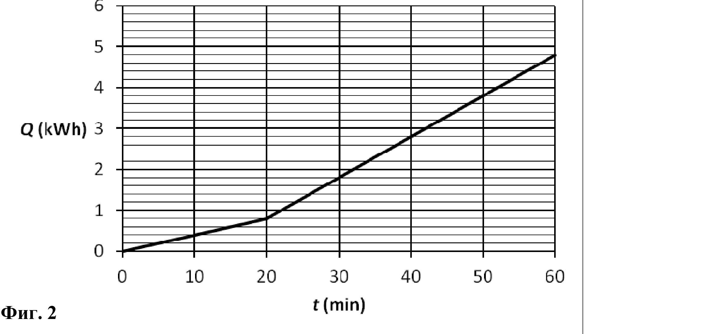
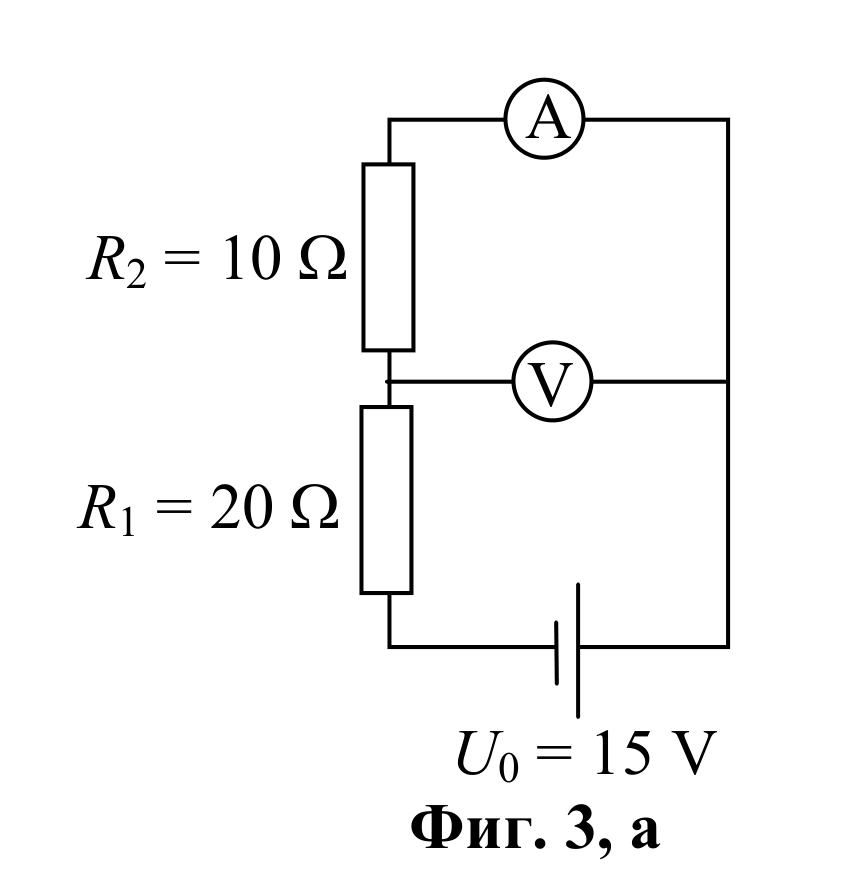
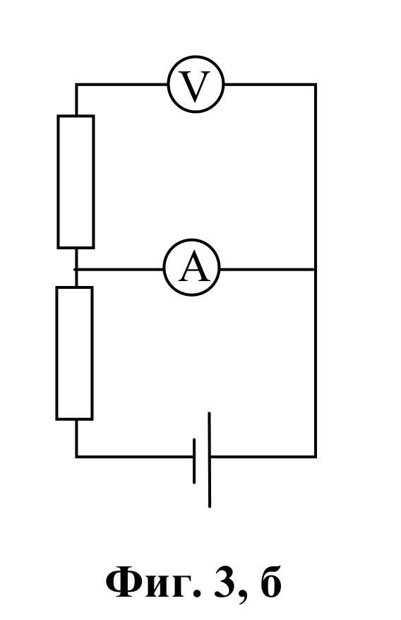
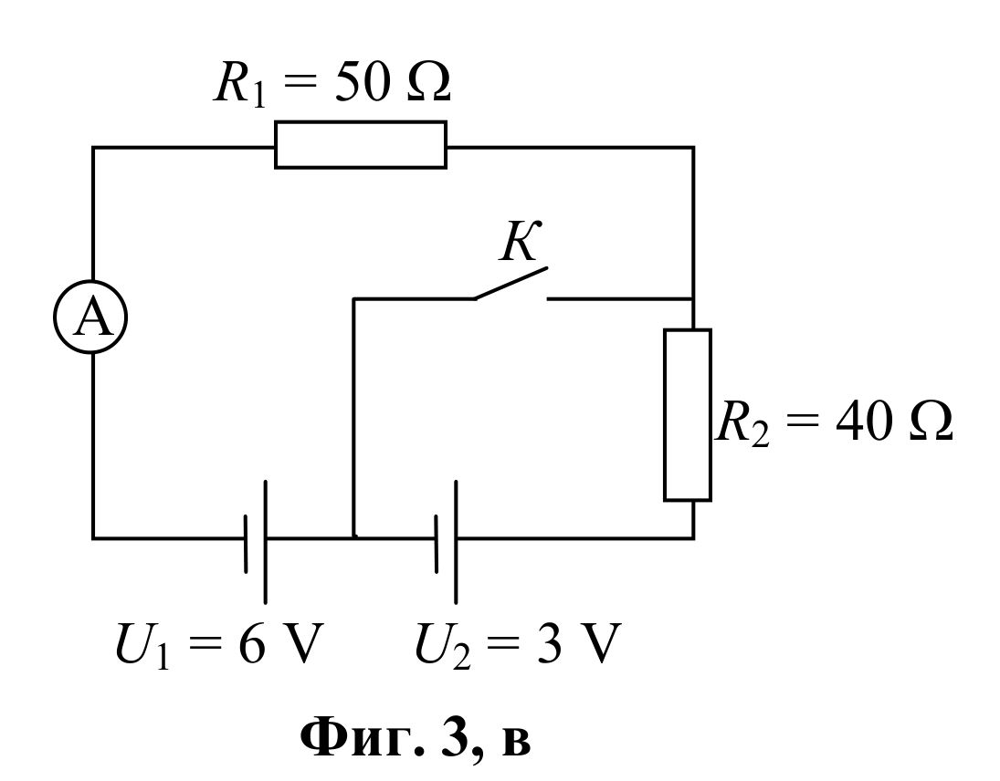

[[Състезания/2/7/2011|◂ 2011]] | [[Състезания/2/7r/2012|решения]] | [[Състезания/2/7/2013| 2013 ▸]]

Задача 1. Движение и сили - 10 точки
Двете подусловия на задачата са независими.

А) По улицата се движат в колона автомобили с еднакви скорости $v_1$ = 54 km/h през
еднакви разстояния $d_1$ = 12 m един от друг (Фиг. 1). На улицата има стеснен участък,
където автомобилите намаляват скоростта си на $v_2$ = 36 km/h. На какво разстояние $d_2$ един
от друг се движат автомобилите на стеснения участък?

Б) Дървено трупче има форма на паралелепипед с дължини на страните a = 2 cm, b = 5 cm
и c = 10 cm. Плътността на дървото е $\rho$ = 500 $\text{kg/m}^{3}$. Трупчето е поставено върху
хоризонтална повърхност.
 - Коя от страните на трупчето: a, b или c трябва да бъде вертикална така, че трупчето
 да оказва максимално налягане върху повърхността? Обосновете отговора си.
 - Колко е налягането p на трупчето върху повърхността в този случай?

Приемете, че земното ускорение е g = 10 N/kg.

Задача 2. Бойлер - 10 точки
В тази задача приемете, че напрежението в електрическата мрежа е U = 240 V.

 Ученик пуснал да се затопля водата в електрически бойлер с две степени на
мощността. През 10 минути засичал по електромера на дома консумираната от бойлера
електрична енергия. В началото бойлерът работил на по-ниската мощност, след което
ученикът го превключил на по-високата мощност. На графиката от Фиг. 2 е дадена
зависимостта на консумираната електрична енергия Q от времето t, изминало след
включването на бойлера.

А) Колко време след включването на бойлера ученикът го е превключил на по-висока
мощност?

Б) Колко вата е мощността $P_1$ на бойлера на по-ниската степен и мощността $P_2$ на по-
високата степен.

В) На по-ниската степен водата се загрява само от един нагревател, включен към
електрическата мрежа. Колко е неговото съпротивление $R_1$?

Г) На по-високата степен, успоредно към първия нагревател, е включен втори нагревател.

Колко е съпротивлението $R_2$ на втория нагревател?

Задача 3. Амперметри и волтметри - 10 точки

А) Два резистора, една батерия, един амперметър и един волтметър са свързани по начина,
показан на Фиг. 3, а. Съпротивленията на резисторите и напрежението на източника са
дадени на фигурата. Какво напрежение U и какъв ток I отчитат съответно волтметърът и
амперметърът?

Б) В същата електрическа верига са разменени местата на волтметъра и на амперметъра,
както е показано на Фиг. 3, б. Какво напрежение и какъв ток ще отчитат двата уреда в този
случай?

В) Два резистора и две батерии са свързани по начина, показан на Фиг. 3, в.

Съпротивленията на резисторите и напреженията на батериите са дадени на фигурата.

Пресметнете тока Iотв, който отчита амперметърът, когато ключът К е отворен и тока Iзатв,
когато ключът е затворен?
