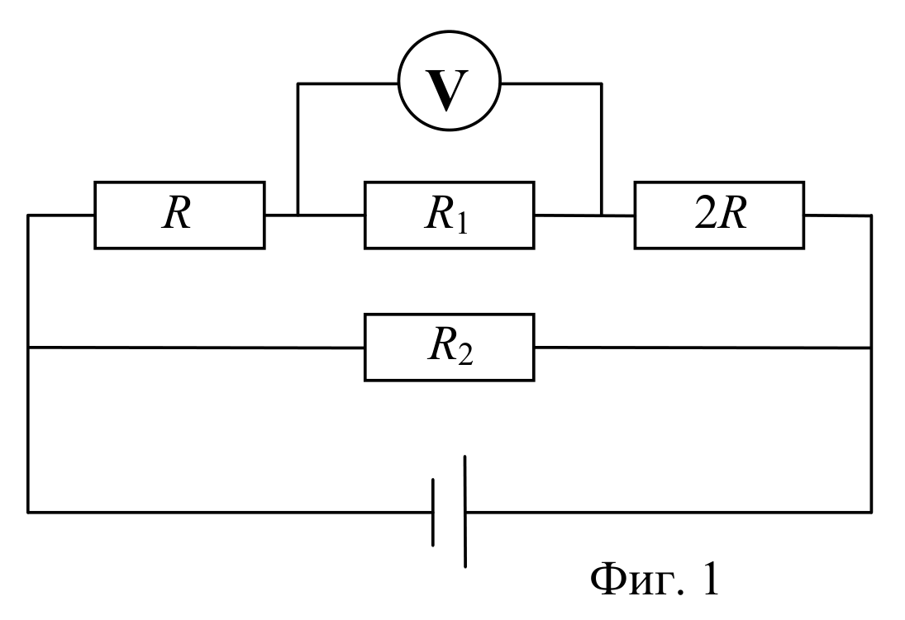
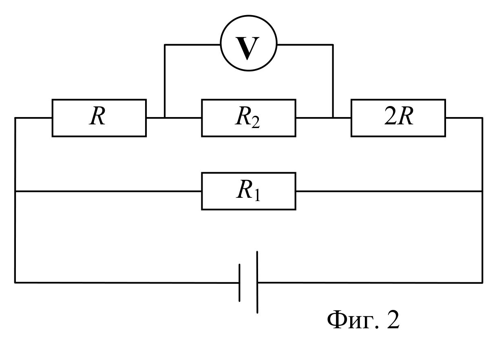
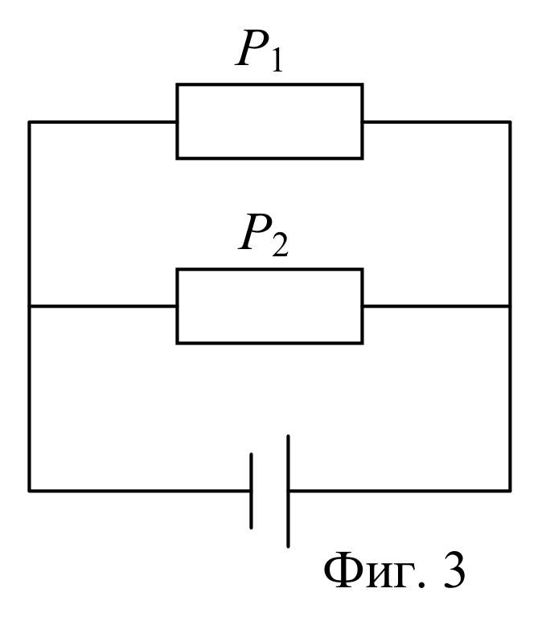
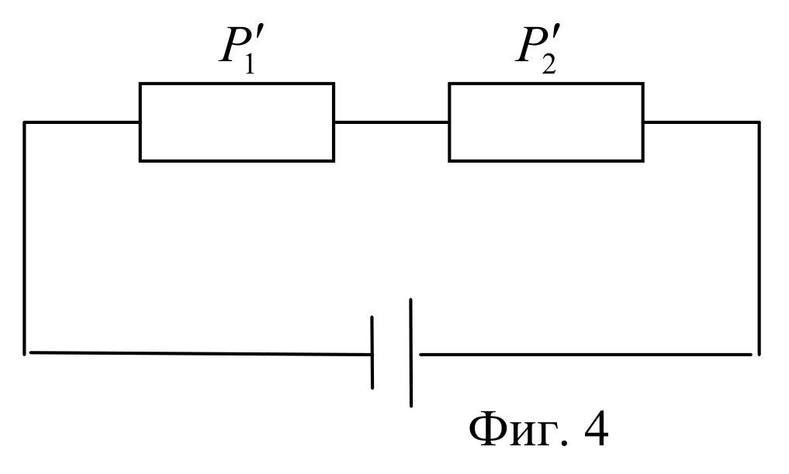
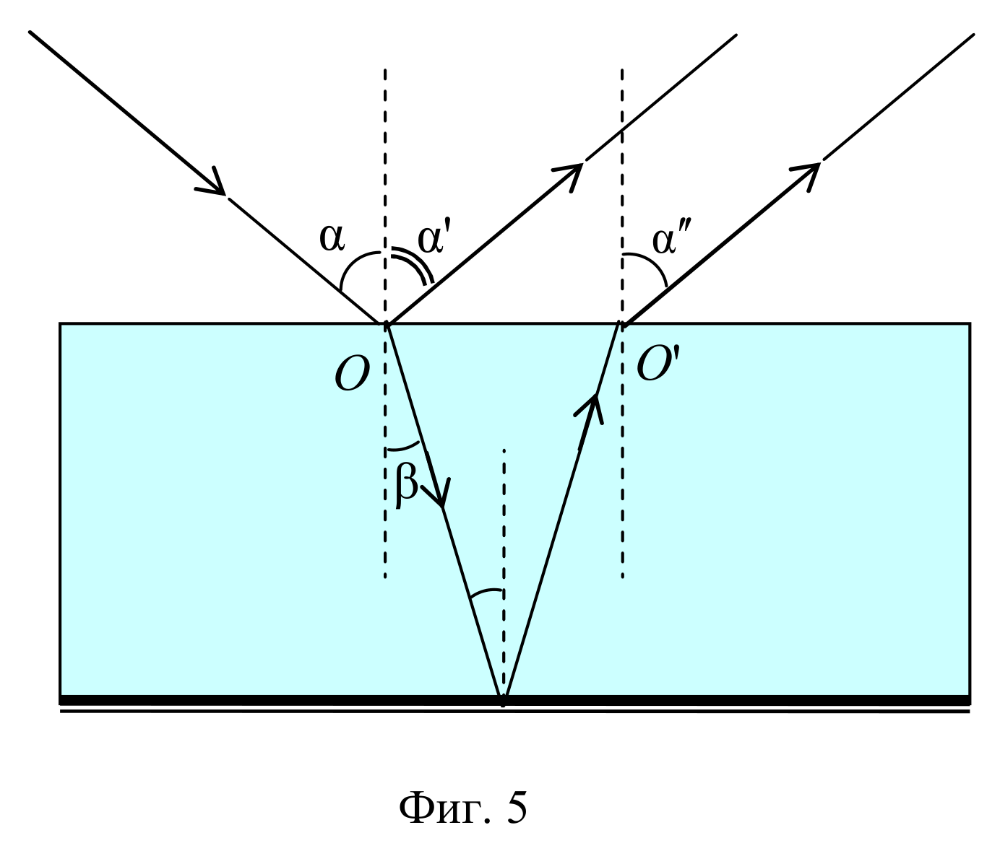

[[Състезания/2/7/2010|◂ 2010]] | [[Състезания/2/7/2011|условия]] | [[Състезания/2/7/2012| 2012 ▸]]

ЗАДАЧА 1. – 10 точки

а)

[1 т.] [1 т.]

б) На фиг. 1 напрежението между краищата на трите последователно свързани съпротивления е $U$. [0,5 т.]
При последователно свързване напрежението на всеки консуматор е пропорционално на неговото съпротивление, тъй като през тях тече еднакъв ток. [0,5 т.] Тогава имаме

$$U_1 = \frac{U}{2} = \frac{R_1}{3R + R_1}\,U,$$

[2 т.] откъдето намираме

$$R_1 = 3R.$$

[1 т.]

в) На фиг. 2 напрежението между краищата на трите последователно свързани съпротивления е $U$. [0,5 т.]
При последователно свързване напрежението на всеки консуматор е пропорционално на неговото съпротивление. [0,5 т.] Тогава имаме

$$U_2 = \frac{U}{4} = \frac{R_2}{3R + R_2}\,U,$$

[2 т.] откъдето намираме

$$R_2 = R.$$

[1 т.]

ЗАДАЧА 2. – 10 точки

а)

[1 т.] [1 т.]

б) Съпротивленията на двата консуматора са съответно

$$R_1 = \frac{U^2}{P_1},\quad [0,5\ \text{т.}] \qquad R_2 = \frac{U^2}{P_2}.$$

[0,5 т.] При последователно свързване (фиг. 4) токът във веригата е

$$I = \frac{U}{R_1 + R_2}.$$

[1 т.] Мощността на консуматора 1 се дава с израза

$$P_1' = I^2 R_1 = \frac{U^2 R_1}{(R_1 + R_2)^2}.$$

[1 т.] Аналогично за мощността на консуматора 2 имаме

$$P_2' = \frac{U^2 R_2}{(R_1 + R_2)^2}.$$

[1 т.] Като заместим $R_1$ и $R_2$ с техните равни за мощността намираме

$$P_1' = \frac{P_2^2}{(P_1 + P_2)^2}\,P_1,$$

[1 т.]

$$P_2' = \frac{P_1^2}{(P_1 + P_2)^2}\,P_2.$$

[1 т.]

в) Като заместим мощностите с техните стойности получаваме

$$P_1' = 0{,}36\,P_1 = 18\ \text{W}, \qquad [1\ \text{т.}]$$

$$P_2' = 0{,}16\,P_2 = 12\ \text{W}.$$

[1 т.]

ЗАДАЧА 3. – 10 точки

а)

[4 т.]

б) Ъгълът на падане върху посребрената стена е равен на ъгъла на пречупване, т.е. е равен на $\beta$ (кръстни ъгли). [1 т.]

в) По закона за отражение $\alpha' = \alpha$, [0,5 т.] а от обратимостта на разпространение на светлината $\alpha'' = \alpha$. [0,5 т.]

г) При увеличаване на ъгъла на падане се увеличава ъгълът на пречупване. [1 т.]
Следователно разстоянието $OO'$ се увеличава. [1 т.]

д) Когато се разпространява с по-малка скорост, ъгълът на пречупване намалява при един и същ ъгъл на падане. [1 т.]
Следователно разстоянието $OO'$ ще намалява. [1 т.]
