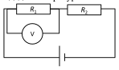
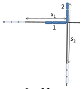
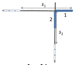

[[Състезания/2/7/2015|◂ 2015]] | [[Състезания/2/7/2016|условия]] | [[Състезания/2/7/2017| 2017 ▸]]

Общи указания
 - Общият брой точки за всяка задача е 10.
 - За всяко вярно и обосновано решение, което се различава от примерните решения,
 се дава пълният брой точки за съответното подусловие.
 - Най-малката стъпка при оценяването е 0,25 точки.

Задача 1. А) Правилната схема е дадена на фигурата.

Б) Токът през първия резистор е:

$I = \frac{U_1}{R_1} = 0{,}02\ A$

При последователно свързване през втория резистор тече същия ток, както през първия
резистор. Напрежението върху втория резистор е:

$U_2 = U-U_1 = 6\ V$
От закона на Ом намираме съпротивлението на втория резистор:

$R_2 = \frac{U_2}{I} = 300\ \Omega$

В) Резисторите са свързани успоредно. Следователно еквивалентното им съпротивление е:

$R = \frac{R_1 R_2}{R_1+R_2} = 100\ \Omega$

От закона на Ом намираме напрежението на източника:

$U = IR = 12\ V$
Амперметърът $A_1$ измерва тока през резистора 1. При успоредно свързване напреженията
и на двата резистора са равни на напрежението на източника. Следователно токът през
резистора 1 е:

$I_1 = \frac{U}{R_1} = 0{,}08\ A$ (или 80 mA)

Г) След отварянето на ключа напрежението върху резистора 1 не се променя.

Следователно амперметърът А1 продължава да отчита същия ток:

$I_1 = 0{,}08\ A$ (или 80 mA)

Понеже при отворен ключ през резистора 2 не тече ток, амперметърът А отчита същия
ток, какъвто отчита амперетърът А1:

$I = I_1 = 0{,}08\ A$ (или 80 mA)

Схема на оценяване на задача 1

| Част | Елемент за оценяване | Макс. точки |
|---|---|---|
| А) (2,0 т.) | Използва правилен схемен знак за източник | 0,50 |
| | Използва правилен схемен знак за волтметър | 0,50 |
| | Чертае правилна схема на последователно свързване на резисторите | 0,50 |
| | Чертае волтметъра, свързан успоредно на резистора 1 | 0,50 |
| Б) (2,5 т.) | Пресмята тока през резистора 1 | 0,50 |
| | Обосновава с последователно свързване, че през втория резистор тече същия ток | 0,50 |
| | Пресмята напрежението върху резистора 2 по правилото за събиране на напрежения при последователно свързване | 1,00 |
| | Пресмята по закона на Ом съпротивлението на резистора 2 (числена стойност и единица) | 0,50 |
| В) (3,5 т.) | Посочва, че резисторите са свързани успоредно | 0,50 |
| | Пресмята еквивалентното съпротивление на веригата | 1,00 |
| | По закона на Ом определя напрежението на източника (числена стойност и единица) | 0,50 |
| | Посочва, че амперметърът $A_1$ измерва тока през резистора 1 | 0,50 |
| | Посочва, че при успоредно свързване напреженията върху двата резистора са равни | 0,50 |
| | Пресмята по закона на Ом тока $I_1$ (числена стойност и единица) | 0,50 |
| | Посочва, че при отваряне на ключа напрежението върху резистора 1 не се променя | 0,50 |
| Г) (2,0 т.) | Стига до извода, че $I_1 = 80\ mA$ (0,08 A) | 0,50 |
| | Обосновава, че двата амперметъра отчитат еднакви токове | 0,50 |
| | Стига до извода, че $I = 80\ mA$ (0,08 A) | 0,50 |
| **Общо:** | | **10,00** |

Задача 2.

А) Едната възможност е влакът 2 да се движи с толкова малка скорост, че когато достигне
кръстовището, влакът 1 вече да е преминал. Най-голямата скорост, при която е възможно
това, съответства на ситуацията, показана на фиг. 2.1. Тогава, пътят, изминат от влака 1 е:

$s_1 = D + L$
а от влака 2:

$s_2 = D$.

До този момент влаковете са се движили eднакво време. Следователно:

Фиг. 2.1

$\frac{D+L}{v_1} = \frac{D}{v_2}$

Оттук намираме:

$v_2 = \frac{v_1 D}{D + L} = 16\ km/h$

Другата възможност е влакът 2 да се движи с толкова голяма скорост, че да премине кръстовището, преди влакът 1 да го е достигнал. Най-малката скорост, при която е възможно това, съответства на ситуацията, показана на фиг. 2.2.

Фиг. 2.2

Тогава, пътят, изминат от влака 1 е:

$s_1 = D$
а от влака 2:

$s_2 = D + L$.

До този момент влаковете са се движили eднакво време. Следователно:

$\frac{D}{v_1} = \frac{D+L}{v_2}$

Оттук намираме:

$v_2 = \frac{v_1 (D+L)}{D} = 25\ km/h$

Следователно влаковете ще се разминат, ако вторият влак се движи със скорост по-малка
от 16 km/h или по-голяма от 25 km/h ($v_2 \le 16$ km/h или $v_2 \ge 25$ km/h).

Б) Верният отговор е 2: топчето 2 пристига първо.

Аргументация. Топчетата намаляват скоростта си, когато се издигат по наклонения праг.

Топчето 1 намалява скоростта си по-рано и изминава по-голямата част от пътя с по-малка
скорост. Алтернативно - топчето 2 намалява скоростта си по-късно и изминава по-
голямата част от пътя с по-голяма скорост. Следователно топчето 2 пристига по-рано от
топчето 1.

Схема на оценяване на задача 2
 Макс.

| Част | Елемент за оценяване | Макс. точки |
|---|---|---|
| А) | Словестно или с чертеж описва първата възможна ситуация | 0,50 |
| | Определя числено или с формула пътищата $s_1$ и $s_2$, изминати от влаковете в първия случай | 1,00 |
| | Записва условие за равенство на времената | 1,00 |
| | Пресмята скоростта $v_2$ в първия случай - число и единица. Аналитичен израз не е нужен | 0,50 |
| | Словестно или с чертеж описва втората възможна ситуация | 0,50 |
| | Определя числено или с формула пътищата $s_1$ и $s_2$, изминати от влаковете в втория случай | 1,00 |
| | Записва условие за равенство на времената | 1,00 |
| | Пресмята скоростта $v_2$ във втория случай - число и единица. Аналитичен израз не е нужен | 0,50 |
| | Записва окончателно - словестно или с неравенство, че $v_2 \le 16\ km/h$ или $v_2 \ge 25\ km/h$. Пълен брой точки се дава и ако неравенствата са записани строго (без знак за равенство) | 1,00 |
| Б) | Посочва отговора 2 | 1,00 |
| | Посочва, че скоростта на топчетата намалява, когато се изкачват по прага | 1,00 |
| | Посочва, че топчето 2 изминава по-голямата част от пътя с по-голяма скорост (или топчето 1 изминава по-голямата част от пътя с по-малка скорост) и прави извод, че топчето 2 пристига първо | 1,00 |
| **Общо** | | **10,00** |

Задача 3.

А) В точка B трябва да бъде окачена теглилка с тегло, равно на силата $F$. Следователно: $mg = F$, откъдето намираме масата на теглилката:

$m = \frac{F}{g} = \frac{20\ N}{10\ N/kg} = 2\ kg$

Б) Трупчето е окачено на по-малко разстояние от опорната точка, отколкото теглилката.

Следователно, щом лостът е в равновесие, теглото на трупчето е по-голямо от теглото на
теглилката. Единственият отговор, който съответства на това условие, е: $m_1$ = 4 kg.

В) За да сравним плътността на трупчето с тази на водата, те трябва да бъдат изразени с
еднакви единици. За целта ще изразим размерите на трупчето в метри:
a = 0,08 m; b = 0,1 m; c = 0,2 m
и пресмятаме обема му в кубически метри:

$V = 0{,}08\cdot 0{,}1\cdot 0{,}2 = 0{,}0016\ m^3$

Следователно плътността на трупчето е:

$\rho = \frac{m_1}{V} = \frac{4\ kg}{0{,}0016\ m^3} = 2500\ kg/m^3$
Плътността на трупчето е по-голяма от плътността на водата. Следователно трупчето ще
потъва във вода.

Г) Когато трупчето е потопено във вода, върху него действа изтласкваща сила, поради
която теглото му намалява. Верният отговор е: 3) Лостът ще се наклони към теглилката.

Схема на оценяване на задача 3

| Точка | Елемент за оценяване | Макс. точки |
|---|---|---|
| А) | Записва условието $mg = F$ | 1,00 |
| | Пресмята масата на теглилката - число и мерна единица | 0,50 |
| Б) | Посочва верния отговор $m_1 = 4\ kg$ | 1,00 |
| | Посочва, че трупчето е окачено по-близо до опорната точка, отколкото теглилката | 1,00 |
| | Обосновава отговора с условието за равновесие на лост (късо рамо - голяма сила, дълго рамо - малка сила) | 1,00 |
| В) | Изразява обема на трупчето в $m^3$ | 1,00 |
| | Записва формула за плътността $\rho = m_1/V$ | 0,50 |
| | Пресмята плътността - число и мерна единица | 0,50 |
| | Посочва, че $\rho > \rho_0$ и прави извод, че трупчето потъва | 0,50 |
| В) (алтернативно решение) | Пресмята обема на трупчето в $cm^3$ | 0,25 |
| | Изразява масата на трупчето в грамове: $m_1 = 4000\ g$ | 0,25 |
| | Записва формула за плътността $\rho = m_1/V$ | 0,50 |
| | Пресмята плътността в $g/cm^3$: $\rho = 2{,}5\ g/cm^3$ - число и мерна единица | 0,50 |
| | Изразява плътността на водата в $g/cm^3$: $\rho_0 = 1\ g/cm^3$ | 0,50 |
| | Посочва, че $\rho > \rho_0$ и прави извод, че трупчето потъва | 0,50 |
| Г) | Посочва верния отговор 3 - лостът се наклонява към теглилката | 1,00 |
| | Посочва, че на трупчето действа изтласкваща сила | 1,00 |
| | Прави извод, че теглото на трупчето намалява | 1,00 |
| **Общо** | | **10,00** |