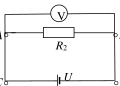
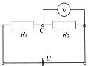
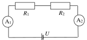

[[Състезания/2/7/2017|◂ 2017]] | [[Състезания/2/7/2018|условия]] | [[Състезания/2/7/2019| 2019 ▸]]

Задача 1. a) На фиг. 1 е показана схемата на електрическата верига.\[1,5 т.\]

(Фиг. 1: верига с източник U, резистори $R_1$, $R_2$ и волтметър V)

 б) Според закона на Ом токът $I_1$ през съпротивлението $R_1$ е

$I_1 = \frac{U_1}{R_1}$, \[1 т.\]

където напрежението $U_1$ между краищата на резистора със съпротивление $R_1$ е

$U_1 = U - U_0$. \[1 т.\]

След заместване получаваме формулата

$I_1 = \frac{U - U_0}{R_1}$. \[1 т.\]

 в) Тъй като резисторите са свързани последователно, токът през $R_2$ е равен на $I_1$
\[0,5 т.\], а напрежението между краищата му е $U_0$ \[0,5 т.\]. Тогава имаме

$R_2 = \frac{U_0}{I_1} = \frac{U_0 R_1}{U - U_0}$. \[1 т.\]

 г) След заместване с числените стойности на зададените величини получаваме

$I_1 = 0{,}04\text{ A}$, \[0,5 т.\] $R_2 = 200\ \Omega$. \[0,5 т.\]

д) На фиг. 2 е показана схемата на затворената електрическа верига, източникът е свързан към точките A и B, а волтметърът – към точките С и D.

(Фиг. 2: източник U между A и B, резистор $R_2$ и волтметър V между C и D) \[1,5 т.\]

е) Волтметърът отчита напрежение

$U' = \frac{U}{2} = 12\text{ V}$. \[1 т.\]

Задача 2. а) Когато ключът K е в положение AC, общото съпротивление в затворената верига е $R_1 + R$ \[0,5 т.\] и от закона на Ом имаме

$U_1 = I_0(R_1 + R)$. \[0,5 т.\]

Аналогично, когато ключът K е в положение BC, общото съпротивление в затворената верига е $R_2 + R$ \[0,5 т.\] и от закона на Ом имаме

$U_2 = I_0(R_2 + R)$. \[0,5 т.\]

R може да получим като:

Разделим почленно двете равенства, при което можем да запишем

$\frac{U_1}{U_2} = \frac{R_1 + R}{R_2 + R}$, \[0,5 т.\]

откъдето следва

$R = \frac{U_2 R_1 - U_1 R_2}{U_1 - U_2} = 80\ \Omega$. \[1,5 т.\]

Друг възможен начин за получаване на R е като изразим $I_0$ от първото равенство и го
заместим във второто.

 б) За намирането на тока $I_0$ използваме веригата при положение на ключа AC.

Тогава имаме

$I_0 = \frac{U_1}{R_1 + R} \approx 0,067\text{ A}$. \[1 т.\]

Същият резултат се получава, ако използваме веригата при положение на ключа BC .

в) На фиг. 3 е показана схемата на електрическата верига при положение на ключа АВ.

(Фиг. 3: резистори $R_1$, $R_2$, амперметри $A_1$, $A_2$ и източник U) \[1 т.\]

 г) Когато ключът K е в положение АВ, общото съпротивление в затворената
верига е $R_1 + R_2$ \[0,5 т.\] и в нея има два източника на напрежение, свързани последователно \[0,5 т.\]. Те могат да бъдат заменени с един източник с напрежение

$U = U_1 + U_2 = 20\text{ V}$. \[1 т.\]

Тогава от закона на Ом за тока във веригата I имаме

$I = \frac{U_1 + U_2}{R_1 + R_2} \approx 0,14\text{ A}$. \[1,5 т.\]

Амперметрите 1 и 2 са свързани последователно и отчитат един и същ ток

$I \approx 0{,}14\text{ A}$. \[0,5 т.\]

Задача 3. а) Тъй като чашата е пълна с течност до ръба, потопяването на едно топче
води до преливане на течност с обем $V_0$ , колкото е обемът на топчето \[1 т.\]. Тогава
имаме

| Маса на течността в чашата | Маса на топчетата в чашата | Маса на нееднородната смес в чашата | Точки |
|---|---|---|---|
| При 1 топче: $\rho_0(V - V_0)$ | $\rho V_0$ | $\rho_1 V$ | \[1,5 т.\] |
| При 2 топчета: $\rho_0(V - 2V_0)$ | $2\rho V_0$ | $\rho_2 V$ | \[1,5 т.\] |

В сила са следните равенства:

$\rho_0 (V - V_0) + \rho V_0 = \rho_1 V$, \[0,5 т.\]

и $\rho_0(V - 2V_0) + 2\rho V_0 = \rho_2 V$. \[0,5 т.\]

Ако умножим по 2 първото равенство и от него почленно извадим второто, след
съкращаване на $V$, намираме

$\rho_0 = 2\rho_1 - \rho_2$, \[2 т.\] $\rho_0 = 1135\text{ kg/m}^3$. \[0,5 т.\]

До същия резултат се достига ако изразим от първото равенство $\rho V_0$ и го заместим във

второто равенство.

б) След заместване в първото равенство с $\rho_0 = 2\rho_1 - \rho_2$ намираме

$\frac{V_0}{V} = \frac{\rho_2 - \rho_1}{\rho_2 + \rho - 2\rho_1}$, \[1,5 т.\] $\frac{V_0}{V} = \frac{1}{21} \approx 0,048$. \[1 т.\]
