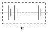
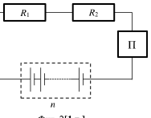
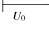

[[Състезания/2/7/2018|◂ 2018]] | [[Състезания/2/7/2019|условия]] | [[Състезания/2/7/2020| 2020 ▸]]

Задача 1. а) Схемата на електрическата верига е показана на фиг. 1. За правилно начертани последователно свързани консуматори \[1 т.\], за правилно свързани амперметър и волтметър \[1 т.\], за правилно включен източник \[0,5 т.\].

б) При последователно свързване на консуматорите токът през всеки един от тях съвпада с тока във веригата \[0,5 т.\]. Тогава съпротивлението на втория консуматор е
$$R_2 = \frac{U_2}{I_0} = \frac{5\text{ V}}{0,1\text{ A}} = 50\text{ }\Omega.$$ [2 т.]

Напрежението между краищата на първия консуматор е
$$U_1 = U_0 - U_2.$$ [1 т.]

Тогава за съпротивлението на първия консуматор намираме
$$R_1 = \frac{U_1}{I_0} = \frac{U_0 - U_2}{I_0} = \frac{7\text{ V}}{0,1\text{ A}} = 70\text{ }\Omega.$$ [1 т.]

в) За съпротивлението $R$ на консуматора намираме
$$R = \frac{U_0}{I_0} = \frac{12\text{ V}}{0,1\text{ A}} = 120\text{ }\Omega.$$ [1,5 т.]

г) При замяна на източника за тока $I$ във веригата имаме
$$I = \frac{U}{R} = \frac{9\text{ V}}{120\text{ }\Omega} = 0,075\text{ A} = 75\text{ mA}.$$ [1,5 т.]

Задача 2. а) За всяка фигура по :

 Фиг. 2\[1 т.\] Фиг. 3 \[1 т.\]

б) Напрежението на последователно свързаните източници е

 U = nU 0 . \[1 т.\]

А) При последователно свързване на консуматорите (фиг. 2) през тях и през автоматичния превключвател тече един и същ ток I , като

 U $= U_1$ + U 2 , \[1 т.\] $U_1$ = I$R_1$ , U 2 = I$R_2$ . \[1 т.\]

След заместване намираме
$$I = \frac{n U_0}{R_1 + R_2} = n \cdot 0,3 \text{ A}.$$ [1 т.]

От условието $I \le 5 \text{ A}$ следва $n \le \frac{5}{0,3} \approx 16,7$. Тъй като $n$ е цяло число, имаме $n = 16$. [1 т.]

Б) При успоредно свързване (фиг. 3) токовете през консуматорите са съответно

$$I_1 = \frac{n U_0}{R_1}, \quad I_2 = \frac{n U_0}{R_2}.$$ [1 т.]

Токът във веригата, т. е. токът, който тече през автоматичния превключвател, е

$$I = I_1 + I_2 = n U_0 \left( \frac{1}{R_1} + \frac{1}{R_2} \right) = n \frac{7,5}{6} \text{ A}.$$ [1 т.]

От условието $I \le 5 \text{ A}$ следва $n \le \frac{30}{7,5} = 4$. Така максималният брой последователно свързани източници, при който превключвателят няма да прекъсне веригата, е n = 4 .\[1 т.\]

Задача 3. а) Ако допуснем, че едната течност с плътност $\rho_2$ е изцяло потопена в течността с плътност $\rho_1$ > $\rho_2$ , на нея ще действа изтласкваща сила, която е по-голяма от силата на тежестта. \[0,5 т.\] Тя ще започне да изплава, докато изцяло се разположи над течността с плътност $\rho_1$ . \[0,5 т.\] Така се образуват два слоя, разположени един над друг, като слоят отдолу има по-голяма плътност от слоя над него. \[0,5 т.\]

б) Да означим с $V_0$ обема на всяка течност, налята в първата чаша, а с $m_0$ - масата на всяка течност, налята във втората чаша. Тогава общата маса на течностите в първата чаша е ($\rho_1$ + $\rho_2$ )$V_0$ \[1 т.\], а общата маса на течностите във втората чаша е $2 m_0$ \[0,5 т.\]. Тези маси са равни, тъй като течностите оказват еднакъв натиск върху дъното на чашите, т. е. в сила е равенството

 ($\rho_1$ + $\rho_2$ )$V_0$ $= 2 m_0$ . \[1 т.\]

Тогава общият обем на всяка от течностите, налята в двете чаши, е съответно

$$V_1 = V_0 + \frac{m_0}{\rho_1}, \quad V_2 = V_0 + \frac{m_0}{\rho_2}.$$ $[2 \text{ т.}]$

Като изразим $m_0$ от първото равенство и заместим, намираме

$$V_1 = V_0 \frac{3\rho_1 + \rho_2}{2\rho_1}, \quad V_2 = V_0 \frac{\rho_1 + 3\rho_2}{2\rho_2}.$$ $[2 \text{ т.}]$

Окончателно имаме

$$\frac{V_1}{V_2} = \frac{\rho_2(3\rho_1 + \rho_2)}{\rho_1(\rho_1 + 3\rho_2)}.$$ $[1 \text{ т.}]$

в) Заместваме стойностите на плътностите (не е необходимо преобразуване на единиците, тъй като за отношението на обемите няма измерителна единица) и получаваме

$$\frac{V_1}{V_2} = \frac{0,8 \frac{\text{g}}{\text{cm}^3} \times 3,8 \frac{\text{g}}{\text{cm}^3}}{1 \frac{\text{g}}{\text{cm}^3} \times 3,4 \frac{\text{g}}{\text{cm}^3}} = \frac{3,04}{3,4} \approx 0,9.$$ $[1 \text{ т.}]$

Забележка. Численият резултат трябва да бъде записан с една значеща цифра, тъй като с такава точност са зададени плътностите.