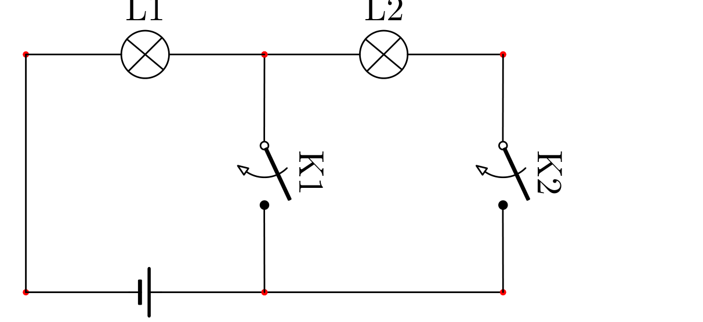
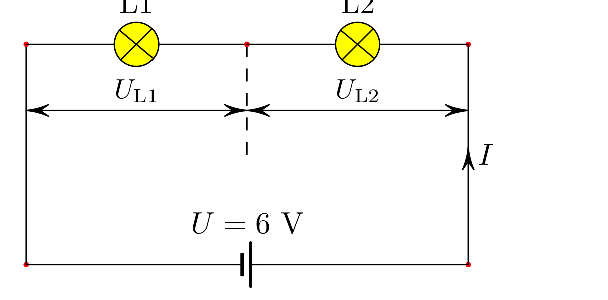

[[Състезания/2/7/2020|◂ 2020]] | [[Състезания/2/7/2021|условия]] | [[Състезания/2/7/2022| 2022 ▸]]

Решение: **1.1.** При означенията показани на фигурата, когато ключ $K_1$ е затворен (включен) ще свети само крушка $L_1$. Когато ключът $K_2$ е затворен (включен) ще светят и двете крушки.

Възможни са и други вериги, например $L_2$ и $K_2$ може да са с разменени позиции. **(4,5 т.)**

**1.2.** Двете крушки са свързани последователно, тогава през тях тече един и същ ток I, а сумата от напреженията им е равна на напрежението на батерията $U_{L1} + U_{L2} = U$. **(0,5 т.)** Крушките са еднакви, което значи че и съпротивленията им са еднакви, тогава $U_{L1} = U_{L2} = U/2 = 3$ V. **(0,5 т.)**

От графиката се вижда, че при такова напрежение през крушките протича ток $I = 0{,}6$ A. **(0,5 т.)** Така определяме съпротивлението на крушките $R = U_{L1}/I = U_{L2}/I = 5\ \Omega$. **(0,5 т.) (1 т.)**

Когато изгори едната крушка напрежението върху другата става равно на това на батерията. **(0,5 т.)** От графиката определяме тока $I_1 = 0{,}8$ A през нея (при напрежение 6 V). Съпротивлението на крушката този път ще е $R = U/I_1 = 7{,}5\ \Omega$. **(0,5 т.)**

Ако двете крушки са свързани успоредно и едната изгори, то тя ще закъси другата и през нея няма да тече ток. **(1 т.)**

Решение: **2.1.** Скоростта на влака може да определим от удължението на стълбовете, които се виждат на втората снимка. Да означим това удължение с $\Delta d_p = 10\% d_p = 0{,}15$ mm. **(0,5 т.)** Обектите на снимката са умалени $1/n$ пъти, където $n = d_p/d = 1{,}5/200 = 0{,}0075$. **(1 т.)** Така преместването на влака спрямо стълба за времето на заснемане на снимката ще е $x_в = n\Delta d_p = 0{,}02$ m, **(0,5 т.)** откъдето може да определим скоростта $v_в = x_в/t = 0{,}02/(1/500)$ m/s = 10 m/s = 36 km/h. **(1 т.)**

Решение: **2.2.** От снимката знаем, че удължението на локомотива е $\Delta l_p$, тогава реалното преместване на локомотива за времето на заснемане на снимката спрямо влака ще е $n\Delta l_p = 0{,}4$ m **(0,5 т.)** откъдето може да определим $v_{отн} = n\Delta l_p/t = 0{,}4/(1/500)$ m/s = 20 m/s = 72 km/h. **(1 т.)** Това е скоростта на локомотива спрямо влака. Тъй като не знаем посоката на движение на локомотива спрямо влака имаме два варианта. Влакът и локомотивът се движат в една и съща посока, тогава скоростта на локомотива е $v_л = 20$ m/s + 10 m/s = 30 m/s = 108 km/h. **(1 т.)**

Влакът и локомотивът се движат в противоположни посоки, тогава скоростта на локомотива е $v_л = 20$ m/s − 10 m/s = 10 m/s = 36 km/h. **(1 т.)**

Решение: **2.3.** Реалният размер на локомотива е $l = nl_p = 16$ m. **(0,5 т.)** Разминаването на влака и локомотива започва когато „предниците“ им се намират на едно място и продължава докато „задниците“ им ще се разминат. **(1 т.)** Това отговаря на изминаване на разстояние $l + l_в$ **(0,5 т.)** със скорост $v_{отн}$, **(0,5 т.)** т.е. времето за разминаване ще е $t = 96$ m/(20 m/s) = 4,8 s. **(1 т.)**

Решение: **3.1.** За да пресметнем скоростта на дрезината във всеки интервал може да определим какво разстояние изминава тя за даденото време. Ако вземем точка от графиката тя ще ни показва стойността на съпротивлението R в момента t. R ще бъде съпротивлението на релсите от омметъра (гарата) до текущото положение на дрезината. Дължината на релсите ще бъде $l = R/k$, **(0,5 т.)** но тъй като има две релси то разстоянието между гарата и дрезината ще бъде два пъти по-малко или $s = l/2 = R/(2k)$. **(0,5 т.)** За даден интервал от време $\Delta t_i = t_{i+1} - t_i$ изминатия път ще е $\Delta s_i = s_{i+1} - s_i = (R_{i+1} - R_i)/(2k) = \Delta R_i/(2k)$, **(1 т.)** където $i \in [1, 7]$ е поредния номер на всеки един от интервалите. Така скоростта в интервал i може да се изрази като $v_i = \Delta s_i/\Delta t_i$. **(0,5 т.)** Да напишем всичко това в една таблица:

| интервал i | 1 | 2 | 3 | 4 | 5 | 6 | 7 |
|---|---|---|---|---|---|---|---|
| $(t_{i+1} - t_i)$ (min) | 30 − 10 | 40 − 30 | 50 − 40 | 60 − 50 | 80 − 60 | 110 − 80 | 130 − 110 |
| $\Delta t_i$ (min) | 20 | 10 | 10 | 10 | 20 | 30 | 20 |
| $10(R_{i+1} - R_i)$ ($\Omega$) | 1 − 1 | 2 − 1 | 4 − 2 | 5 − 4 | 5 − 5 | 5 − 3 | 3 − 3 |
| $\Delta R_i$ ($\Omega$) | 0,0 | 0,1 | 0,2 | 0,1 | 0,0 | 0,2 | 0,0 |
| $\Delta s_i$ (km) | 0 | 1 | 2 | 1 | 0 | 2 | 0 |
| $\Delta t_i$ (h) | 1/3 | 1/6 | 1/6 | 1/6 | 1/3 | 1/2 | 1/3 |
| $v_i$ (km/h) | 0 | 6 | 12 | 6 | 0 | 4 | 0 |

**(3,5 т.)**

Решение: **3.2.** Изминатото разстояние може да получим като съберем всички стойности $\Delta s_i$, $\Delta s = 6$ km. **(1 т.)** Разстоянието от началното положение е $\Delta s - s_6 = 4$ km, защото в интервала $i = 6$ съпротивлението намалява с времето, което ще рече ще дрезината се движи към гарата. **(1 т.)**

Решение: **3.3.** Средната скорост може да получим като разделим изминатия път $\Delta s$ на времето за което е изминат този път $\Delta t = 2$ h, **(1 т.)** в случая $v_{ср} = 6$ km/2 h = 3 km/h. **(1 т.)**
