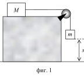

[[Състезания/2/8/2012|◂ 2012]] | [[Състезания/2/8r/2013|решения]] | [[Състезания/2/8/2014| 2014 ▸]]

Задача 1. Равноускорително движение - 10 точки
 Тяло се движи равноускорително. За време $t_1$ = 4 s от началото на наблюдението
на движението, то изминава разстояние $s_1$ = 36 m, а в момента $t_2$ = 6 s неговата скорост
е $v_2$ = 15 m/s.

а) Намерете ускорението a на движение на тялото.

б) Какво разстояние $s_2$ е изминало тялото за време $t_2$?

Задача 2. Коефициент на триене - 10 точки

На фиг. 1 е показана установка за измерване на коефициента на триене k между тяло с
маса M = 3 kg и хоризонтална равнина. При спускането на тялото с маса m = 1 kg то
изминава разстояние s = 1,5 m за време t = 4 s. Нишката, която свързва телата, е
неразтеглива и тя действа на всяко едно от телата (m и M) с постоянна по големина сила
T. Земното ускорение е $g \approx 9,8 \left(\text{m/s}\right)^{2}$ .

а) Напишете уравненията за всяко от телата, които
 следват от втория принцип на механиката.

б) С каква по големина сила на опън F тялото с
 маса m действа на нишката?

в) При измерването на k имате възможност да
 m използвате два вида съединителни нишки.
 Първата се къса при сила на опън $F_1$ = 8 N, а
 s втората - при сила на опън $F_2$ = 12 N. Могат ли да
 се използват и двете нишки в описания
 фиг. 1 експеримент? Обосновете отговора си.
 г) Намерете коефициента на триене k между
 тялото с маса M и хоризонталната равнина.

Задача 3. Отскачащо топче - 10 точки

Топче пада свободно от определена височина вертикално върху хоризонтална метална
плоча и след удар в нея отскача на височина, която е $\eta$ = 0,8 част от първоначалната.
Движението продължава, като височината на топчето след всеки удар намалява.

а) Каква част $\alpha$ от енергията си топчето губи след всеки удар?

б) Изразете височината на издигане на топчето след всеки удар чрез началната
височина h. След колко на брой удара n на топчето в плочата височината му на
издигане ще е по-малка от половината на началната височина h? За да обосновете
отговора си попълнете таблицата.

 $h_1 h_2 h_3 \dots \dots \dots h$n

в) Изразете скоростта на отскачане на топчето след всеки удар чрез скоростта v преди
първия удар. След колко на брой удара k на топчето в плочата скоростта му на
отскачане ще е по-малка от половината на скоростта му v преди първия удар? За да
обосновете отговора си попълнете таблицата.

 $v_1 v_2 v_3 \dots \dots \dots v$k

Начертайте таблиците във Вашата писмена работа и ги попълнете!
