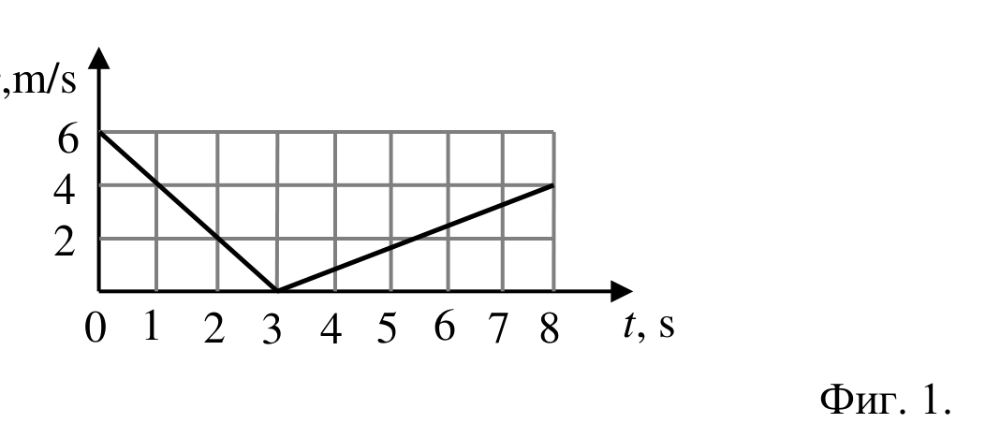
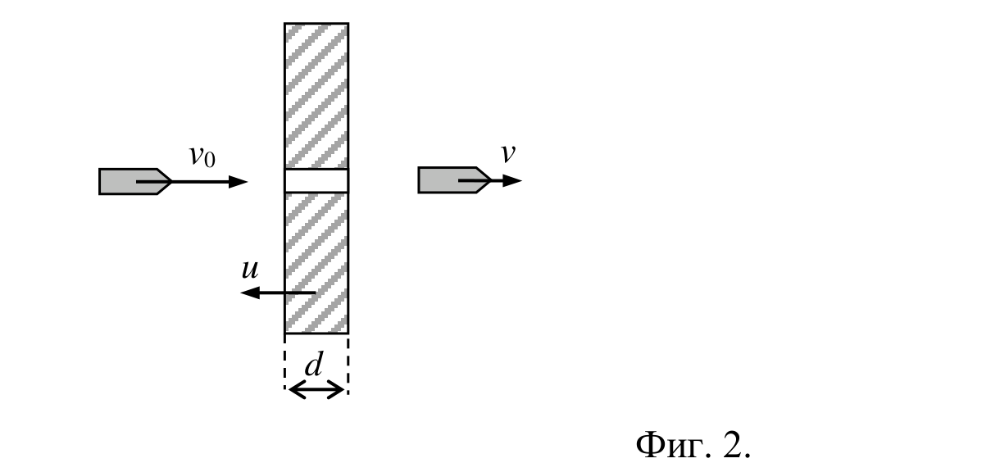
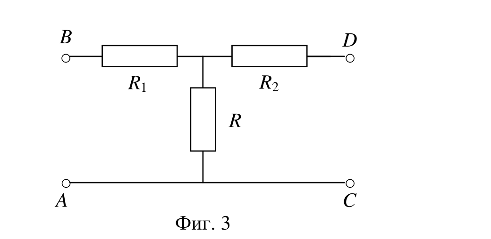

[[Състезания/2/8/2016|◂ 2016]] | [[Състезания/2/8r/2017|решения]] | [[Състезания/2/8/2018| 2018 ▸]]

Общо указание. При решаването на всички задачи търсените физични величини да се
изразят чрез величините, зададени в условието на задачата, и да се определят
стойностите им след заместване с указаните конкретни стойности.

Задача 1. Кинематика

ЧАСТ А. Влак изминава разстоянието между две гари със средна скорост v = 12 m/s .

През първата и последната трета от пътя влакът се движи с една и съща скорост $v_1$ , а

през останалата част - със скорост $v_2$ , която е n = 1,5 пъти по-голяма. Намерете

скоростите $v_1$ и $v_2$ на влака.

ЧАСТ Б. Аеростат (балон) се издига вертикално нагоре с постоянна скорост
v 0 = 7 m/s . Когато достига височина H = 200 m над земната повърхност от него се
отделя малък тежък предмет.

а) Намерете времето t , за което предметът ще падне на земната повърхност.

б) С каква скорост v предметът ще падне на Земята?

Съпротивлението на въздуха се пренебрегва. Земното ускорение е $g \approx 9,8 \left(\text{m/s}\right)^{2}$ .

Задача 2. Динамика

ЧАСТ А. Графиката на големината на скоростта на хокейна шайба с маса m = 180 g
при движението ѝ по наклонена равнина е показана на фиг. 1. Първоначално тя се
движи нагоре по наклонената равнина, а след това се спуска надолу.

Фиг. 1.

Коефициентът на триене при движение на шайбата по наклонената равнина е k = 0,2 .

Определете:

а) ускорението $a_1$ на шайбата при движението ѝ нагоре и ускорението $a_2$ при
движението ѝ надолу по наклонената равнина.

б) движещата сила F и реакцията на опората R , действащи на шайбата върху
наклонената равнина.

ЧАСТ Б. Куршум с маса m лети хоризонтално със скорост $v_0$ . Той пробива

вертикална дъска с дебелина d , неподвижно монтирана върху платформа, движеща се
срещу куршума със скорост u . С каква скорост v ще излети куршумът от дъската, ако
силата на съпротивление F на движението му в нея е постояна (фиг. 2)?

Фиг. 2.

Задача 3. Електрическа верига

На фиг. 3 е показана схема на електрическа верига, в която съпротивлението R е
неизвестно, а другите резистори имат съпротивления съответно $R_1$ = 4 $\Omega$ и $R_2 = 16 \Omega$ .

Фиг. 3.

Когато между полюсите A и B се свърже източник с неизвестно напрежение U 0 , а

между C и D - волтметър, волтметърът отчита напрежение $U_1$ = 9 V . Ако сменим

местата им, т.е. между полюсите C и D се свърже източникът с напрежение U 0 , а

между A и B - волтметърът , той отчита напрежение U 2 = 6 V .

а) Определете съпротивлението R .

б) Намерете напрежението U 0 на източника.

в) При какво съпротивление R мощността на тока в съпротивленията $R_1$ и $R_2$ е
една и съща?

 Всяка задача се оценява с максимален брой 10 точки.