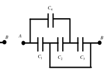

[[Състезания/2/9/2014|◂ 2014]] | [[Състезания/2/9r/2015|решения]] | [[Състезания/2/9/2016| 2016 ▸]]

Задача 1. Електрическа схема

Източник на постоянно напрежение U = 12 V, шест еднакви крушки със съпротивления
R = 10 $\Omega$ и два ключа са свързани в схема, както е показано на фигура 1. Приемете, че
съпротивлението на крушките R не зависи от температурата. Намерете общата отделена
мощност P в схемата за следните положения на двата ключа:

(Фиг. 1 а, 1 б, 1 в и 1 г: верига с източник 12 V, шест крушки R и два ключа; на фиг. 1 г е включен кондензатор C)

а) при положение на ключовете от фиг. 1а \[2.5 т\];

б) при положение на ключовете от фиг. 1б \[2.5 т\];

в) при положение на ключовете от фиг. 1в \[2.5 т\];

г) Намерете заряда и напрежението, до което ще се зареди кондензаторът от фиг. 1г, когато
се установи постоянен ток във веригата \[2.5 т\]. Кондензаторът е с капацитет C = 1 $\mu$F.

Задача 2. Цилиндър с течност

В цилиндър с радиус R е налята вода с плътност $\rho_В$ до височина $H_0$.

а) В цилиндъра се поставя еднородно кълбо с маса m и плътност $\rho_К$, което плава във водата
(частично е потопено в нея). Намерете височината H, до която ще се покачи нивото на водата. \[3 т\]

б) Нека с $V_В$ означим обема на онази част от кълбото, която е потопена във водата, а с $V_К$ обема на кълбото. Намерете съотношението $V_В/V_К$. \[2 т\]

в) В цилиндъра наливаме олио с обем, равен на този на водата, и с плътност $\rho_О$. Олиото напълно покрива кълбото и сега част от обема на кълбото е потопена във водата, а останалата част е потопена в олиото. Намерете съотношението $V_В/V_К$. \[3 т\]

г) Към кълбото от предишната точка се прикрепя тежест с обем многократно по-малък от обема на
кълбото и с маса 3m . Системата от двете тела плава в течностите. Определете големината на силата
на Архимед, която действа на системата. \[2 т\]

Задача 3. Кондензатори

Намерете капацитета на еквивалентния кондензатор между точки А и В във веригите, показани на:

(Фиг. 2 а, 2 б и 2 в: кондензаторни вериги с $C_1$, $C_2$, $C_3$ и $C_4$ между точките A и B)

а) фиг. 2а \[3 т\]; б) фиг. 2б \[3 т\]; в) фиг. 2в \[4 т\].
