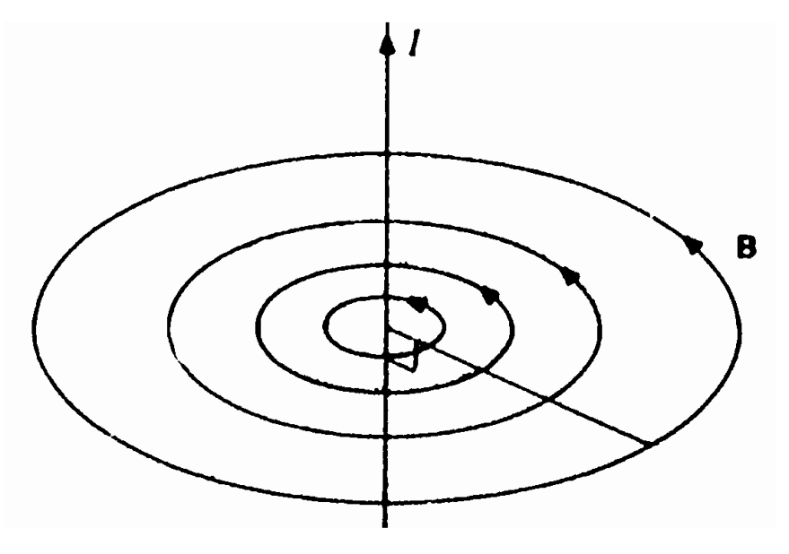

[[Състезания/2/9/2010|◂ 2010]] | [[Състезания/2/9/2011|условия]] | [[Състезания/2/9/2012| 2012 ▸]]

ЗАДАЧА 1.

а) Големината на силата определяме от закона на Кулон $F = k\frac{Q_1 Q_2}{d^2}$ \[1 т.\]
или $F = (9\cdot 10^{9} \times 2\cdot 10^{-6} \times 4\cdot 10^{-6})/(1\cdot 10^{-2})^2 = 720\ N$ \[1 т.\]

Силата е на привличане, тъй като зарядите за разноименни. \[1 т.\]

б) Тъй като електрическият заряд се запазва, a допиращите се топчета са еднакви, то
след всеки контакт между две топчета общият заряд ще се разделя по равно между тях.
\[1 т.\]

Случай 1 - третото топче се допира първо до първото, след това до второто.

След първото допиране $Q_1' = (0+Q_1)/2 = Q_1/2 = 1\ \mu C$ върху всяко топче. \[1 т.\]

След второто допиране $Q_2' = (Q_1/2+Q_2)/2 = Q_1/4+Q_2/2 = -1{,}5\ \mu C$ върху всяко топче.
\[1 т.\]

Използваме законът на Кулон, но за зарядите $Q_1'$ и $Q_2'$:

F = 135 N и силата е отново на привличане. \[1 т.\]

Случай 2 - третото топче се допира първо до второто, след това до първото.

След първото допиране $Q_2' = (0+Q_2)/2 = Q_2/2 = -2\ \mu C$ върху всяко топче. \[1 т.\]

След второто допиране $Q_1' = (Q_2/2+Q_1)/2 = Q_2/4+Q_1/2 = 0\ C$ върху всяко топче. \[1 т.\]

От законът на Кулон следва, че топчетата едно и две няма да си взаимодействат
електрически, т.е. F = 0 N. \[1 т.\]

ЗАДАЧА 2.

a) Ефективната стойност на тока определяме от I = P/U = 110/220 = 0,5 A, \[1 т.\] а
амплитудата му от $I_0 = I\sqrt{2} = 0,5 \times 1{,}41 \approx 0,7\ A$. \[1 т.\]

б) Съпротивлението на всеки един от проводниците определяме от $R = \frac{\rho l}{S}$ \[1 т.\]
или $R = (2{,}75\cdot 10^{-8} \times 8\cdot 10^{3})/(4\cdot 10^{-6}) = 55\ \Omega$ \[1 т.\]

За да определим тока през веригата, приравняваме ефективното напрежение на мрежата
на ефективните падове на напрежението върху проводниците и консуматора
U = 2R.I + P/I \[1 т.\]

Откъдето получаваме за ефективната стойност на тока $2R \cdot I^2 - U \cdot I + P = 0$ \[1 т.\]
или като заместим числените стойности $110 \cdot I^2 - 220 \cdot I + 110 = 0$, \[0,5 т.\]
което се свежда до $(I-1)^2 = 0$ \[0,5 т.\] или токът през веригата $I = 1\ A$. \[1 т.\]

Ефективната стойност на напрежението върху телевизора ще бъде Ueff = P/I = 110 V
\[1 т.\], т.е. телевизорът ще може да работи. \[1 т.\]

ЗАДАЧА 3.

а) Индукционните линии на магнитната индукция са концентрични окръжности с
център върху правия проводник \[0,5 т.\], като посоката им е обратно на часовниковата
стрелка, ако гледаме срещу посоката на тока (и съответно обратно) \[0,5 т.\]

б) Големината на магнитната индукция е пропорционална на големината на тока и
обратно пропорционална на разстоянието от проводника \[1 т.\]
$B = \frac{\mu_0 I}{2\pi r}$ \[0,5 т.\] където $\mu_0$ е магнитната константа \[0,5 т.\]

в) Нека токовете текат в една и съща посока. Тогава по правата, свързваща двата
проводника, векторите на магнитната индукция, които създават двата тока, ще са
насочени един срещу друг.\[1 т.\] Те ще съвпаднат по големина, когато
$\frac{I_1}{r_1} = \frac{I_2}{r_2}$, като $r_1 + r_2 = a$ е разстоянието между двата проводника, \[0,5 т.\]

Откъдето получаваме $r_1 = \frac{I_1}{I_1+I_2}a$ \[0,5 т.\], или търсената точка се намира на
разстояние $r_1 = 2{,}5\ cm$ от проводника по който тече ток с големина 10 А по посока на
втория проводник. \[0,5 т.\] и на разстояние $r_2$ = 7,5 cm от втория проводник. \[0,5 т.\]

Нека сега токовете текат в противоположни посоки. Тогава по правата, свързваща двата
проводника, векторите на магнитната индукция, които създават двата тока, ще са
насочени в една и съща посока.\[1 т.\]

Те ще са насочени в противоположни посоки по продължението на тази права, но от
другата страна на проводниците.\[1 т.\]

Тъй като $I_2$ $> I_1$, то равенство по големина е възможно при $r_2$ $> r_1$. \[0,5 т.\]

Нека означим $r_1 = x$, тогава $r_2 = x + a$ и $\frac{I_1}{x} = \frac{I_2}{x+a}$ \[0,5 т.\]
откъдето получаваме $x = \frac{I_1}{I_2-I_1}a$ или $r_1 = x = 5\ cm$ \[0,5 т.\], а $r_2 = x + a = 15\ cm$ \[0,5 т.\].
