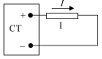
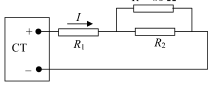

[[Състезания/2/9/2012|◂ 2012]] | [[Състезания/2/9/2013|условия]] | [[Състезания/2/9/2014| 2014 ▸]]

Общи указания
 - Численият отговор се приема за верен, ако стойността му е $pm$ 5 % от дадената в
 решението и е посочена вярната му размерност.
 - Числените отговори в междинните резултати са дадени за удобство и не са
 задължителни.
 - В крайния отговор търсените величини трябва да бъдат изразени чрез данни от
 условието или чрез други величини, определени на по-ранен етап от решението.

Задача 1. Ускорител на протони
а) Интензитетът на електричното поле във вътрешността на какво да е метално тяло е
нула. Следователно:
 EA = 0 . \[1,0 т\]
Ако липсва обосновка, се отнемат 0,5 т.
Интензитетът вън от сферата е равен на интензитета, създаден от точков заряд Q,
разположен в центъра й:
 k$Q 9\cdot 10^{9} N \cdot m_2 / C 2 \cdot 2\cdot 10^{-4} C$
 EB = 2 = 2
 $= 1,8\cdot 10^{6} N / C$ \[1,5 т\]
 R (1 m )
За липсващ или грешен числен отговор от резултата се отнемат 0,5 т.
б) Понеже интензитетът на полето вътре в сферата е равен на нула, на протоните не
действа електрична сила. Следователно те се движат равномерно и праволинейно, докато
достигнат отвора, т.е.
 $v_1$ $= v_0$ = 1000 m/s . \[1,0 т\]
Ако липсва обосновка, се отнемат 0,5 т.
в) На протон, излязъл от отвора, действа сила:
 F = eEB . \[1,0 т\]
От II принцип на Нютон следва, че:
$a = \frac{F}{m} = \frac{e E_B}{m} = \frac{1,8 \cdot 10^6 \text{ N/C} \cdot 1,6 \cdot 10^{-19} \text{ C}}{1,7 \cdot 10^{-27} \text{ kg}} \approx 1,7 \cdot 10^{14} \text{ m/s}^2$ \[1,5 т\]

За липсващ или грешен числен отговор от резултата се отменат 0,5 m.
г) Потенциалът на повърхността на сферата е:
$\phi_1 = \frac{kQ}{R} = \frac{9 \cdot 10^9 \text{ N}\cdot\text{m}^2 / \text{C}^2 \cdot 2 \cdot 10^{-4} \text{ C}}{1 \text{ m}} = 1,8 \cdot 10^6 \text{ V}$ , \[1,0 т\]

а в точката $M$:
$\phi_2 = \frac{kQ}{d} = \frac{9 \cdot 10^9 \text{ N}\cdot\text{m}^2 / \text{C}^2 \cdot 2 \cdot 10^{-4} \text{ C}}{10 \text{ m}} = 1,8 \cdot 10^5 \text{ V}$ \[1,0 т\]

За всеки липсващ или грешен числен отговор от резултата се отнемат по 0,5 т.
д) От закона за запазване на енергията следва:
$$\frac{mv_1^2}{2} + e\varphi_1 = \frac{mv_2^2}{2} + e\varphi_2,$$ \[1,0 т\]

откъдето:
$$v_2 = \sqrt{v_1^2 + \frac{2e(\varphi_1 - \varphi_2)}{m}} \approx 1,7 \cdot 10^7 \text{ m/s} .$$ \[1,0 т\]

За липсващ или грешен числен отговор от резултата се отнемат 0,5 т.

**Задача 2. Късо съединение**
а) Съпротивлението на жичката е:
$$R = \frac{\rho l}{S} = \frac{1,7 \cdot 10^{-8} \Omega \cdot \text{m} \cdot 0,1 \text{ m}}{1 \cdot 10^{-7} \text{ m}^2} = 1,7 \cdot 10^{-2} \Omega.$$ \[1,0 т\]

От закона на Ом за цялата верига следва, че:
$$I = \frac{\mathcal{E}}{R+r} = \frac{9 \text{ V}}{0,117 \Omega} \approx 77 \text{ A} .$$ \[1,0 т\]

За липсващ или грешен числен отговор от резултата се отнемат 0,5 т.

б) От закона на Джаул-Ленц следва, че за време $t$ в жичката се отделя количество топлина
$$Q = I^2Rt$$ \[1,0 т\]

Понеже цялото количество топлина води до загряване на жичката от началната температура $T_1$ до температурата на топене $T_2$, получаваме:
$$I^2Rt = mc(T_2 - T_1),$$ \[1,0 т\]

където
$$m = \rho_M V = \rho_M Sl$$ \[1,0 т\]

е масата на жичката. Следователно:
$$t = \frac{\rho_M Slc(T_2 - T_1)}{I^2 R} \approx 0,38 \text{ s}$$ \[1,5 т\]

За липсващ или грешен числен отговор от резултата се отнемат 0,5 т.

в) За същото време в батерията ще се отдели топлина:
$$Q_1 = I^2rt = \frac{\rho_M Slc(T_2 - T_1)r}{R} = \frac{\rho_M S^2 c(T_2 - T_1)r}{\rho}$$ \[1,0 т\]

От друга страна:
$$Q_1 = Mc\Delta T ,$$ \[1,0 т\]

където $\Delta T$ е изменението на температурата на батерията. Така окончателно намираме:
$$\Delta T = (T_2 - T_1) \frac{\rho_M S^2 r}{\rho M} \approx 11 \text{ °C} .$$ \[1,5 т\]
За липсващ или грешен числен отговор от резултата се отнемат 0,5 т.

Задача 3. Стабилизиран токоизправител
а) В положение А на плъзгача, веригата е еквивалентна на следната:
 I
 \[1,0 т\] Точките се присъждат и тогава, когато вместо чертеж
 + е дадена ясна словесна обосновка.
 СТ 1

 -
 2
От закона на Ом намираме: U A = I$R_1$ $= 0,04 A \cdot 150 \Omega$ = 6 V . \[1,0 т\]
За липсващ или грешен числен резултат се отнемат 0,5 т.
 В положение В на плъзгача, веригата е
 R = 60 $\Omega$ еквивалентна на следната:

 I
 + \[1,0 т\] Точките се присъждат и тогава, когато
 СТ $R_1 R_2$ вместо чертеж е дадена ясна словесна
 обосновка.
 -

Еквивалентното й съпротивление е:
$R_{екв} = R_1 + \frac{RR_2}{R + R_2} = 150 \ \Omega + \frac{120 \ \Omega \cdot 60 \ \Omega}{120 \ \Omega + 60 \ \Omega} = 190 \ \Omega$. \[1,0 т\]

Напрежението на токоизправителя се получава от закона на Ом:
$U_B = I_{екв} \cdot 190 \ \Omega = 0,04 \ \text{A} \cdot 190 \ \Omega = 7,6 \text{ V}$ \[1,0 т\]
*За липсващ или грешен числен отговор от резултата се отнемат 0,5 т.*

**б)** Понеже резисторът и кондензаторът са свързани последователно, напрежението на токоизправителя е:
$U = IR + U_C$ , \[1,0 т\]
където $U_C$ е напрежението на кондензатора. Веднага след затваряне на ключа кондензаторът е незареден, т.е. $U_C = 0$. Следователно:
$U_0 = IR = 0,002 \ \text{A} \cdot 5000 \ \Omega = 10 \text{ V}$ . \[1,0 т\]
*За липсващ или грешен числен отговор от резултата се отнемат 0,5 т.*

**в)** Когато напрежението на токоизправителя достигне $U_{\text{max}}$, напрежението върху кондензатора е:
$U_C = U_{\text{max}} - IR = U_{\text{max}} - U_0 = 5 \text{ V}$ . \[1,0 т\]
Зарядът на кондензатора в този момент е: $q = CU_C = 0,2 \text{ F} \cdot 5 \text{ V} = 1\text{C}$ . \[1,0 т\]
От връзката $I = q/t$ намираме
$t = \frac{q}{I} = \frac{1 \text{ C}}{0,002 \text{ A}} = 500 \text{ s}$ . \[1,0 т\]

За липсващ или грешен числен отговор от резултата се отнемат 0,5 т.