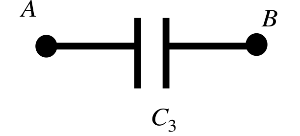
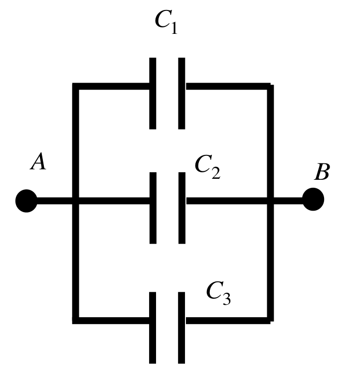
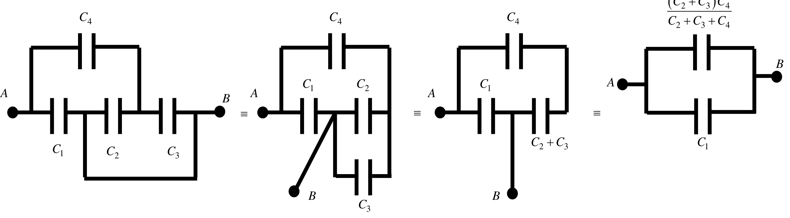

[[Състезания/2/9/2014|◂ 2014]] | [[Състезания/2/9/2015|условия]] | [[Състезания/2/9/2016| 2016 ▸]]

Задача 1. Електрическа схема

а) Еквивалентното съпротивление на веригата е $2R = 20\ \Omega$ \[1,5 т\]. От закона на Джаул-Ленц за мощността на веригата имаме $P = \frac{U^2}{2 R} = 7{,}2$ W \[1 т\].

б) Еквивалентното съпротивление на веригата е $3R = 30\ \Omega$ \[1,5 т\]. От закона на Джаул-Ленц за мощността на веригата имаме $P = \frac{U^2}{3 R} = 4{,}8$ W \[1 т\].

в) Еквивалентното съпротивление на веригата е $2{,}5R = 25\ \Omega$ \[1,5 т\]. От закона на Джаул-Ленц за мощността на веригата имаме $P = \frac{U^2}{2{,}5 R} = 5{,}76$ W \[1 т\].

г) Тъй като кондензаторът и крушката са свързани успоредно, напрежението, приложено върху кондензатора, е равно на напрежението, приложено върху крушката. Следователно за напрежението $U_0$, до което ще се зареди кондензаторът, имаме $U_0 = RI$ \[0,5 т\], където I е токът през крушката, след като се установи постоянен ток във веригата. Имаме $I = \frac{U}{2{,}5 R}$, следователно $U_0 = \frac{2 U}{5} = 4{,}8$ V \[1 т\]. За заряда имаме $q = C U_0 = \frac{2CU}{5} = 4{,}8\ \mu$C \[1 т\].

Задача 2. Цилиндър с течност

а) Понеже кълбото плува, имаме равновесие между Архимедовата сила и силата на тежестта $mg = \rho_{В} V_{В} g$ \[1 т\]. Така намираме обема на изместената вода $V_{В} = \frac{m}{\rho_{В}}$ \[1 т\]. Височината H ще намерим от уравнението

$V_{В} = \pi R^2 (H - H_0) = \frac{m}{\rho_{В}} \;\Rightarrow\; H = H_0 + \frac{m}{\pi R^2 \rho_{В}}$ \[1 т\].

б) Обемът на изместената вода има маса, равна на тази на кълбото m, т.е. $V_{В} = \frac{m}{\rho_{В}}$, а обемът на цялото кълбо е $V_{К} = \frac{m}{\rho_{К}}$ \[1 т\]. Така получаваме $\frac{V_{В}}{V_{К}} = \frac{\rho_{К}}{\rho_{В}}$ \[1 т\].

в) Част от тежестта на кълбото се поема от водата, а останалата част се поема от олиото. Подемната сила е сума от силите на Архимед от страна на водата $F_{A_1}$ и на олиото $F_{A_2}$. Така получаваме

$F_{A_1} + F_{A_2} = G = mg$ \[1 т\]. Имаме $F_{A_1} = V_{В}\rho_{В} g$ \[0,4 т\] и $F_{A_2} = V_{О}\rho_{О} g$ \[0,4 т\]. Също така имаме $V_{В} + V_{О} = V_{К}$ \[0,2 т\]. Следователно

$\frac{V_{В}}{V_{К}} = \frac{\rho_{К} - \rho_{О}}{\rho_{В} - \rho_{О}}$ \[1 т\].

г) Отново имаме равновесие между Архимедовата сила и силата на тежестта \[1 т\] $\Rightarrow$ $F_{А} = 4mg$ \[1 т\].

Задача 3. Кондензатори

а) Потенциалът на лявата плоча на кондензатора $C_1$ е равен на потенциала на дясната плоча на кондензатора $C_2$. Следователно кондензаторите $C_1$ и $C_2$ могат да бъдат елиминирани \[1 т\]. Така получаваме следната еквивалентна схема \[1 т\]:

Оттук следва $C = C_3$ \[1 т\].

б) Левите плочи на кондензатори $C_1$ и $C_3$ и дясната плоча на кондензатор $C_2$ имат еднакъв потенциал, равен на този, приложен в т. А. Десните плочи на кондензатори $C_1$ и $C_3$ и лявата плоча на кондензатор $C_2$ имат еднакъв потенциал, равен на този, приложен в т. В. Следователно имаме три успоредно свързани кондензатора \[2 т\], свързани в следната схема:

Капацитетът на тази система е сума от капацитетите на отделните кондензатори. Така намираме $C = C_1 + C_2 + C_3$ \[1 т\].

в) Еквивалентната схема намираме по следния начин \[3 т\]:

Използваме правилата за пресмятане на капацитет на успоредно и последователно свързани кондензатори. Така получаваме $C = C_1 + \frac{(C_2 + C_3) C_4}{C_2 + C_3 + C_4}$ \[1 т\].
