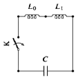
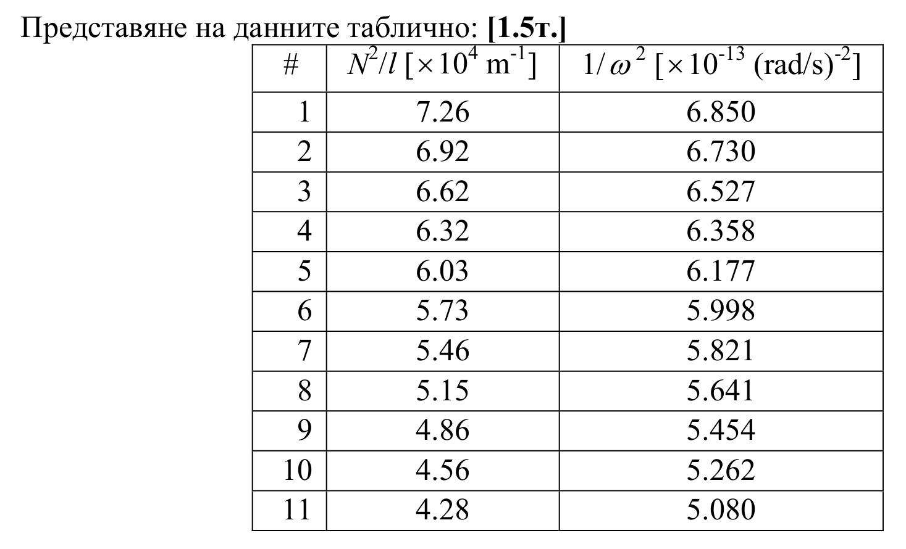
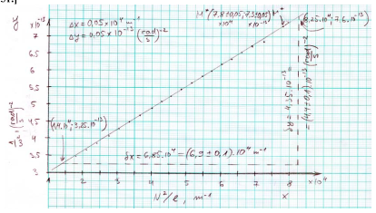
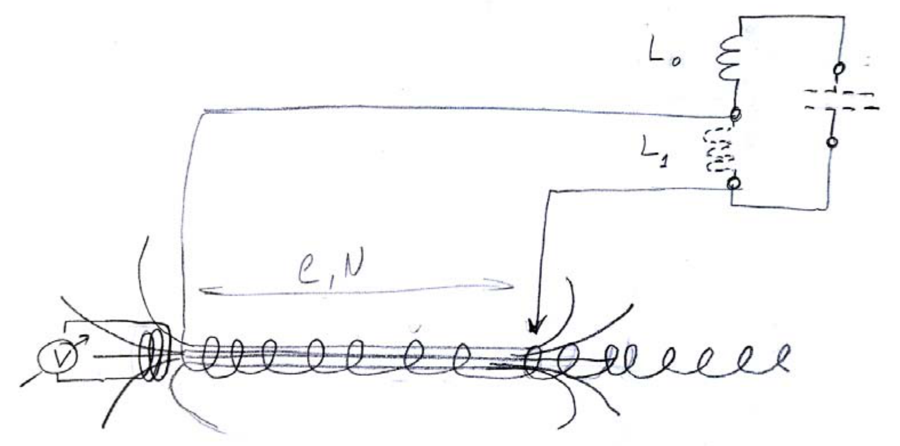

ЕКСПЕРИМЕНТАЛНА ЗАДАЧА
Изследване на LC трептящ кръг
Теоретична част

 Трептящ LC кръг представлява електрическа верига с пренебрежимо малко омово
съпротивление R, съставена от кондензатор с капацитет C и бобина с индуктивност L (виж фигурата). Такива вериги се използват в генератори на незатихващи трептения, в системи за обработка на сигнали, в комуникациите и други. Едно от най-разпространените им приложения е при радиопредавателите и радиоприемниците. Например, когато настройваме радиоприемник на желаната станция, променяме собствената (резонансната) честота на LC трептящ кръг, свързан с антената на приемника.

Ако в такъв трептящ кръг преди да затворим веригата, кондензаторът C е зареден до заряд $q_0$, след затваряне на веригата, през бобината L
започва да протича ток и в нея се индуцира магнитно поле. Така електричната енергия
на заредения кондензатор преминава в магнитна енергия на намотката, след което
процесът се обръща и магнитната енергия на намотката преминава в електрична
енергия на заредения кондензатор. Тъй като съпротивлението R на контура е нула, това
периодично преобразуване на електрична в магнитна енергия и обратно може да
продължи неограничено дълго време и в контура ще се наблюдават незатихващи
електромагнитни трептения.

 Може да се покаже, че собствената кръгова честота на незатихващите трептения в
LC кръга се определя от израза:

$\omega = \frac{1}{\sqrt{LC}}$ (1)
 В един реален трептящ кръг обаче, винаги има и различно от нула омово съпротивление R, което се дължи на съпротивлението на свързващите проводници и това на намотката. При протичане на ток през R, част от електромагнитната енергия на системата се превръща в топлина и трептенията във веригата стават затихващи. В зависимост от стойността на R, времето за затихване е различно, но дори и при малко съпротивление това време не е достатъчно, ако искаме да изследваме трептящия кръг с помощта на мултицет. За да се избегне затихването може да се използва по-сложна електронна схема (генератор на хармонични трептения), която внася допълнителна енергия, равна на загубите в съпротивлението R. Част от тази схема отново представлява LC кръг, но вместо една в него се използват две последователно свързани бобини с индуктивности съответно $L_0$ и $L_1$ (на фигурата е дадена само частта от схемата, която
представлява трептящия кръг). Общата индуктивност на двете последователни бобини
се определя от израза:

$L = L_0 + L_1$ (2)
така кръговата честота на трептящ кръг отново ще се определя от формула (1).

 В настоящата задача бобината $L_0$ ще наричаме вътрешна, а $L_1$ външна. Вътрешната
бобина има фиксирана стойност на индуктивността и тя не може да бъде променяна, за разлика от външната, която представлява соленоид, т.е. намотка чиято дължина е много по-голяма от диаметъра й. Соленоидът е изработен от меден проводник и в зависимост
от това каква част от него се използва, индуктивността му може да се променя.

 Измерването на честотата на трептящия кръг може да стане с помощта на мултицет
и допълнителна "измерителна бобина". Изводите на мултицета се свързват с
измерителната бобина и тя се поставя на подходящо (и достъпно) място, където
плътността на магнитната индукция създавана от соленоида е най-висока. По този

начин, ако през соленоида тече ток с определена честота в измерителната бобина ще се
индуцира електродвижещо напрежение със същата честота, а тя може да бъде измерена
с мултицета.

| Уреди и материали          |       |
| -------------------------- | ----- |
| кондензатор                | 1 бр. |
| меден соленоид на поставка | 1 бр. |
| измерителна бобина         | 1 бр. |
| електронна схема           | 1 бр. |
| мултицет                   | 1 бр. |
| свързващи проводници       | 2 бр. |
| микрощипка                 | 1 бр. |
| батерия 9V                 | 1 бр. |
| милиметрова хартия         | 2 л.  |
| ролетка                    | 1 бр. |

Указания
 - не се опитвайте да отваряте кутията, в която се намира ел. схемата
 - не дърпайте проводниците, излизащи от кутията
 - не деформирайте соленоида и не го изваждайте от поставката му
 - при поставяне на измерителната бобина соленоидът не трябва да се деформира
 - не включвайте осветлението на екрана на мултицета
 - не натискайте бутоните REL и HOLD на мултицета, ако не знаете тяхното
 предназначение
 - след приключване на измерванията много внимателно изключете захранването
 на електронната схема.
 - внимавайте да не загубите кондензатора

Необходими величини и формули:
 - индуктивност на соленоид с дължина l, напречно сечение S и брой навивки N
$L = \mu_0 \mu_r N^2 \frac{S}{l}.$ (3)
- относителната магнитна проницаемост на въздуха $\mu_r = 1.$
- магнитна проницаемост на вакуума $\mu_0 = 4\pi \times 10^{-7} \text{ H/m}.$

Задачи:
1. Изследване на зависимостта на честотата на LC трептящия кръг от величините,
 определящи индуктивността на използваната част от соленоида \[6т.\]
 1.1. Получете израз за зависимостта на честотата на LC веригата от величините,
 определящи индуктивността на използваната част от соленоида. \[1т.\]

Замествайки (3) в (2) и в (1) може да изразим честотата на LC веригата от величината $N^2/l$:

$f = \frac{1}{2\pi\sqrt{L_0 C + \mu_0 \mu_r CS \cdot \frac{N^2}{l}}}$ \[1т.\]
 1.2. Получете експериментално зависимостта на честотата на трептящия кръг от
 величините, определящи индуктивността на използваната част от соленоида.

 Представете данните таблично и оценете грешката на пряко измерените величини.
 \[2т.\]

 Представяне на данните таблично:
 за повече от 10 измервания \[1.5т.\]

# N [бр. навивки] l [mm] N²/l [× 10³ m⁻¹] f [Hz]

 1 240 793 72.60 192300
 2 230 765 69.20 194000
 3 220 731 66.20 197000
 4 210 698 63.20 199600
 5 200 663 60.30 202500
 6 190 630 57.30 205500
 7 180 593 54.60 208600
 8 170 561 51.50 211900
 9 160 527 48.60 215500
 10 150 493 45.60 219400
 11 140 458 42.80 223300
 12 130 422 40.00 227700
 13 120 392 36.70 232600
 14 110 359 33.70 237700
 15 100 327 30.60 243200
 16 90 295 27.50 249400
 17 80 265 24.20 256300
 18 70 232 21.10 263300
 19 60 201 17.90 270900
 20 50 171 14.60 279200
 21 40 137 11.70 287400
 22 30 102 8.82 296800
 23 20 66 6.06 309700
 Грешки при измерванията: $\Delta$N = 1, $\Delta$l = 1 mm, $\Delta$f = 100 Hz. \[0.5т.\]
 1.3. Направете схема (чертеж) описваща експеримента и означете мястото, където се
 поставя измерителната бобина. Аргументирайте се за избраната от вас позиция на
 бобината. \[2т.\]

 Схематично представяне на експеримента. \[1.5т.\]

 Измерителната бобина се поставя съосно с оста на соленоида от към края, който е
 свързан към схемата постоянно, така че да да обхваща максимално магнитни
 индукционни линии от соленоида \[0.5т.\].
 1.4. Измерете с мултицета капацитета на кондензатора от LC веригата, и направете
 оценка за точността на измерването. \[1т.\]

$C_{изм} = (21.5 \pm 0.1)\text{ nF}$ \[1т.\]

2. Обработка на експерименталните данни \[10т.\]
 2.1. Представете зависимостта от задача 1.1. в подходящи променливи, така че да
 получите линейна зависимост, от която да може да се определят индуктивността на
 вътрешната бобина $L_0$ и капацитета C. \[2т.\]

Зависимостта може да се представи като линейна по следния начин:

$\frac{1}{\omega^2} = L_0 C + \mu_0 \mu_r CS \cdot \frac{N^2}{l}$ \[2т.\]

ако означим с y = 1/ω² и x = N²/l тогава зависимостта ще има вида y = B + Ax, където A = μ₀μᵣCS и B = L₀C.
 2.2. Използвайки експерименталните данни, представете зависимостта от задача 2.1.
 таблично и графично. \[4т.\]

 Представяне на данните таблично: \[1.5т.\]

# N²/l [× 10⁴ m⁻¹] 1/ω² [× 10⁻¹³ (rad/s)⁻²]

 1 7.26 6.850
 2 6.92 6.730
 3 6.62 6.527
 4 6.32 6.358
 5 6.03 6.177
 6 5.73 5.998
 7 5.46 5.821
 8 5.15 5.641
 9 4.86 5.454
 10 4.56 5.262
 11 4.28 5.080
 12 4.00 4.886
 13 3.67 4.682
 14 3.37 4.483
 15 3.06 4.283
 16 2.75 4.072
 17 2.42 3.856
 18 2.11 3.654
 19 1.79 3.452
 Представяне на данните графично:
 \[2.5т.\]

 2.3. Определете коефициентите на линейната зависимост. Обосновете каква част от
 експерименталните данни на измерената зависимост е разумно да се използват. \[2т.\]

Поради това, че зависимостта $L = \mu_0 \mu_r N^2 \frac{S}{l}$ е за соленоид, т.е. намотка с дължина много по-голяма от диаметъра, е разумно да използваме данните, удовлетворяващи условието: използваната част от соленоида да е по-дълга от диаметъра му. \[1т.\]

 За зависимостта y = Ax + B, коефициентът А се определя от наклона на правата:

 $A = \frac{y_2 - y_1}{x_2 - x_1} = \frac{\delta y}{\delta x} = \frac{4.4 \times 10^{-13}}{6.9 \times 10^4}$ $= 6.3768 \times 10^{-18} \text{ m s}^2 / \text{rad}^2.$ \[0.5т.\]

Коефициентът В може да се определи от ординатата при x = 0 или от произволна точка $M^*(x^*, y^*) = ((7.8 \pm 0.05) \times 10^4, (7.3 \pm 0.05) \times 10^{-13})$ от правата, като $B = y^* - Ax^*$,
тогава $B = (7.3 \times 10^{-13} - 6.3768\cdot 10^{-18} \times 7.8\cdot 10^{4})\text{ (rad/s)}^{-2} = 2.3261 \times 10^{-13}\text{ (rad/s)}^{-2}$ \[0.5т.\]
 2.4. Определете грешките на коефициентите на линейната зависимост. \[2т.\]
Относителна грешка на А: $\frac{\Delta A}{A} = \frac{\Delta\delta y}{\delta y} + \frac{\Delta\delta x}{\delta x} = \frac{0.1}{4.4} + \frac{0.1}{6.9} = 0.02 + 0.02 = 4\%$ \[0.5т.\]
Абсолютна грешка на А: $\Delta A = \frac{\Delta A}{A} A = 6.3768\cdot 10^{-18} \times 0.04 = 0.3\cdot 10^{-18}\text{ m s}^2/\text{rad}^2$ \[0.5т.\]

$A = (6.4 \pm 0.3) \times 10^{-18}\text{ m s}^2/\text{rad}^2$

 $\frac{\Delta(Ax^*)}{Ax^*} = \frac{\Delta A}{A} + \frac{\Delta x^*}{x^*} = 0.04 + \frac{0.05}{7.8} = 0.04 + 0.006 = 0.046 = 5\%$

Абсолютна грешка на втория член на $B$:

$\Delta(Ax^*) = \frac{\Delta(Ax^*)}{Ax^*} Ax^* = 0.05 \times 6.3768 \times 10^{-18} \times 7.8 \times 10^{-8} \times 7.8 \times 10^{-8} = 0.3 \times 10^{-13} \text{ (rad/s)}^2$

Абсолютна грешка на $B$:

$\Delta B = \Delta y^* + \Delta(Ax^*) = 0.05 \times 10^{-13} + 0.3 \times 10^{-13} = 0.4 \times 10^{-13} \text{ (rad/s)}^2$. **\[0.5 т.\]**

Относителна грешка на $B$:

$\frac{\Delta B}{B} = \frac{0.4 \times 10^{-13}}{2.3261 \times 10^{-13}} = 0.17 = 17\%$. **\[0.5 т.\]**

$\boxed{B =(2.3 \pm 0.4) \times 10^{-13} \text{ (rad/s)}^2}$

**3. Определяне на индуктивността на вътрешната бобина $L_0$ и капацитета $C$ на трептящия кръг. \[4 т.\]**

**3.1. Определете стойностите на $L_0$ и $C$. \[1 т.\]**

При пресмятането на $C$ да се използва вътрешният диаметър на соленоида
$d =(17 \pm 1) \text{ mm}$.

$C = \frac{A}{\mu_0 \mu_r S} = \frac{4A}{\mu_0 \mu_r \pi d^2} = \frac{4 \times 6.4 \times 10^{-18}}{4 \pi \times 10^{-7} \pi(17 \times 10^{-3})^2} = \frac{6.4 \times 10^{-5}}{\pi^2(17)^2} \text{ F} = 22.4 \times 10^{-9} \text{ F} = 22.4 \text{ nF}$. **\[0.5 т.\]**

$L_0 = \frac{B}{C} = \frac{2.3 \times 10^{-13}}{22.4 \times 10^{-9}} \text{ H} = 10.25 \times 10^{-6} \text{ H} = 10.25 \text{ } \mu\text{H}$. **\[0.5 т.\]**

**3.2. Определете абсолютните и относителните грешки на $L_0$ и $C$. \[2 т.\]**

Относителна грешка: $\frac{\Delta C}{C} = \frac{\Delta A}{A} + 2 \frac{\Delta d}{d} = 0.04 + 2 \frac{1}{17} = 0.04 + 0.12 = 0.16 = 16\%$. **\[0.5 т.\]**

Абсолютна грешка: $\Delta C = \frac{\Delta C}{C} C = 0.16 \times 22.4 \text{ nF} = 4 \text{ nF}$. **\[0.5 т.\]**

$\boxed{C =(22 \pm 4) \text{ nF}}$

Относителна грешка: $\frac{\Delta L_0}{L_0} = \frac{\Delta B}{B} + \frac{\Delta C}{C} = 0.17 + 0.16 = 0.33 = 33\%$. **\[0.5 т.\]**

Абсолютна грешка: $\Delta L_0 = \frac{\Delta L_0}{L_0} L_0 = 0.33 \times 10.25 \text{ } \mu\text{H} = 3 \text{ } \mu\text{H}$. **\[0.5 т.\]**

$\boxed{L_0 =(10 \pm 3) \text{ } \mu\text{H}}$

**3.3. Сравнете измерената в задача 1.4. стойност за капацитета и пресменатата в задача 3.1. \[1 т.\]**

$C_{\text{изм}} =(21.5 \pm 0.1) \text{ nF}$
$C_{\text{пр}} =(22 \pm 4) \text{ nF}$

 Вижда се че измерената и пресметнатата стойност за капацитета съвпадат в рамките
 на грешката. \[1т.\]

При липса на размерности на величините, включително в таблици, графики и др. се отнемат по 0.25 т.

