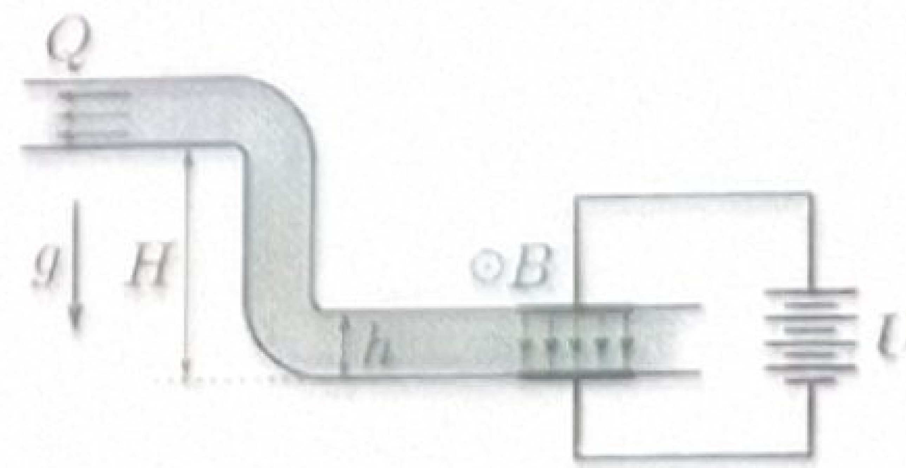
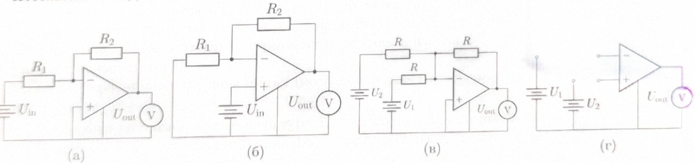
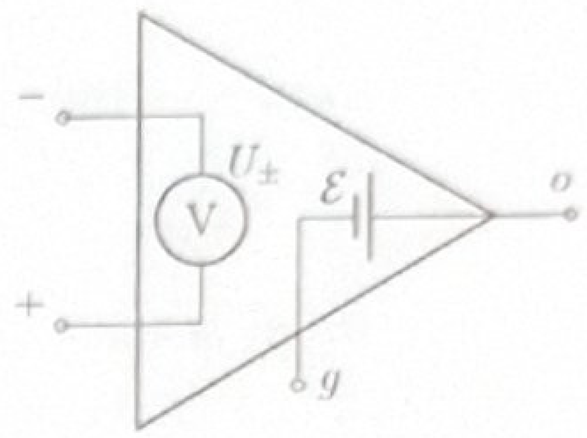

[[Състезания/3/10/2025|◂ 2025]] | [[Състезания/3/10r/2026|решения]]

**Задача 1 Операционен усилвател (10 т.)**

На 25 април 1961 г. е издаден патентът за първата практична интегрална схема (микрочип) — изброитението, което промени света. Една от най-важните интегрални схеми е операционният усилвател (ОУ).

Моделът на идеален ОУ, представен на фиг. 1, има два входа - инвертиращ (–) и неинвертиращ (+), и два изхода — о и g („земя“). Според модела входовете са свързани с един идеален волтметър, а изходите о и g — към идеален източник на ЕДН $\mathcal E$ такова, че напрежението между входовете $U_{\pm} = 0 \text{ V}$.

На схемите по-долу $U_{\text{out}}$ е напрежението, измерено от волтметъра на изхода.

а) За схемата от фиг. 2а, определете $U_{\text{out}}$, изразен чрез $U_{\text{in}}, R_1, R_2$. (2.5 т.)
б) За схемата от фиг. 2б, определете $U_{\text{out}}$, изразен чрез $U_{\text{in}}, R_1, R_2$. (2.5 т.)
в) За схемата от фиг. 2в, определете $U_{\text{out}}$, изразен чрез $U_1, U_2, R$. (3.0 т.)
г) Използвайки 4 еднакви резистора със съпротивление $R$, довършете схемата на фиг. 2г така, че $U_{\text{out}} = U_1 - U_2$. (2.0 т.)

**Подсказка:** Изходете от схемите на фиг. 2а, 2б, 2в, за да постигнете съответния резултат.

Фигура 2: Основни конфигурации на операционен усилвател и шаблон

**Задача 2 Магнитохидродинамична помпа (10 т.)**
Метална примка с дължина $l$ се движи със скорост $v$ в посока, перпендикулярна на примката. Приложено е магнитно поле с индукция $B$, перпендикулярно на примката и направлението на движението.

а) Определете ЕДН $\mathcal E_{\text{ind}}$, индуцирано между краищата на примката. Отговора изразете чрез $l, v, B$. (1.5 т.)
**Упътване:** Намерете работата на единица заряд, извършена от магнитните сили при преместване на заряд от единия до другия край на пръчката.

В ядрените реактори като охладител често се използва течен натрий (течен метал). За неговото придвижване се използват помпи без движещи се механични части, базирани на електромагнитни сили.

Течният метал, с плътност $\rho$, тече през тръба с правоъгълно напречно сечение с височина $h$ и ширина $w$. Върху участък от тръбата е приложено еднородно магнитно поле с индукция $B$, насочено хоризонтално (успоредно на широчината $w$). На горната и долната стена (на разстояние $h$ една от друга) са поставени електроди, свързани към източник на постоянно напрежение с ЕДН $U$. Това води до електричен ток, течащ перпендикулярно както на направлението на тръбата, така и на магнитното поле.
Моделирайте течащия натрий между електродите като твърд правоъгълен проводник с ефективно съпротивление $R$, който се плъзга през тръбата.

б) Каква е максималната денивелация $H_\text{max}$, която помпа може да преодолее? Отговора изразете чрез $U, R, B, h, w$ и земното ускорение $g$. (2.0 т.)

*Упътване*: При максималната денивелация, течността е в механично равновесие и в покой.

Сега допуснете, че течността се движи с постоянна скорост $v$. Тъй като тя е движещ се проводник в магнитно поле, между двата направляванетои края се индуцира ЕДН $\mathcal E_\text{ind}$, което се противопоставя на ЕДН на източника, задвижващ тока през натрия.
Всякакви сили на триене се пренебрегват.

в) Намерете дебита $Q_{\text{max}}$ (изпомпан обем за единица време; измерва се в $\text{m}^3/\text{s}$) на помпата в отсъствие на денивелация ($H = 0$). Отговора изразете чрез $U, R, B, h, w$. (2.0 т.)

г) Намерете дебита на помпата $Q$ в зависимост от денивелацията $H$, изразена чрез $H, H_\text{max}, Q_\text{max}$. (2.5 т.)

д) Намерете КПД $\eta = P_{\text{mex}} / P_{\text{el}}$ при дадена денивелация $H$, изразена чрез $H$ и $H_{\text{max}}$. Това е отношението между механичната мощност и пълната електричната мощност на източника. (2.0 т.)

**Задача 3. Топлинен двигател с ластик (10т.)**

Да разгледаме идеализиран ластик, за който е изпълнено $F = \alpha T(L - L_0)$, където $F$ е силата на опън, $T$ е абсолютната температура, $L$ е дължината на ластика, $L_0$ е дължината на ластика в неразтегнато състояние, а $\mathbf{\alpha}$ е константа. Приемаме, че вътрешната енергия на ластика зависи само от температурата му и се дава с израза $U = CT$, където $C$ е топлинният му капацитет.

Ластикът периодично извършва цикъл (последователност от процеси), състоящ се от четири процеса:
$1 \to 2$: Изотермно разтягане при температура $T_0$ от дължина $2L_0$ до дължина $4L_0$.
$2 \to 3$: Нагряване при постоянна дължина $4L_0$ от температура $T_0$ до $2T_0$.
$3 \to 4$: Изотермно свиване при температура $2T_0$ от дължина $4L_0$ до $2L_0$.
$4 \to 1$: Охлаждане при постоянна дължина $2L_0$ от температура $2T_0$ до $T_0$.

а) На $F,L$-диаграма (аналог на $p,V$-диаграма) начертайте цикъл 1-2-3-4-1. Означете посоката на процесите по протичане на цикъла. (2.0 т.)

б) Намерете сумарната механична работа $A$, извършена от ластика за един пълен цикъл. Отговора изразете чрез $\alpha, T_0, L_0$. (3.5 т.)

в) Намерете общото количество топлина $Q_{\text{пол}}$, получено от ластика за един цикъл. Отговора изразете чрез $\alpha, T_0, L_0, C$. (3.5 т.)

г) Намерете КПД $\mathbf{\eta}$ на тази топлинна машина, ако $C = 8\alpha L_0^2$. (1.0 т.)

