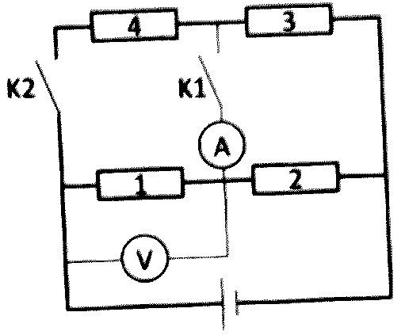
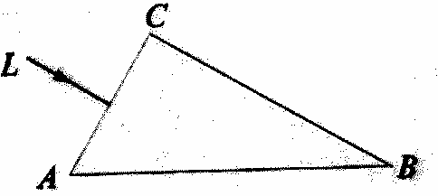
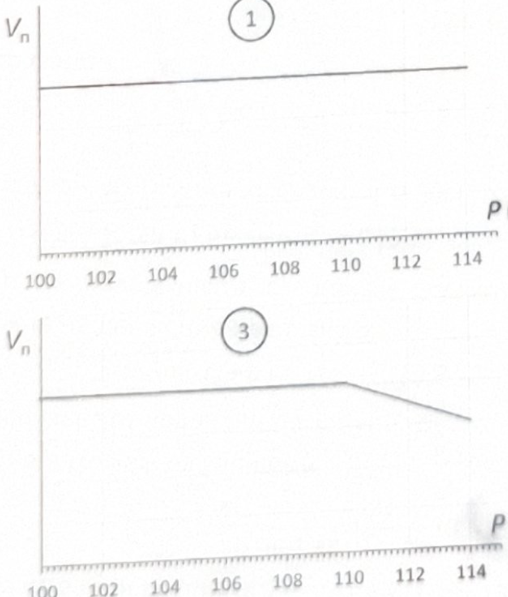
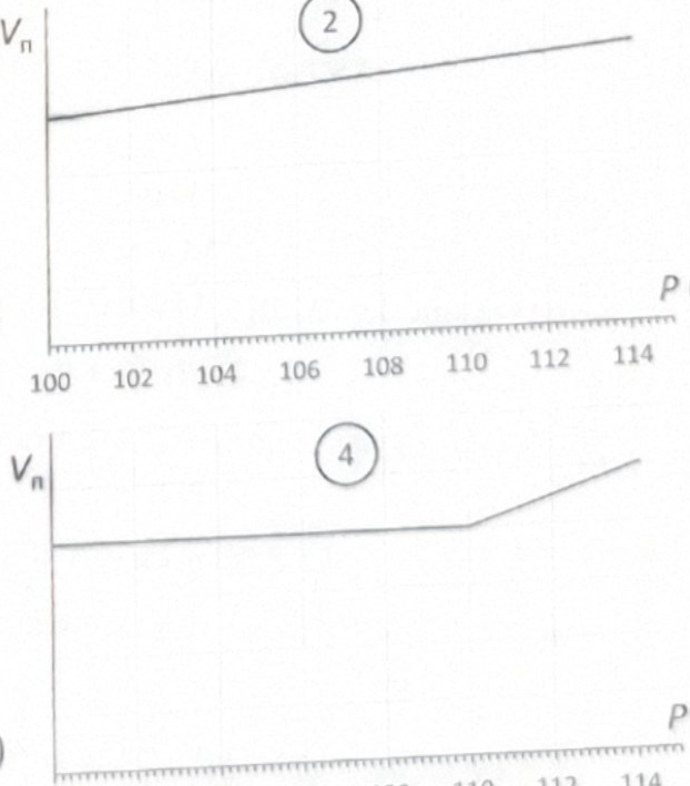
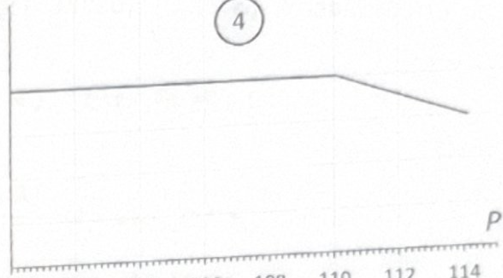
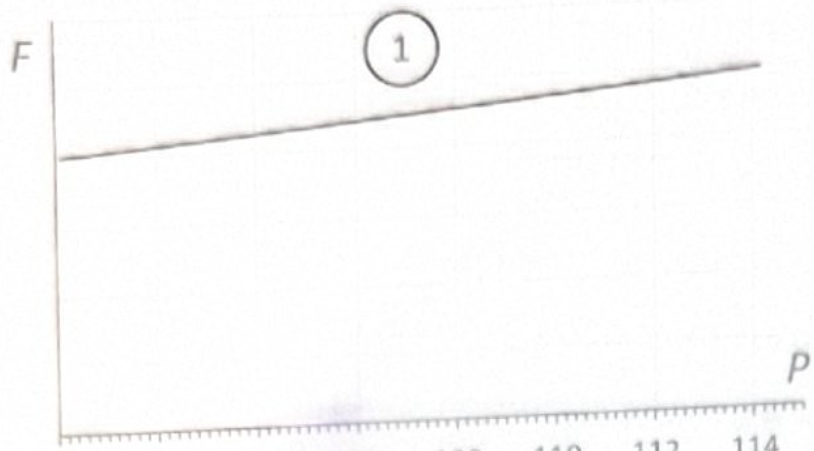
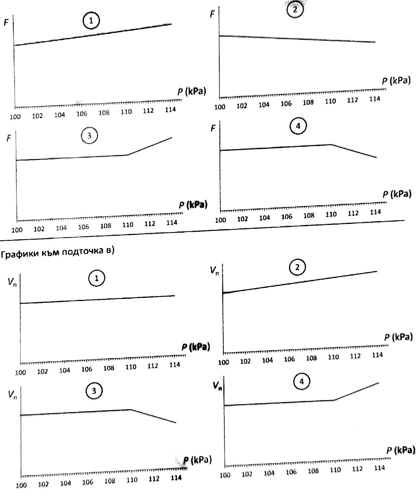
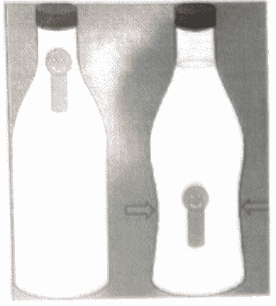
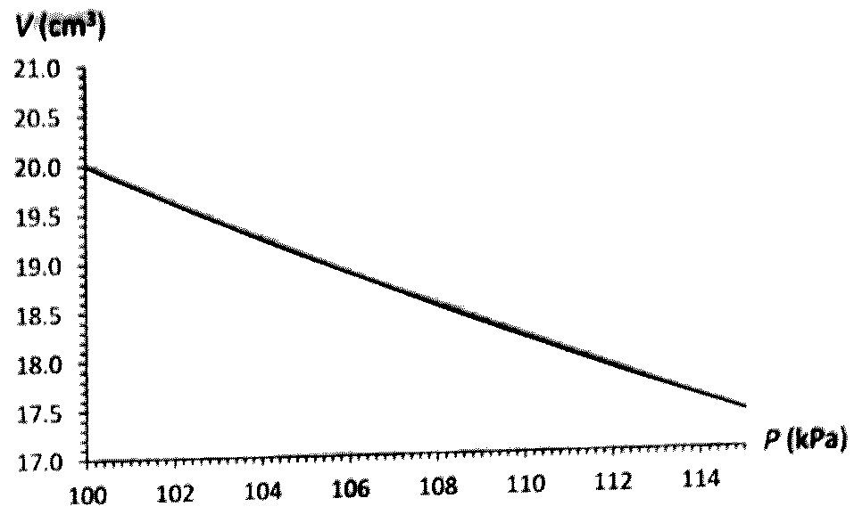

[[Състезания/3/7/2025|◂ 2025]] | [[Състезания/3/7r/2026|решения]]

**Задача 1. Резистор след резистор, след резистор ...**

На фиг. 1 е дадена електрическа схема, която се състои от източник с постоянно напрежение $U_0 = 12\text{ V}$, четири резистора с неизвестно съпротивление, номерирани от 1 до 4, два ключа $K_1$ и $K_2$, волтметър и амперметър. В таблицата е дадено показанието $U$ на волтметъра и $I$ на амперметъра за три различни комбинации от положения на ключовете.

Въз основа на данните в таблицата определете:

а) съпротивленията $R_1, R_2$ и $R_3$ съответно на резисторите 1, 2 и 3; (5.0 т)

б) съпротивлението $R_4$ на резистора 4 и липсващото в таблицата показание / на амперметъра. (5.0 т)

| Комбинация № | Ключ 1 | Ключ 2 | $U\text{ (V)}$ | $I\text{ (mA)}$ |
| :--- | :--- | :--- | :--- | :--- |
| 1 | отворен | отворен | 6 | 0 |
| 2 | затворен | отворен | 7 | 20 |
| 3 | затворен | затворен | 4 | |

**Задача 2. Картезиански водолаз**

Картезианският водолаз е „научна“ играчка, изброена от великия математик и физик Рене Декарт. „Водолазът“ представлява фигурка, изработена от еластичен и мек материал, който лесно се свива под действие на външно налягане. Водолазът се поставя в затворена пластмасова бутилка с вода, в която е оставен малко въздух при нормално атмосферно налягане $p_0 = 100\text{ kPa}$, така че водолазът плава, частично показвайки се над водата (фиг. 2 (а) –вляво). Ако започнете да свивате бавно бутилката с ръка, налягането на въздуха в нея постепенно се повишава и в определен момент водолазът започва да потъва (фиг. 2 (а) –вдясно). Ако отпуснете бутилката, водолазът отново изплува. На фиг. 2 (б) е дадена графика на обема $V$ на водолаза от налягането $P$ на въздуха в бутилката.

а) В работния лист са дадени четири схематични графики, номерирани от 1 до 4, на които не са нанесени числени стойности по вертикалната ос. Коя от графиките съответства на зависимостта на изтласкващата сила $F$, действаща на водолаза, от налягането $P$ на въздуха в бутилката? Обосновете накратко вашия отговор. (2.0 т)

б) Като използвате данните от графиките на фиг. 2 (б) и от работния лист, пресметнете изтласкващата сила $F_0$, действаща на водолаза, и плътността $\rho_0$ на материала, от който той е изработен, при нормално атмосферно налягане $p_0$. (4.0 т)

в) В работния лист са дадени и четири схематични графики, номерирани от 1 до 4, на които също не са нанесени числени стойности по вертикалната ос. Коя от графите съответства на зависимостта на обема $V_\text{п}$ на потопената под водата част на водолаза от налягането на $P$ на въздуха в бутилката. Обосновете накратко вашия отговор. (2.5 т)

г) Колко е обемът $V_\text{н}$ на частта от водолаза, намираща се над водата при нормално атмосферно налягане? (1.5 т)

**Основни данни:** плътност на водата, $\rho_\text{в} = 1\text{ g/cm}^3$; $g = 9,81\text{ N/kg}$. В тази задача може да се пренебрегне хидростатичното налягане на водата в бутилката.

**Задача 3. Отблясъци**

Основата на стъклена призма е правогълен триъгълник $ABC$ с прав ъгъл при върха $C$ и ъгъл $60^\circ$ при върха $A$. (Фиг. 3). Граничният ъгъл между стъклото, от което е направена призмата, и въздуха е $\alpha_\text{г} = 35^\circ$. Ако перпендикулярно на страната $AC$ бъде насочен светлинен лъч $l$, от страните $AB$ и $BC$ съответно излизат два светлинни лъча, които не са показани на фигурата. Оказва се, че лъчът, излизащ от страната $BC$ е успореден на страната $AB$.

а) Какво явление се наблюдава, когато лъчът достигне страната $AB$? Направете чертеж и обосновете вашия отговор. (2.0 т)

б) Допълнете чертежа от т. а), като продължите хода на лъча в призмата и илюстрирате как се получават лъчите, излизащи от страните $AB$ и $BC$. (1.0 т)

в) Колко градуса е ъгълът на пречупване на лъча, излизащ от страната $BC$? Какъв ъгъл със страната $AB$ сключва излизащият от нея лъч? (5.5 т)

г) Ако лъчът светлина е насочен перпендикулярно на страната $BC$, от страната $AB$ излиза пречупен лъч. Проследете на чертеж хода на светлинния лъч в този случай и пресметете ъглите на падане и на пречупване на лъча от страната $AB$. (1.5 т)

**Внимание!** За да получите пълен брой точки на задача 3, трябва освен и точни чертежи, да дадете кратко словесно обяснение на решението. Навсякъде, където настъпва отражение или пречупване, означете съответните ъгли на падане, отражение и пречупване.

