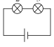
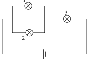

Задача 1. Защо трака влакът?

А) Процепите се оставят, за да могат релсите свободно да се разширяват при затопляне
на времето. \[1 т\]

Б) Силата на звука се измерва в децибели (dB). \[1 т\]

В) За всеки правилно отчетен момент - по \[0,1 т\].

 За посочване на правилния номер на оста - по \[0,1 т\].

 Общо: \[1 т\]
 
| поредно изтракване | момент от време (s) | № на ос |
| :----------------: | :-----------------: | :-----: |
|         1          |         0,2         |    1    |
|         2          |         2,2         |    4    |
|         3          |         2,6         |    3    |
|         4          |         5,2         |    2    |
|         5          |         5,6         |    1    |

Г) За времето между изтракване на осите 4 и 3 (или 2 и 1) вагонът изминава път:
s $= D_1$ = 2 m . \[1 т\]

Интервалът от време между двете изтраквания е:
$t = 2{,}6\text{ s} - 2{,}2\text{ s} = 0{,}4\text{ s}$. \[1 т\]

Следователно скоростта на вагона е:

$v = \frac{s}{t} = 5\text{ m/s}$. \[1 т\]

Алтернативно решение
За времето между изтракване на осите 3 и 2 вагонът изминава път:
$s = D_2 = 13\text{ m}$. \[1 т\]

Интервалът от време между двете изтраквания е:
$t = 5{,}2\text{ s} - 2{,}6\text{ s} = 2{,}6\text{ s}$. \[1 т\]

Следователно скоростта на вагона е:

$v = \frac{s}{t} = 5\text{ m/s}$. \[1 т\]

Д) За времето между последователни изтраквания на една и съща ос, например оста 1,
влакът изминава път, равен на дължината на релсата:
$s = L$. \[1 т\]

Интервалът от време между двете изтраквания на оста 1 е:
$t = 5{,}6\text{ s} - 0{,}2\text{ s} = 5{,}4\text{ s}$. \[1 т\]

Следователно дължината на релсата е:

$L = vt = 27\text{ m}$. \[1 т\]

 1

Е) Докато всички колела на вагона минат през един процеп, се чуват 4 тракания.

Следователно вагонът е минал през:

$N = \frac{100}{4} = 25$ процепа. \[0,2 т\]

Броят на изцяло изминатите релси е $N-1 = 24$. \[0,2 т\]

Докато траят последните 4 тракания, вагонът изминава допълнително разстояние, равно
на разстоянието между осите 1 и 4, т.е. 17 m. \[0,2 т\]

Следователно, вагонът е изминал път:
$s = 24 \cdot 27\text{ m} + 17\text{ m} = 665\text{ m}$. \[0,4 т\]

Задача 2. Осветление

А) Схемата е дадена на фигурата. Ако схемата съдържа две лампи, свързани успоредно, и една - свързана последователно към тях: \[1 т\]

Ако лампите са номерирани правилно: \[1 т\]

Б) Напреженията върху двете успоредно свързани лампи са еднакви - 6 V. \[0,5 т\]

Когато към тях се свържe последователно третата лампа, която работи пре напрежение също 6 V, напрежението в краищата на веригата е 12 V - колкото на акумулатора. \[0,5 т\]

При нормална работа през лампите текат токове:

$I_1 = \frac{P_1}{U_0} = 1 \text{ A}$; $I_2 = \frac{P_2}{U_0} = 2 \text{ A}$; $I_3 = \frac{P_3}{U_0} = 3 \text{ A}.$ \[0,5 т\]

Сумата от токовете, които текат през успоредно свързаните лампи е равна на тока през
лампата, свързана последователно към тях. Следователно успоредно трябва да бъдат
свързани лампите 1 и 2. \[0,5 т\]

В) Във веригата тече същият ток, какъвто през лампата 3:

$I = 3\text{ A}$. \[1 т\\]

Г) Ако лампата 1 изгори, схемата е еквивалентна на следната: \[1 т\]

Съпротивленията на лампите 2 и 3 могат да бъдат намерени от закона на
Ом за нормалните работни напрежения и токове:

$R_2 = \frac{U_0}{I_2} = 3\ \Omega$; \[0,5 т\] $\quad R_3 = \frac{U_0}{I_3} = 2\ \Omega$. \[0,5 т\]

Съпротивливенията могат да бъдат определени и от закона на Джаул-Ленц за нормалните работни мощности и напрежения. Еквивалентното съпротивление на веригата е:

$R = R_2 + R_3 = 5\ \Omega$. \[0,5 т\]

токът във веригата: $I = \frac{U}{R} = 2{,}4\text{ A}$. \[0,5 т\]

а мощностите на лампите:

 2
$P_2 = I^2 R_2 \approx 17\text{ W}$. \[1 т\]

$P_3 = I^2 R_3 \approx 12\text{ W}$. \[1 т\]

Ако е използван законът на Джаул-Ленц, но след закръгляне на числения резултат се
получава стойност, различна от дадената, се отнемат по 0,5 точки за грешен числен
резултат.

Задача 3. А) Автомобилни гуми
 Автомобилът упражнява върху пътя натиск:

$F = mg$ . \[1 т\]

Той се разпределя върху общата допирна площ на гумите с пътя:

$S = 4dx$ \[1 т\]
и води до допълнително (над атмосферното) налягане на въздуха в тях:

$p = \frac{mg}{4dx}$. \[1 т\]

Оттук намираме:

$x = \frac{mg}{4 pd}$, \[1 т\]
$x = \frac{1200 \text{ kg} \cdot 10 \text{ N/kg}}{4 \cdot 200000 \text{ Pa} \cdot 0,15 \text{ m}} = 0,1 \text{ m}$. \[1 т\]

Б) Гмуркане с шнорхел
Ако S e площта на напречното сечение на шнорхела, обемът на водата в него е:

$V = hS,$ $[1\text{ т}]$
а нейната маса:

$m = \rho hS .$ $[1\text{ т}]$

Теглото на водния стълб е съответно:

$F = mg = \rho hSg .$ $[1\text{ т}]$

Теглото на водния стълб се уравновесява от натиска, който упражнява върху него въздухът в дробовете на гмуркача:

$\rho hSg = pS ,$ $[1\text{ т}]$
откъдето намираме:

$p = \rho hg = 1000\text{ kg/m}^3 \cdot 0,3\text{ m} \cdot 10\text{ N/kg} = 3000\text{ Pa}. [1\text{ т}]$

