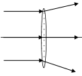
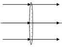
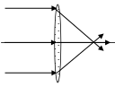
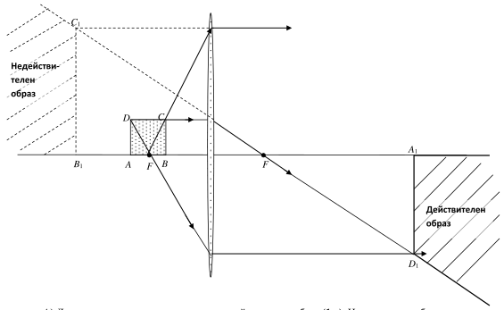

[[Състезания/3/7/2019|◂ 2019]] | [[Състезания/3/7/2020|условия]] | [[Състезания/3/7/2021| 2021 ▸]]

Задача 1.

А) Обемът на хидравличната течност се запазва постоянен: $V = V_1$. (0,5 т)

$SL = S_1h$

$h = L\cdot\frac{S}{S_1}$. (0,5 т)

Б) използваме полученията отговор в А)

$h = L\cdot\frac{S}{S_1}$ (1 т)

След почленно деление на двете страни на уравнението на времето се получава:

$v_1 = v\cdot\frac{S}{S_1}$ (1 т)

В) $p = \frac{Mg}{S_1}$ (1 т)

Г) примерно обяснение: защото с издигане на кабината се увеличава хидростатичното
налягане във вертикалния цилиндър. По този начин освен, че електромоторът трябва да
издига масата на кабината, трябва да преодолява все по-голямо хидростатично налягане.
(1 т)

Забележка: да се признаят всички отговори, които са добре обосновани.

Д) налягането върху малкото бутало:

$p_{max} = \frac{Mg}{S_1} + \frac{mg}{S_1}$ (1 т)

Където m - масата на стълба хидравлично масло. Като се приложи формулата:

m = $\rho$V, където V = $S_1$.H (1 т) е обемът на маслото във вертикалния съд и замести в горното
уравнение:

$p_{max} = \frac{Mg}{S_1} + \rho gH$ (1 т)

Е) налягането в положение 1 на асансьорната кабина при максимален товар в нея е:

$p_{max} = \frac{(M+m_{max})g}{S_1}$ (1 т)

$m_{max} = \frac{p_{max}S_1 - Mg}{g}$ (1 т)

Задача 2.

Част 1.

А) от формулата P = $U_2$/R, следва, че в САЩ лампите ще светят с 4 пъти по-малка
мощност, т.е. P = 20 W. (1 т).

Б) съпротивлението на всяка лампа може да се изрази чрез мощността:

$\frac{R_{ам}}{R_{ев}} = \frac{1}{4}$ (1 т)

 В) максимален ток ще тече във веригата, ако двете батерии са
 свързани последователно. (1 т)

 Г) светлинните източници ще светят най-дълго време, ако батериите
 са свързани успоредно, защото тогава във веригата и съответно през
 батериите тече най-малък ток и техният заряд се "изразходва" най-
 бавно. (1 т).

Д) При последователно свързване на батериите през всяка лампа ще протече съответно
електричен ток $I_1$ и $I_2$, равни на:

 $I_1$ $=\frac{ U1 +U2}{ R1}=$4A (0,5 т)

 $I_2$ $=\frac{ U1 +U2}{ R2}=$ 8A (0,5 т)

Следователно лампата със съпротивление $R_2$ = 3 $\Omega$ ще изгори. За правилен извод (1 т).

Аналогично при успоредно свързване на батериите:

$I_3 = \frac{U}{R_1} = 2\text{ A}$ (0,5 т)

$I_4 = \frac{U}{R_2} = 4\text{ A}$ (0,5 т)

Нито една лампа няма да изгори. За правилен извод (1 т).

 2
Част 2. Познаваме ли електричния ток?

А) Примерно обяснение: електричното съпротивление не зависи от приложеното върху
него напрежение. Колкото пъти се увеличи напрежението, толкова пъти ще се увеличи и
електричния ток. По този начин отношението U/I остава постоянно.

Б) Примерни отговори (1 т):

1. Не. Сумарният заряд на свободните електрони е равен на сумарния заряд на
неподвижните йони.

2. Не. Това, че има свободни електрони не означава, че има некомпенсирани заряди.

Забележка: да се приемат всички обосновани отговори.

Задача 3. Част 1.

 А) за правилно построени лъчи (1 т). Лещата е събирателна
 (0,5 т).

 Б) Правилно начертани лъчи. Няма пречупване, поради една и
 съща оптична плътност. (1,5 т)

 В) правилно начертани лъчи (1 т). Лещата е разсейвателна.
 (0,5 т)

 3
 Част 2.

(Чертеж: източник ABCD, леща с фокус F и образите му)

А) Лявата половина от квадрата ще дава действителен образ (1 т). На чертежа е отбелязан
 с непрекъснати линии. За правилно построени лъчи (1,5 т).

 Дясната половина от квадрата ще дава недействителен образ (1 т). На чертежа е отбелязан
 с пунктирни линии. За правилно построени лъчи (1,5 т).

Б) върху екран образът на източника ще има формата на трапец (1 т).

