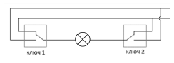
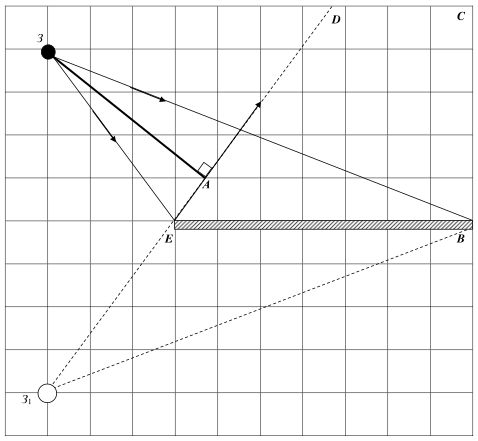

[[Състезания/3/7/2020|◂ 2020]] | [[Състезания/3/7/2021|условия]] | [[Състезания/3/7/2022| 2022 ▸]]

Решение на Зад. 1. Част 1.

А) Вижда се от графиката, че скоростта на покачване на нивото на водата от момента 2
min намалява. При условие, че валежът е с една и съща скорост, следва че в този момент
нивото е стигнало второто тъпало и започва запълване на паралелепипед с по-голяма
площ на основата.

Да се приемат всички описания на учениците, които показват правилни разсъждения.

$t_1 = 2\text{ min}$ \[0,5 т.\]

Б) разстоянието а може да се намери като използваме, че времето за напълване на обема $V_1$ от кутията до първото стъпало е равно на обема вода, навлязъл в кутията за време $t_1$ \[0,5 т.\]

$V_1 = a\cdot h_1\cdot b = Q\cdot t_1$ \[0,5 т.\]

$a = \frac{Qt_1}{h_1 b}$

$a = 0,83\text{ dm} = 8,3\text{ cm}$ \[0,5 т.\]

В) височината на първото стъпало е $h_1 = 6\text{ cm} = 0,6\text{ dm}$. От графиката е видно, че в момента 2 min височината е 6 cm, т.е. напълва се обемът преди стъпалото \[0,5 т.\]

Дължината на първото стъпало ще намерим като използваме обема вода необходим да запълни кутията до нивото от първото до второто стъпало. Този обем се запълва за време 5 - 2 = 3 минути \[0,5 т.\]. Височината между първото и второто стъпало е 8 - 6 = 2 cm = 0,2 dm \[0,5 т.\]. Виж графиката.

$V_2 = (a + a_1)\cdot h_2\cdot b = Q\cdot(5 - 2)$ \[1 т.\]

$a_1 = \frac{3Q}{h_2 b} - a$

$a_1 = 2,92\text{ dm} = 29,2\text{ cm}$ \[0,5 т.\]

Г) За да се спаси Бръм трябва измине хоризонталната част на първото стъпало докато водата не достигне горния му ръб.

$v_{min} = \frac{a_1}{t_1}$ \[0,5 т.\]

$v_{min} = \frac{29,2\text{ cm}}{2\text{ min}} = 14,6\text{ cm/min}$ \[0,5 т.\]

Няма смисъл да се разглежда движението по вертикалната част на второто стъпало,
защото нивото на водата след $t_1$ = 2 min се покачва по-бавно, а Бръм поддържа същата
скорост (0,5 т).

Част 2.

А) обемът на водата в кутията е V = Q.t = 0,5 l/min.5min = 2,5 l (0,5 т)

От друга страна за водата е вярно, че вода с обем 2,5 l има маса 2,5 kg (0,5 т).

Б) след разтварянетото имаме една течност-смес от вода и веществото от стъпалото с плътност $\rho_0$. След разтарянето течността заема обем на паралелепипед $(a_1 + a)\cdot h\cdot b$. Няма промяна във височината на стълба течност - до ръба на второто стъпало (по усл). Точно тази плътност трябва да се намери \[0,5 т.\]

$\rho_0 = \frac{m_{вода} + m_{стъпало}}{V}$

$\rho_0 = \frac{m_{вода} + \rho_{ст}\cdot V_{стъпало}}{(a_1 + a)\cdot h\cdot b}$ \[1 т.\]

$\rho_0 = \frac{m_{вода} + \rho_{ст}\cdot a_1 h_1 b}{(a_1 + a)\cdot h\cdot b} = 1,12\text{ kg/m}^3$ \[1 т.\]

Да се приемат всички решения, които след верни разсъждения водят до верен
резултат!

Решение на Зад. 2

Част 1.

А) $P_1 = \frac{U_1^2}{R_1} \approx 3,4\text{ W}$ \[0,5 т.\]

$P_2 = 0\text{ W}$ \[0,5 т.\]

Б) $P_1 = 0\text{ W}$ \[0,5 т.\]

$P_2 = \frac{U_2^2}{R_2} = 4,5\text{ W}$ \[0,5 т.\]

В) $P_1 = \frac{(U_1 + U_2)^2}{R_1} \approx 18,4\text{ W}$ \[0,5 т. за $U_1 + U_2$\]

$P_2 = 0\text{ W}$ \[0,5 т.\]

Г) при затваряне на двата ключа консуматорите са свързани успоредно към батерия с напрежение $U = U_1 + U_2$. \[1 т.\]

$P_1 = \frac{(U_1 + U_2)^2}{R_1} \approx 18,4\text{ W}$ \[1 т.\]

$P_2 = \frac{(U_1 + U_2)^2}{R_2} \approx 13,8\text{ W}$ \[1 т.\]

Д) За вярна схема (3 т)

Да се приеме за вярно всяка друга схема, която отговаря на условието в задачата.

Част 2. Проводникът се загрява и удължава (топлинно разширение). Поради това
провисва (0,5 т). Но съпротивлението на проводник е правопропорционално на дължината
му, т.е. съпротивлението на проводника нараства, следователно токът намалява (0,5 т).

При по-малък ток се отделя по-малко количество топлина според закона на Джаул-Ленц
(0,5 т). Следователно проводникът се охлажда, свива се, при което теглилката се вдига
нагоре (0,5 т). После процесът се повтаря.

 Решение на Зад. 2

 Допълнителен лист 1 (към Задача 3, част 1)

(Фиг.: огледало на мрежа, точки A, E, B, C, D, началното положение З на Алиса и образът З₁ на заека)

А) за построяване на образа на заека З₁ \[2 т.\]

Б) Алиса за да види Заека в огледалото трябва да се намира в областта ограничена от точките EBCD (зона на видимост) \[2 т.\]

В) Минималното разстояние е перпендикулярът, спуснат от първоначалното положение на Алиса (т.З) към ED \[1 т.\]

Г) Алиса трябва да се намира в т.А \[1 т.\]

Част 2.

А) За правилно определяне на образа - равен по размери на пръчката, обърнат,
действителен (2 т).

Да се признаят всички отговори и решения, които след верни разсъждения водят до
краен резултат. Например решение чрез еднакви триъгълници или използване на
формулата $\frac{1}{a} + \frac{1}{b} = \frac{1}{f}$ (ако е преподадена например в часовете по "Занимания по
интереси") или други!

Б) Пръчката няма да може да се проектира върху екран, когато тя се намира между лещата и фокусното разстояние \[0,5 т.\]. Следователно тя е изминала път $2f - f = f$, т.е. скоростта е:

$v = \frac{f}{t} = \frac{2}{0,5} = 4\text{ m/s}$ \[0,5 т.\]

В) Докато пръчката достигне до Алиса (от момента $t_0$) ще измине път 4f \[0,5 т.\].

Следователно търсеното време е:

$t = \frac{4f}{v} = 2\text{ s}$ \[0,5 т.\]
