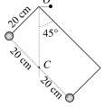

[[Състезания/3/8/2019|◂ 2019]] | [[Състезания/3/8/2020|условия]] | [[Състезания/3/8/2021| 2021 ▸]]

Задача 1. Преплуване на река
А) Плувецът достига другия бряг за време:

(1) $t = \frac{L}{u_0} = \frac{150 \text{m}}{0,75 \text{m/s}}$ = 200 s. 1,0 т

Тъй като скоростта на течението е постоянна по цялата широчина на реката,
отместването на плувеца по течението е:
(2) $s = vt = 0,5 \text{m/s} \cdot 200 \text{s}$ = 100 m. 1,0 т

Б) Плувецът достига 60-тия метър от брега за време:

(3) $t_1 = \frac{ 60 \text{m}}{ 0,75 \text{m/s}}$ = 80 s. 0,5 т

За това време скоростта, с който го премества течението нараства от нула до:
(4) $v_1$ = 0,5 m/s. 0,5 т
Следователно движението на плувеца в посока на течението за този интервал от време е
равноускорително с ускорение:

(5) $a_1 = \frac{v_1}{t_1}$ = 0,00625 m/s$^{2}$. 1,0 т

и с нулева начална скорост. Преместването на плувеца по течението за това време е
съответно:

(7) $s_1 = \frac{a_1 t_1^2}{2} = \frac{v_1 t_1}{2}$ = 20 m. 1,0 т

От 60-тия до 90-тия метър от брега скоростта на течението е постоянна и равна на $v_1$ .
Плувецът преминава тази част от реката за време:

(8) $t_2 = \frac{ 30 \text{m}}{ 0,75 \text{m/s}}$ = 40 s. 0,5 т

и се премества допълнително по течението на разстояние:
(9) $s_2 = v_1 t_2 = 0,5 \text{m/s} \cdot 40 \text{s}$ = 20 m. 0,5 т
Последните 60 метра от широчината на реката плувецът преминава за време:

(10) $t_3 = \frac{ 60 \text{m}}{ 0,75 \text{m/s}}$ = 80 s. 0,5 т

В този участък скоростта на течението намалява от $v_1$ до нула. Следователно тук
плувецът се движи в посока на течението равнозакъснетелно с ускорение:

(11) $a_3 = \frac{v_1}{t_3}$ = 0,00625 m/s$^{2}$. 1,0 т

и се отмества допълнително на разстояние:

(12) $s_3 = v_1 t_3 - \frac{a_3 t_3^2}{2}$ = 20 m. 1,5 т
Следователно докато премине реката, плувецът се премества по течението на разстояние:
(13) $s = s_1 + s_2 + s_3$ = 60 m. 1,0 т

Задача 2. Механичен коктейл
А) Площта на листа, изразена в квадратни метри, е:
 (1) S = 0,2 m . 0,3 m $= 0,06 \text{m}^{2}$ , 0,5 т
масата ѝ:
 (2) m = 50 $\text{g/m}^{2}$ . $0,06 \text{m}^{2}$ = 3 g = 0,003 kg, 0,5 т
а теглото на листа - съответно:
 (3) P = mg = 0,003 kg . $10 \left(\text{m/s}\right)^{2}$ = 0,03 N. 0,5 т
Да означим с 1 книгата, чийто първи лист се намира най-отгоре, а с 2 - другата книга,
чийто последен лист лежи върху масата. Върху n-тия лист на първата книга "тежат" n -
1 листа от същата книга и още толкова листа от втората книга. Следователно общият
натиск, който оказват тези листа върху n-тия лист, е:
(4) $N_1 = 2(n - 1)P$, 1,0 т
а максималната сила на триене върху горната повърхност на листа - съответно:
(5) $f_1 = k N_1 = 2(n - 1)kP$, 0,5 т
n-тият лист на книгата 1 оказва върху намиращият се под него лист на книгата 2
натиск:
(6) $N_2 = N_1 + P = (2n - 1)P$. 1,0 т
Следователно силата на триене върху долната повърхност на листа е:
(7) $f_2 = k N_2 = (2n - 1)kP$, 0,5 т
a общата сила на триене върху избрания лист:
(8) $f = f_1 + f_2 = (4n - 3)kP$, 0,5 т
Като сумираме силите на триене, действащи върху всички листа на книгата 1
(n = 1, 2, $\dots$, 100), получаваме общата сила F, нужна за разделяне на двете книги:

(9) $F = \left[4(1 + 2 + \dots + 100) - 3\cdot 100\right]kP$ = 19 900 kP $\approx 358 \text{N}$. 1,0 т

 2
Б) В състояние на равновесие центърът на тежестта на тялото се
 O
намира вертикално под точката на окачване, т.е. под т. О (1 т). Тъй
като масата на телта е пренебрежимо малка, а двете топчета са
еднакви, центърът С на тежестта се намира по средата между двете 45$^\circ$
топчета (1 т). Следователно вертикалната права, минаваща през т.
О, разполовява отсечката, свързваща двете топчета на две части с .C
дължина 20 cm всяка (1 т). От чертежа е ясно, че $\alpha$ = 45$^\circ$ (1 т).

Задача 3. Опит с линийка
На линийката действа силата на тежестта:
 (1) G = mg 0,5 т
и Архимедовата сила:
(2) $F_A = \rho_0 V g$, 1,0 т
където:
(3) $V = Sh$. 0,5 т
e обемът на потопената част от линийката (S площта на напречното сечение). Силомерът
отчита равнодействащата на двеге сили:
(4) $F = G - F_A = mg - \rho_0 g S h$. 1,0 т
От графиката отчитаме показанието на силомера при две дълбочини, например:
 h (cm) F (N)
 10 0,30 0,5 т
 16 0,27 0,5 т
След като изразим дълбочината в метри и заместим данните във формула (4), получаваме
две уравнения:
 (5) 0,30 N = mg - $\rho_0$ gS. 0,10 $m_0$,5 т
 (6) 0,27 N = mg - $\rho_0$ gS. 0,16 m, 0,5 т
от които определяме площта на напречното сечение на линийката:

(7) $S = \frac{ 0,30 \text{N} - 0,27 \text{N}}{ 1000 \text{kg/m}^{3} \cdot 10 \text{m/s}^{2} \cdot (0,16 \text{m} - 0,10 \text{m})}$ = 0,00005 m$^{2}$. 1,0 т

и масата на линийката:

(8) $m = \frac{ 0,30 \text{N} + 1000 \text{kg/m}^{3} \cdot 0,00005 \text{m}^{2} \cdot 0,1 \text{m}}{ 10 \text{m/s}^{2}}$ = 0,035 kg = 35 g. 1,0 т
Общият обем на линийката е:
(9) $V = S l$ = 0,00005 m$^{2}$ . 0,5 m = 0,000025 m$^{3}$. 1,0 т
Следователно плътността на линийката е:

(10) $\rho = \frac{m}{V} = \frac{ 0,035 \text{kg}}{ 0,000025 \text{m}^{3}}$ = 1400 kg/m$^{3}$. 1,0 т

Тъй като материалът на линийката е по-плътен от водата, линийката ще потъне. 1,0 т

