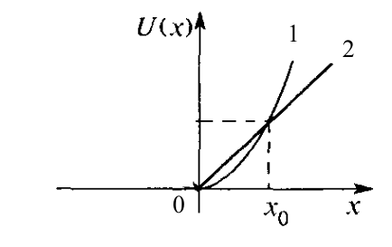
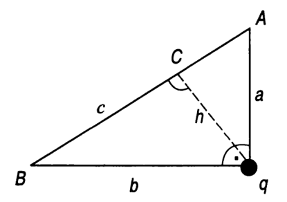
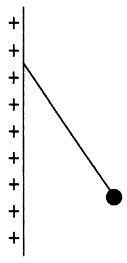

[[Състезания/esenno/10/2025|◂ 2025]] | [[Състезания/esenno/10r/2026|решения]]

**Задача 1. Механично движение**

Тяло с маса m може да извършва две различни движения по права линия. В първия случай движението е с потенциална енергия $U_1(x) = \alpha x^2$, а във втория – с потенциална енергия $U_2(x) = \beta x$. Константите $\alpha, \beta > 0$, а графиките на потенциалната енергия при $x \ge 0$ са показан на фиг. 1.

Ако във всеки един от случаите движението започва от т. $x_0$ с нулева скорост, определете:

а) положението $x_0$. \[1 т.\]

б) скоростите $v_1$ и $v_2$, които достига частицата в точката $x = 0$. Сравнете $v_1$ с $v_2$. \[4,5 т.\]

в) времената $t_1$ и $t_2$ на движение на тялото във всеки един от случаите. Сравнете $t_1$ с $t_2$. \[4,5 т.\]

**Задача 2. Топлинен двигател**

Топлинен двигател работи по цикличен процес, състоящ се от следните процеси: изобарно разширение 1–2, изохорен процес 2–3 и изотермно свиване 3–1. Работното вещество е един мол идеален газ, чиято вътрешна енергия е $U = (3/2)RT$, $R = const$. За всяко състояние на газа е изпълнено равенството $PV = RT$.

а) Начертайте на P, V - диаграма цикличния процес 1–2–3–1. \[1,5 т.\]

б) Определете минималната $T_{min}$ и максималната $T_{max}$ температура в цикъла. \[2,75 т.\]

в) Получете израз за КПД на топлинния двигател, зависещ само от отношението $\alpha = T_{min}/T_{max}$. Известно е, че работата, извършена от газа при изотермното свиване, е $A_Т = RT_1 f(V_1/V_2)$, като изразът f зависи само от отношението на обемите. \[5 т.\]

г) Намерете числената стойност на КПД в проценти, съответстваща на случая $\alpha = 1/2$. Отчетете, че $f(1/2) \approx -0{,}69$. \[0,75 т.\]

**Задача 3. Електростатично поле**

**А.** Точков електричен заряд q се намира във върха на правия ъгъл в правоъгълен триъгълник (фиг. 2).

Интензитетът на електричното поле в точките А и В е съответно $E_А = 20\ \text{N/C}$ и $E_В = 10\ \text{N/C}$. Намерете интензитета на полето в точка С. \[4,5 т.\]

**Б.** До вертикална равномерно заредена равнина на безтегловна непроводяща нишка е окачено тежко топче, заредено едноименно с равнината (фиг. 3). При запълване на пространството с течност с плътност $\rho_0$, положението на топчето не се променя. Електричното поле, което създава заредената равнина, е еднородно, като при наличие на течността интензитетът на полето намалява ε пъти ($\varepsilon > 1$).

а) Посочете силите, които действат на топчето в двата описани случая. \[2 т.\]

б) Намерете плътността ρ на материала, от който е направено топчето. \[3,5 т.\]
