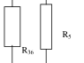
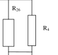
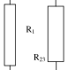
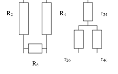

 Задача 1.

a) Разстоянието между топчетата намира от закона на Кулон:

$F = K \frac{q_1 q_2}{r^2}$ \[1 т.\] или $r = \sqrt{K \frac{q_1 q_2}{F}}$, което дава $r = 0,4\ \mathrm m$ \[1 т.\]

б) Зарядът с големина $q_1 = +6\ \mu\text{C}$ създава поле с големина $E = F / q_2$ \[1 т.\] или $E = 3,375 \cdot 10^5 \text{ N/C}$, а зарядът с големина $q_2 = -4\ \mu\text{C}$ поле с големина $E = F / q_1 = 2,25 \cdot 10^5 \text{ N/C}$ \[1 т.\]

в) Разстоянието между топчетата ще бъде равновесното разстояние $r$ минус деформацията $x$ (тъй като топчетата се привличат) \[1 т.\]. При равновесие ще имаме:

$k_1 \cdot x = K \frac{q_1 q_2}{(r - x)^2}$, \[1 т.\]

откъдето определяме коефициента на еластичност на пружината $k_1 = 24 \text{ N/m}$ \[1 т.\]

г) В този случай пълния електричен заряд $q = q_1 + q_2 = 2\ \mu\text{C}$ \[0,5 т.\] ще се разпредели по равно между двете топчета - $q_1' = q_2' = 1\ \mu\text{C}$ \[0,5 т.\]. Електрическата сила е на отблъскване и ще имаме разтягане на пружината
$k_2 \cdot x = K \frac{q_1' q_2'}{(r + x)^2}$ \[1 т.\]
откъдето определяме коефициента на еластичност на пружината $k_1$ = 24 N/m \[1 т.\]

г) В този случай пълния електричен заряд q $= q_1$ $+ q_2$ = 2 $\mu$C \[0,5 т.\] ще се разпредели по
равно между двете топчета - $q_1$' = q 2' = 1$\mu$C \[0,5 т.\]. Електрическата сила е на отблъскване и ще имаме разстягане на пружината
 q'q'
$k_2$ .x = K 1 2 2 \[1 т.\]
 (r + x)

Откъдето намираме коефициента на еластичност $k_2$ = 0,36 N/m \[1 т.\].

Задача 2.

а) Съпротивленията $R_2$ и $R_3$ са свързани последователно и дават еквивалентно
съпротивление RЕ1 $= R_2$ $+ R_3$ = 5 $\Omega$ \[0,5 т.\]. По същия начин RЕ2 $= R_4 + R_5$ = 10 $\Omega$ \[0,5 т.\]. Трите
съпротивления $R_1$ , RЕ1 и RЕ2 са свързани успоредно и еквивалентното им съпротивление се
определя от
$\frac{1}{R} = \frac{1}{R_1} + \frac{1}{R_{E1}} + \frac{1}{R_{E2}}$ \[0,5 т.\] или $1/R = 5/10 \text{ }\Omega^{-1}$, т.е. $R = 2 \text{ }\Omega$ \[0,5 т.\]. Токът определяме от закона на Ом $I = \frac{U}{R}$ \[0,5 т.\], т.е. $I = 5 \text{ A}$ \[0,5 т.\]. Токовете през съответните съпротивления намираме от $I_1 = U/R_1 = 2\text{A}$, $I_2 = U/R_{E1} = 2\text{A}$ и $I_3 = U/R_{E2} = 1\text{A}$. \[0,5 т.\]

Съответно отделените мощности $P = R I^2$ \[0,5 т.\] ще бъдат
$P_1 = 10 \text{ W}$, $P_2 = 4 \text{ W}$, $P_3 = 6 \text{ W}$, $P_4 = P_5 = 5 \text{ W}$ \[1 т.\]

б) Задачата може да решим по два начина -намираме първо токовете и оттам -
еквивалентното съпротивление или намираме първо еквивалентното съпротивление, след
което определяме токовете.
1. Решение на задачата с намиране на токовете чрез падовете на потенциала.

Токът през резистора $R_1$ се намира непосредствено : I 1 $= U / R_1$ = 2 A. \[0,5 т.\]

За намирането на останалите шест тока пресмятаме падовете на напрежението при различни
комбинации:

$R_2 I_2$ $+ R_3 I_3$ = U
$R_4 I_4$ $+ R_5 I_5$ = U
$R_2 I_2$ $+ R_6 I_6$ $+ R_5 I_5$ = U \[0,5 т.\]

Освен това токовете през отделните резистори са свързани посредством:

$I_2$ $= I_3$ $+ I_6$
$I_5$ $= I_4$ $+ I_6$ \[0,5 т.\]

За опростяване на изчисленията заместваме стойностите на съпротивленията и напрежението
U в първите три уравнения. Токовете $I_3$ и I 4 фигурират само в по две уравнения, така че
първо ги изключваме тях.

$2 \cdot I_2$ + 3(I 2 - $I_6$) = 10
$2 \cdot I_5$ $- I_6$ = 2
$2 \cdot I_2$ $+ 2 \cdot I_6$ $+ 5 \cdot I_5$ = 10 \[0,5 т.\]

От второто уравнение определяме I 5 и заместваме в третото - получаваме система от две
уравнения:

$4 \cdot I_2$ $+ 9 \cdot I_6$ = 10
$5 \cdot I_2$ $- 3 \cdot I_6$ = 10 \[0,5 т.\]

Откъдето определяме $I_2$ и $I_6$, след това I 5, $I_4$ и $I_3$: $I_2$ $= 40 / 19 A \approx 2,105 A$ \[0,5 т.\];
$I_6$ = (5.$I_2$ - 10)/$3 A \approx 0,175 A$ \[0,25 т.\]; $I_5$ = 1 $+ I_6 / 2 \approx 1,088 A$ \[0,25 т.\]
$I_4$ $= I_5$ $- I_6 \approx 0,913 A$ \[0,25 т.\]; $I_3$ = (10-2.$I_2$)/$3 \approx 1,93 A$ \[0,25 т.\]

Пълният ток през системата е I = I 1 $+ I_2$ $+ I_4 \approx 5,02 A$ \[0,5 т.\]

Откъдето определяме еквивалентното съпротивление R = U/I = 1,99 $\Omega$ \[0,5 т.\]

2а. За да определим съставното съпротивление на схемата, може да заместим три от
резисторите (например $R_2$ , $R_3$ и $R_6$ ) с друг
 $R_26$
набор от три резистора - $R_23$, $R_26$ и $R_36$,
така че съставните съпротивления между
еквивалентни точки да бъдат едни и същи

(1) $\frac{R_{26}(R_{23} + R_{36})}{(R_{23} + R_{26} + R_{36})} = R_2 + R_6 = 4\Omega$

(2) $\frac{R_{23}(R_{26} + R_{36})}{(R_{23} + R_{26} + R_{36})} = R_2 + R_3 = 5\Omega$

(3) $\frac{R_{36}(R_{23} + R_{26})}{(R_{23} + R_{26} + R_{36})} = R_3 + R_6 = 5\Omega$
\[1 т.\]

Делейки почленно (1) и (2) и (2) и (3) от горните $A R_26$
уравнения получаваме:
5$R_{26}$($R_{23}$ + $R_{36}$) = 4$R_{23}$($R_{26}$+$R_{36}$) и $R_4$
$R_23$($R_26$ + $R_36$) = $R_36$($R_23$ + $R_26$)

Последното уравнение дава $R_23$ $= R_36$, което заедно с предходното води до $2 R_23 = 3 R_26$ и замествайки в което и да е от уравненията (1) - (3) получаваме

$R_23$ $= R_36$ = 8$\Omega$ и $R_26$ = 16/3 $\Omega$ \[1 т.\] $R_5$

Съпротивлението на отделните елементи и схемата като $B R_36$
цяло е:

$\frac{1}{R'} = \frac{1}{R_{26}} + \frac{1}{R_4} \text{ , } R' = 80/31 \ \Omega \approx 2,58 \ \Omega$
$\frac{1}{R''} = \frac{1}{R_{36}} + \frac{1}{R_5} \text{ , } R'' = 40/13 \ \Omega \approx 3,08 \ \Omega$
$\frac{1}{R} = \frac{1}{R_1} + \frac{1}{R_{23}} + \frac{1}{R' + R''} \text{ , } 1/R \approx 0,502 \ \Omega^{-1}$
$R \approx 1,99 \ \Omega$ \[0,5 т.\]

Пълният ток ще бъде I $= U / R \approx 5,02 A$. \[0,5 т.\]

Токът през резисторите $R_1$ и $R_23$ определяме от I i = U/Ri : $I_1$ = 2 A \[0,5 т.\] и $I_23$ = 1,25 A.

Останалите 1,77 А ще текат през резисторите R' и R", като $I_26 / I_4$ $= R_4 / R_26$ = 15/16 и $I_26 + I_4$ =
1,77 А, откъдето намираме I 26 = 0,856 A и I 4 = 0,914 A \[0,5 т.\]. По същият начин определяме и
$I_36 / I_5$ = 5/8 : $I_36$ = 0,681 A и $I_5$ = 1,089 A \[0,5 т.\]. За да определим токовете в първоначалната
схема, е необходимо да се върнем на преобразуването звезда - триъгълник. Токът I 3 , който

тече през резистора $R_3$, се формира от токовете $I_23$ и I 36.

$I_3$ $= I_23$ + I 36 = 1,25 + 0,673 = 1,931 A \[0,25 т.\]

Съответно
$I_2$ $= I_{23}$ + $I_{26}$ = 2,106 A, а разликата между тези два тока дава тока, който ще тече през
резистора $R_6$ : $I_6$ $= I_2$ $- I_3$ = 0,175 A \[0,25 т.\] ( или от $I_5$ - $I_4$ )

2б. Преобразуването на системата от три
резистора в друга схема от три резистора не е
единствено. Възможна е и друга реализация,
както е показано на фигурите в дясно. $R_2 R_4 r_24$

Трансформациите са:

 R ( R + $R_6$ ) 14
$r_24$ $+ r_26$ = 2 4 = $\Omega$
 $R_2$ $+ R_4$ $+ R_6 9$

 R ( R + $R_6$ ) 20
$r_24$ $+ r_46$ = 4 2 = $\Omega$
 $R_2$ $+ R_4$ $+ R_6 9 r_26 r_46$

 R ( R + $R_2$ ) 14 $R_6$

$r_26$ $+ r_46$ = 6 4 = $\Omega$ \[1 т.\]
 $R_2$ $+ R_4$ $+ R_6 9$

Откъдето получаваме: $r_24$ $= r_46$ = 10/9 $\Omega$ и $r_26$ = 4/9 $\Omega$\[0,5 т.\].

При изчисляване на еквивалентните съпротивления получаваме:
r' $= r_26$ $+ R_3$ = 4/9 + 3 = 31/9 $\Omega$ и r" $= r_46$ $+ R_5$ = 10/9 + 5 = 55/9 $\Omega$ \[0,5 т.\].

Общото съпротивление на веригата, съставена от $R_2$, $R_3$, $R_4$, $R_5$ и $R_6$ ще бъде:

r $= r_24$ + = 3,314$\Omega$ , а пълното съпротивление: R $=\frac{ r '.r" r.R1}{ r '+ r" r + R1}=$ 1,99$\Omega$ \[0,5 т.\].

Пълният ток ще бъде I $= U / R \approx 5,02 A$. \[0,5 т.\]

Токът през резистора $R_1$ определяме от Ii = U/Ri : $I_1$ = 2 A \[0,5 т.\]

Токовете през резисторите $R_3$ и $R_5$ съвпадат с токовете през r' и r" $- I_3$ $+ I_5$ = 3,02 A и
$I_3 / I_5$ = r"/r': I 3 = 1,931 A и $I_5$ = 1,089 A\[0,5 т.\].

Останалите токове определяме от:

$I_2$ $+ I_4$ $= I_3$ $+ I_5$ = 3,02 A; $I_2$ $- I_6$ $= I_3$ = 1,931 A и $R_2 I_2$ = U $- R_3 I_3$ = 4,207 V \[0,5 т.\]

$I_2$ = 2,103 A; $I_4$ = 0,916 A; $I_6$ = 0,172 A \[0,5 т.\]

 Задача 3.
 
а) ЕДН по големина може да определим от закона на Фарадей $\varepsilon^* = \frac{\Delta\Phi}{\Delta t}$ \[0,5 т.\], където $\Phi$ е потока на магнитната индукция B през повърхността с площ S, ограничена от U-образния контур и проводника\[0,5 т.\]. Тъй като големината и посоката на магнитното поле не се променя с времето, промяната на потока се дължи на промяна на площта $\Delta\Phi$ = B$\Delta$S \[0,5 т.\], като $\Delta$S = l.v.$\Delta$t. \[0,5 т.\] Оттук определяме големината на индуцираното ЕДН
$\varepsilon$* = B.v.l = 0,25 V \[1 т.\]

Посоката на индуцираното ЕДН определяме от правилото на Ленц - тъй като потока на
магнитната индукция нараства при движението на проводника, то индуцирания ток трябва да създава магнитно поле, насочено обратно на външното поле, т.е.индуцираното магнитно поле в контура трябва да е насочено към нас, и прилагайки правилото на дясната ръка получаваме посоката на тока в проводника - нагоре. Посоката на тока в контура ще бъде обратно на часовниковата стрелка. \[1 т.\]

Токът I, който протича през съпротивлението определяме от закона на Ом -

$I =\frac{ \varepsilon^*}{ R}= 0,05 A$ \[1 т.\]

б) Подусловието може да решим по два начина:
1. Мощността, която се разсейва от съпротивлението P = I 2R е равна на мoщността на силата F, която движи проводника с постоянна скорост v надясно (определихме посоката и): \[1 т.\]

$F.v = I^2 R$ -> $F = \frac{I^2 R}{v} = \frac{\varepsilon^{*2}}{R.v} = \frac{B^2 v l^2}{R}$ \[1 т.\] може да използваме която и да е от трите формули

F = 0,0025 N = 2,5 mN \[1 т.\]

2. На проводник с дължина l, по който тече ток с големина I (нагоре) и е поставен в
перпендикулярно външно магнитно поле с индукция B действа сила с големина F = I.l.B,
чиято посока се определя от правилото на дясната ръка - в нашия случай наляво на чертежа. \[1 т.\] За се движи проводника с постоянна скорост v е необходимо да се приложи същата по големина, но обратна по посока сила \[1 т.\]

$F = \frac{\varepsilon^{*} l B}{R} = \frac{B^{2} v l^{2}}{R} = 2,5 \text{ mN}$ \[1 т.\]

в) Когато е включен външен източник на ЕДН $\varepsilon$ във веригата, необходимо е да съобразим
полярността му спрямо индуцираното ЕДН $\varepsilon$ * . При решаването на подусловие (а) видяхме,
че токът от индуцираното ЕДН тече обратно на часовниковата стрелка. Ако нямаше
индуцирано ЕДН, то тока ще тече по часовниковата стрелка \[0,5 т.\]. Следователно двата източника са свързани един срещу друг \[0,5 т.\] и големината на тока определяме от $IR = \varepsilon - \varepsilon^*$ или $I = \frac{\varepsilon - \varepsilon^*}{R} = 0,1\text{A}$ \[0,5 т.\], а посоката му ще бъде по часовниковата стрелка.

\[0,5 т.\]

