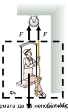
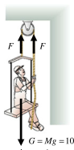
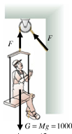

[[Състезания/esenno/10/2010|условия]] | [[Състезания/esenno/10/2011| 2011 ▸]]

Задача 1. Макари
Част 1. а) Няма противоречие с третия принцип на Нютон и човекът може да се придвижи,
опъвайки въжето. Това лесно се съобразява, ако мислено поставим човека и количката в кутия
(затворена система), като е показано на Фигура 1 а, така че да останат само въжето и макарата
извън кутията. \[2т\]

(Фигура 1 а: човекът и количката в кутия, с две равни и противоположни сили F; G = Mg)

б) Понеже искаме човекът и платформата да са неподвижни, то за двата случая, показани на Фигура 1 б и Фигура 1 в, ще имаме равновесие, когато F = G = 1000 N, и съответно F = G/2 = 500 N. В първия случай въжето не издържа на натоварването и се къса, тоест не
препоръчваме на човека да завързва въжето на стената, а да го държи. \[2,5т\]

(Фигура 1 б и Фигура 1 в: равновесие на човек + платформа, G = Mg = 1000 N)

в) Понеже въжето минава през макарата, то за да се повдигне на разстояние L = 5m , човекът
трябва да издърпа два пъти повече въже $\Rightarrow$ T = 2 L / V = 20 s \[2,5т\]

Част 2. Понеже няма триене и понеже бананите тежат точно толкова, колкото и маймунката, то
в началото имаме равновесие на системата.

Равновесието не трябва да се променя в никой момент $\Rightarrow$ с каквато и скорост маймунката да се
катери по въжето, с такава скорост ще се отдалечават от нея бананите (силата на опън от страна
на маймунката се прехвърля през макарата и действа на бананите, които имат същата маса като
маймунката). Тоест, след T = 5 s , разстоянието между маймунката и бананите ще е пак
първоначалното разстояние от L = 10 m .\[3т\]

Задача 2. Да вървя или да бягам в дъжда?

а) Ще намерим количеството дъжд, което ще навали горната стена на гъбата паралелепипед
(главата и раменете на човека) и предната страна на паралелепипеда (лицето, гърдите и
корема). Върху горната стена имаме следното количество дъжд: $bSg \cdot t$,
където $t = \frac{L}{V_{1,2}}$ е времето през което вали дъждът (времето, за което човекът пробягва /
извървява разстояние L) $\Rightarrow$ количеството дъжд върху горната страна на паралелепипеда е:

$bSg \cdot \frac{L}{V_{1,2}}$ \[0,5т\],

докато върху предната стена имаме следното количество дъжд:

$hSg \cdot \frac{V_{1,2}}{u} \cdot t = hSg \cdot \frac{L}{u}$ \[0,5т\] $\Rightarrow$ общото количество дъжд като бягаме е

$$S .g .L \left( \frac{h}{u} + \frac{b}{V_1} \right) \approx 4,8l$$

\[0,5т\],
а когато ходим е

$$S .g .L \left(\frac{h}{u} + \frac{b}{V_2}\right) \approx 5, 7l$$

\[0,5т\]

б) очевидно е по-добре да бягаме, отколкото да ходим \[0,5т\]

в) аналогично на а) ще разделим количеството дъжд, което ще навали горната стена на
паралелепипеда и предната страна на паралелепипеда. Количеството дъжд върху горната
страна на паралелепипеда отново е

$bSg \cdot \frac{L}{V_{1,2}}$ \[0,5т\],

докато върху предната стена имаме следното количество дъжд:

$hSg \cdot \frac{V_{1,2}+w}{u} \cdot t = hSg \cdot \frac{V_{1,2}+w}{u} \cdot \frac{L}{V_{1,2}}$ \[1т\] $\Rightarrow$ общото количество дъжд като бягаме е

$$S . g .L \left[ \frac{h}{u} + \frac{1}{V_1} \left(b+\frac{hw}{u}\right) \right] \approx 6, 2l$$

\[0,5т\],
а когато ходим е

$$S . g .L \left[\frac{h}{u} + \frac{1}{V_2} \left( b + \frac{hw}{u}\right) \right] \approx 8,3l$$

\[0,5т\]

г) очевидно е по-добре да бягаме, отколкото да ходим \[0,5т\]

д) може лесно да се съобрази, че тази точка е много подобна на точка в) с разлика, че
хоризонталната скорост на дъжда и скоростта, с която човекът се движи не се събират, а се вадят
$\Rightarrow$ общото количество дъжд като бягаме ( $V_1$ > w ) е

$$S .g .L \left[ \frac{h}{u} + \frac{1}{V_1} \left(b - \frac{hw}{u}\right) \right] \approx 2,8l$$

\[2т\],
а когато ходим ( $V_2$ = w ) е
$S .g .L \left[-\frac{h}{u} + \frac{1}{V_2} \left( b + \frac{hw}{u}\right) \right] = \frac{S.g.L.b}{w} \approx 1,7l$ \[2т\]

е) очевидно е по-добре да ходим, отколкото да бягаме за тази ситуация \[0,5т\]

Задача 3. Съпротивление на безкрайни вериги

а) От безкрайността на веригата следва, че ако съпротивлението между точки А и Б е RAБ , то
добавяйки още един повтарящ се елемент към безкрайната верига, получаваме същото
съпротивление RAБ между точки А и Б. Тоест, имаме еквивалентна верига (показана на Фигура 2

б) на първоначалната верига (показана на Фигура 2 а)

(Фигура 2 а и Фигура 2 б: безкрайна резисторна верига с елементи R между точките А и Б)

Математически за съпротивлението между точки А и Б получаваме:

$R_{AБ} = \frac{(R + R_{AБ})R}{R_{AБ} + R + R}$ $\Rightarrow$ $R^2_{AБ} + RR_{AБ} - R^2 = 0$ \[1т\]

От квадратичното уравнение физически смисъл има само положителният корен $\Rightarrow$

$R_{AБ} = \frac{\sqrt{5}-1}{2}R \approx 0,6 R$ \[2т\]

б) симетрията на задачата е като на предишната точка, с тази разлика, че сега веригата е
безкрайна и в двете направления $\Rightarrow$ свежда се лесно до два паралелно свързани резистора,
всеки с големина $R\cdot\frac{\sqrt{5}-1}{2}$ $\Rightarrow$

$R_{AБ} = \frac{\sqrt{5}-1}{4}R \approx 0,3 R$ \[2т\]

в) Ако в точка А от веригата приложим положителен потенциал, то от съображение на симетрия,
към точка Б ще протича ток i / 4 от общият ток (Фигура 3а). Аналогично, ако към точка Б приложим
отрицателен потенциал, то към точка Б ще протича ток i / 4 от общият ток (Фигура 3б).

Използвайки принципа на суперпозицията и прилагайки едновременно и положителното
напрежение към точка А и отрицателното към точка Б, то ще получим ток i / 2 , който ще протече
между точки А и Б $\Rightarrow$ Използвайки закона на Ом, имаме U AБ = Ri / 2 или за ефективното
съпротивлението между точки А и Б, имаме RAБ = R / 2 \[5т\]
(Фигура 3 а и Фигура 3 б: разпределение на токовете i/4 в безкрайната мрежа)

