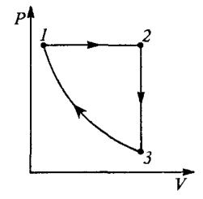
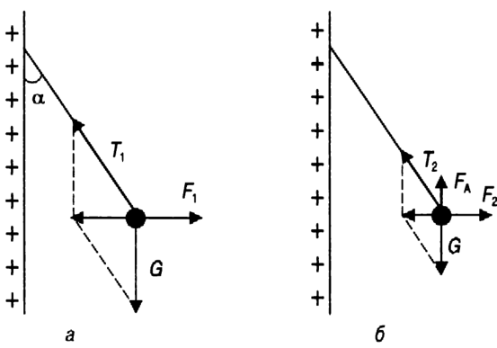
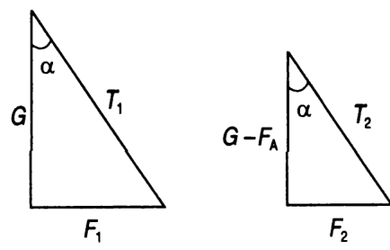

[[Състезания/esenno/10/2025|◂ 2025]] | [[Състезания/esenno/10/2026|условия]]

**Задача 1. Механично движение**

а) Тъй като е в сила равенството $U_1(x_0) = U_2(x_0)$ \[0,5 т.\], получаваме

$x_0 = \frac{\beta}{\alpha}$ \[0,5 т.\]

б) В т. $x_0$ потенциалната енергия на тялото е равна на пълната му енергия \[0,5 т.\]. От друга страна при $x = 0$ пълната енергия е изцяло кинетична \[0,5 т.\]. Следователно в сила са равенствата

$\frac{mv_1^2}{2} = \alpha x_0^2$ \[0,5 т.\], $\qquad v_1 = \sqrt{\frac{2\alpha x_0^2}{m}} = \frac{2\beta^2}{m\alpha}$ \[1 т.\]

$\frac{mv_2^2}{2} = \beta x_0$ \[0,5 т.\], $\qquad v_2 = \sqrt{\frac{2\beta x_0}{m}} = \frac{2\beta^2}{m\alpha}$ \[1 т.\]

т.е. имаме $v_1 = v_2$ \[0,5 т.\].

в) Ще положим $\alpha = k/2$ $(k > 0)$ \[0,5 т.\]. Тогава потенциалната енергия

$U_1(x) = \frac{kx^2}{2}$ \[0,5 т.\]

е потенциална енергия на тяло, извършващо хармонично трептене с период

$T_1 = 2\pi\sqrt{\frac{m}{k}} = 2\pi\sqrt{\frac{m}{2\alpha}}$ \[0,5 т.\]

Времето $t_1$ за достигане на точката с $x = 0$ е

$t_1 = \frac{1}{4}T_1 = \frac{\pi}{2}\sqrt{\frac{m}{2\alpha}}$ \[0,5 т.\]

Във втория случай, ако изберем $\beta = mg$ (g – земното ускорение) \[0,5 т.\], потенциалната енергия $U_2(x) = mgx$ е потенциална енергия на тяло с маса m на височина x над повърхността на Земята \[0,5 т.\]. Тогава движението на тялото е свободно падане, като времето за достигане на положението $x = 0$ е

$t_2 = \frac{v_2}{g} = \frac{2m}{\alpha}$ \[0,5 т.\]

Следователно получаваме

$t_2 = \frac{4}{\pi}t_1$ \[0,5 т.\]

т.е. имаме $t_2 > t_1$ \[0,5 т.\].

**Задача 2. Топлинен двигател**

а) На фиг. 1 е показана P, V - диаграмата на цикличния процес 1–2–3–1. \[1,5 т.\]

б) За изобарния процес 1–2 е в сила равенството

$\frac{V_1}{T_1} = \frac{V_2}{T_2}$ \[0,5 т.\]

Тъй като имаме $V_1 < V_2$ \[0,25 т.\], получаваме $T_1 < T_2$ \[0,25 т.\]. Следователно върху изобарата 1–2 най-ниската температура е $T_1$, а най-високата – $T_2$. От друга страна, в изохорния процес 2–3 имаме

$\frac{P_1}{T_2} = \frac{P_2}{T_3}$ \[0,5 т.\]

Като отчетем, че $P_1 > P_2$ \[0,25 т.\], намираме $T_2 > T_3$ \[0,25 т.\]. От изотермния процес 3–1 следва $T_3 = T_1$ \[0,25 т.\]. Тогава намираме $T_{min} = T_1$, $T_{max} = T_2$ \[0,5 т.\].

в) По определение КПД на топлинния двигател е

$\eta = \frac{Q_{пол} - Q_{отд}}{Q_{пол}}$ \[0,25 т.\]

Обмененото количество топлина $Q_{12}$ според първия принцип на термодинамиката е

$Q_{12} = U_2 - U_1 + P_1(V_2 - V_1)$ \[0,5 т.\]

Тъй като имаме

$U_2 - U_1 = \frac{3}{2}R(T_{max} - T_{min})$ \[0,5 т.\], $\qquad P_1(V_2 - V_1) = R(T_{max} - T_{min})$ \[0,5 т.\]

намираме

$Q_{12} = \frac{5}{2}R(T_{max} - T_{min}) > 0$ \[0,5 т.\]

Аналогично за изохорния процес 2–3 получаваме

$Q_{23} = U_3 - U_2 = \frac{3}{2}R(T_{min} - T_{max}) < 0$ \[0,5 т.\]

При изотермното свиване на идеалния газ 3–1 вътрешната му енергия не се променя, тъй като тя зависи само от температурата. Следователно имаме

$Q_{31} = U_1 - U_3 + A_T = RT_{min}f(V_1/V_2) < 0$ \[0,5 т.\]

Тогава можем да запишем

$Q_{пол} = \frac{5}{2}R(T_{max} - T_{min})$ \[0,5 т.\]

$Q_{отд} = -(Q_{23} + Q_{31}) = \frac{3}{2}R(T_{max} - T_{min}) - RT_{min}f(T_{min}/T_{max})$ \[0,5 т.\]

тъй като $V_1/V_2 = T_{min}/T_{max}$ \[0,25 т.\]. След като заместим тези изрази, за КПД получаваме

$\eta = \frac{2}{5}\left[1 + \frac{\alpha f(\alpha)}{1 - \alpha}\right]$ \[0,5 т.\]

г) $\eta \approx 12{,}4\%$ \[0,75 т.\]

**Задача 3. Електростатично поле**

**А.** Интензитетът на полето в т. С е

$E_C = k\frac{q}{h^2}$ \[1 т.\]

а интензитетите в точките А и В са съответно

$E_A = k\frac{q}{a^2}$ \[0,5 т.\], $\qquad E_B = k\frac{q}{b^2}$ \[0,5 т.\]

Разстоянието

$h = \frac{ab}{c} = \frac{ab}{\sqrt{a^2 + b^2}}$ \[0,5 т.\]

откъдето следва

$E_C = k\frac{q}{a^2b^2}(a^2 + b^2) = E_A\left(\frac{a^2}{b^2} + 1\right)$ \[0,5 т.\]

Тъй като имаме $kq = a^2E_A = b^2E_B$ \[0,5 т.\], окончателно намираме

$E_C = E_A\left(\frac{E_B}{E_A} + 1\right) = E_A + E_B = 30\ \text{N/C}$ \[1 т.\]

**Б.** а) На фиг. 2,а са показани силите, които действат на топчето, преди запълване на пространството с течност: $G = mg = \rho gV$ – сила на тежестта \[0,5 т.\], $T_1$ – сила на опън и $F_1 = qE_1$ – електричната сила, с която равнината действа на топчето \[0,5 т.\].

След запълването с течност (фиг. 2,б) се появява изтласкваща сила $F_A = \rho_0 gV$ \[0,5 т.\], силите $T_2$, $F_2 = qE_2 = (q/\varepsilon)E_1$ и G \[0,5 т.\].

б) Електричната сила $F_1$ уравновесява резултантната на G и $T_1$ \[0,5 т.\], докато $F_2$ – резултантната на $G - F_A$ и $T_2$ \[0,5 т.\]. От подобието на триъгълниците (фиг. 3) следва равенството

$\frac{F_1}{G} = \frac{F_2}{G - F_A}$ \[1 т.\]

Като заместим силите с определящите ги изрази, имаме

$\frac{qE_1}{\rho gV} = \frac{qE_1/\varepsilon}{\rho gV - \rho_0 gV}$ \[0,5 т.\]

откъдето получаваме

$\rho = \frac{\varepsilon}{\varepsilon - 1}\rho_0$ \[1 т.\]
