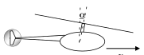
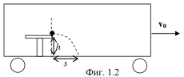
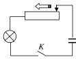

Задача 1. Двете подусловия на задачата са независими. И в двете подусловия
приемете, че земното ускорение е g $= 10 \left(\text{m/s}\right)^{2}$.

а) На какъв ъгъл $\alpha$ спрямо вертикалата трябва да бъде наклонена оста на
витлото на хеликоптер, за да може хеликоптерът да се движи с постоянна
скорост v = 30 m/s в хоризонтално направление (фиг. 1.1)? Масата на
хеликоптера е m = 2000 kg. На хеликоптера действа сила на съпротивление на
въздуха с големина f = k$v_2$, където k = 2 kg/m е коефициент на
пропорционалност.

Упътване. Ако ъгълът $\alpha$ е изразен в радиани, можете да използвате с точност до
две значещи цифри приблизителните равенства: sin $\alpha \approx$ tg$\alpha \approx \alpha$ , когато
$\alpha$ < 0,25 rad (15 $^\circ$). (5 точки)

Фиг. 1.1 Фиг. 1.2

б) Влак се движи с постоянна скорост $v_0$ = 50 km/h. На ръба на масичката в едно
от купетата по посока на движение на влака, е поставено малко топче (фиг. 1.2).

Влакът започва да спира с постоянно ускорение а $= 1 \left(\text{m/s}\right)^{2}$. На какво разстояние
s от ръба на масичката в хоризонтално направление ще падне топчето?

Височината на масичката е h = 50 cm (5 точки)

Задача 2. Стопяем предпазител (бушон) е изработен от медна жичка с кръгово
напречно сечение с диаметър d = 0,1 mm. Температурата на топене на медта е
$t_0$ = 1085 $^\circ$C, специфичното съпротивление на медта - $\rho$ = $1,75\cdot 10^{-8}$ $\Omega$.m, а
константата на Стефан-Болцман - $\sigma$ $= 5,67\cdot 10^{-8} W \cdot \text{m}^{-2} \cdot \text{K}^{-4}$. Приемете, че жичката
излъчва като абсолютно черно тяло и, че специфичното съпротивление на медта
не се променя с температурата.

а) Каква е максималната големина Imax на електричния ток, който може да
протича през предпазителя? (7 точки)

б) Колко ще бъде температурата на жичката, ако през предпазителя протича ток
с големина: I = 1/2 Imax? (3 точки)

Задача 3. В последните години благодарение на нанотехнологиите бяха създадени т. нар. свръхкондензатори, чийто капацитет достига 1 F. Свръхкондензаторите могат да се използват за временно съхранение на електроенергия в редица устройства - автомобили, компютърни захранвания и т. н.

На фиг. 3 е показана схема за захранване на електрическа лампа от свръхкондензатор с капацитет C = 1 F. Нормалният работен ток на лампата е In = 1 А, а нормалното й работно напрежение - Un = 10 V. Лампата е свързана към кондензатора чрез реостат с променливо съпротивление. Преди затварянето на ключа К напрежението върху кондензатора е $U_0$ = 100 V. След затварянето на ключа, плъзгачът на реостата започва да се движи. При това съпротивлението на реостата се променя с времето така, че през лампата тече постоянен ток, равен на нормалния й работен ток.

а) Колко време t през лампата ще тече такъв ток, че тя да свети нормално? (4,5 точки)

б) Намерете КПД на веригата, т.е. отношението QL/Q, където QL е количеството
енергия, отделено в лампата по време на нейната нормална работа, а Q - общото
количество енергия, отделено във веригата за същото време. (3,5 точки)

в) Намерете по какъв закон R(t) трябва да се променя съпротивлението на
реостата, така че през лампата да протича постоянен ток In.

Изразете отговора чрез зададените в условието величини.  (2 точки)