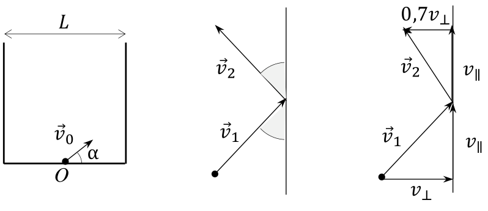
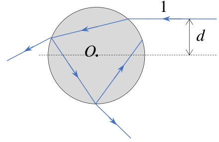
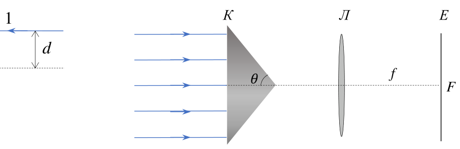

[[Състезания/esenno/11/2025|◂ 2025]] | [[Състезания/esenno/11r/2026|решения]]

**Задача 1. Скуош**

Скуошът е подобна на тенис игра на закрито, в която играчите си подават топката посредством отскачане от стените на специално помещение. Зала за скуош има две много високи успоредни стени на разстояние $L = 5{,}00\ \text{m}$ една от друга. Топката е изстреляна от точка на пода, намираща се по средата между стените, с начална скорост $v_0 = 10{,}0\ \text{m/s}$ под ъгъл α ($0 < \alpha < 90^\circ$) спрямо хоризонта (фиг. 1 a). Приемете, че земното ускорение е $g = 10{,}0\ \text{m/s}^2$.

а) Разгледайте идеализирания случай (фиг. 1 б), при който топката отскача еластично, т.е. скоростта ѝ $\vec{v}_1$ непосредствено преди удара с някоя от стените е равна по големина и сключва същия ъгъл със стената, като скоростта ѝ $\vec{v}_2$ непосредствено след удара.

- Намерете всички възможни стойности на ъгъла на изстрелване α, при които топката се връща в точката на изстрелване, без да се удари в пода? \[4,5 т.\]
- Изобразете схематично траекторията на топката за всяка от намерените стойности на α. \[1,5 т.\]

б) В действителност част от механичната енергия на топката се губи при удара със стената, както е илюстрирано на фиг. 1 в. Скоростта $\vec{v}_1$ на топката преди удара може да се разложи на две компоненти $v_\parallel$ и $v_\perp$, които са съответно успоредна и перпендикулярна на стената. Успоредната компонента на скоростта $v_2$ след удара не се променя, но перпендикулярната компонента на $v_2$ намалява на $0{,}7v_\perp$. При тези предположения:

- Намерете всички възможни стойности на ъгъла α, при които топката се връща в точката на изстрелване, без да се удари в пода? \[3,0 т.\]
- Изобразете схематично траекторията на топката за всяка от намерените стойности на α. \[1,0 т.\]

**Задача 2. Поливане на градината**

Помпа с механична мощност $P = 50{,}0\ \text{W}$ изпомпва вода от езеро и я изкачва по тръба с площ на напречното сечение $S = 3{,}00\ \text{cm}^2$ до градина на височина $h = 10{,}0\ \text{m}$ над водната повърхност. Приемете, че земното ускорение е $g = 10{,}0\ \text{m/s}^2$, а плътността на водата е $\rho = 1000\ \text{kg/m}^3$.

а) Получете математическа връзка между масовия дебит Q на изпомпваната вода и скоростта v, с която водата се движи по тръбата. \[2,0 т.\]

\*Масовият дебит Q е масата вода, която минава през напречното сечение на тръбата за единица време. Единицата, в която се измерва Q, е kg/s.

б) Получете уравнение, от което може да бъде определен дебитът на изпомпваната вода. Дадените в условието величини може да участват в уравнението като параметри. \[5,5 т.\]

в) От полученото в точка б) уравнение пресметнете приблизителната стойността на Q в килограми за секунда с точност до третия знак след десетичната запетая. \[2,5 т.\]

Упътване. В зависимост от начина, по който решавате задачата, е възможно да получите уравнение от вида $x = f(x)$, което не знаете как да решите точно. Често пъти такива уравнения може да бъдат решени приблизително чрез подходящ избор на начално приближение $x_1$, от което се получава последователност от следващи по-точни приближения $x_n$ посредством итеративната връзка $x_{n+1} = f(x_n)$. Итерациите се повтарят, докато бъде достигната желаната точност.

**Задача 3. Фигури от светлина**

Задачата се състои от две независими подусловия. И в двете подусловия можете да приемете, че показателят на пречупване на въздуха е $n_0 = 1$. Показателят на пречупване на водата е $n_1 = 1{,}33$, а на стъклото е $n_2 = 1{,}50$.

а) Върху сферична водна капка с радиус R, пада светлинен лъч 1 на разстояние d спрямо права, минаваща през центъра O на капката, както е показано на фиг. 3 a. Светлината, навлязла в капката, може да претърпи многократни отражения и пречупвания на границата между водата и въздуха (вж. фиг. 3 а). При какви стойности на d (изразени в единици R) светлинните лъчи в капката описват правилен многоъгълник? \[5,0 т.\]

б) Успореден светлинен сноп пада нормално върху основата на прозрачен стъклен конус K с ъгъл $\theta = 60^\circ$ между оста и образуващата, както е показано на фиг. 3 б. Зад върха на конуса се намира събирателна леща Л с фокусно разстояние $f = 20\ \text{cm}$, чиято оптична ос съвпада с оста на конуса. От другата страна, във фокуса F на лещата е поставен екран Е, перпендикулярен на оптичната ѝ ос.

Каква геометрична фигура образува светлината, попаднала върху екрана? Характеризирайте фигурата с подходящ размер и го пресметнете. Обосновете решението си с подходящ чертеж. \[5,0 т.\]

Упътване. В зависимост от начина на вашето решение, можете да използвате, че: 1) сноп успоредни лъчи, минаващи през събирателна леща, се пресичат зад нея в точка, намираща се на разстояние f от лещата; 2) $tg(\beta - \alpha) = \frac{tg\beta - tg\alpha}{1 + tg\beta\,tg\alpha}$.
