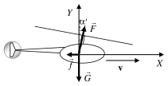

Задача 1. а) На фигурата са изобразени силите, действащи на хеликоптера:
подемна сила на витлото F, насочена по оста на витлото, сила на тежестта G и
сила на въздушно съпротивление f. ....................[1 т. за чертеж с правилно
означени сили]

 Y
 $\alpha \rho$
 F

 $\rho$
 f v X
 $\rho$
 G
 $\rho$
Понеже хеликоптерът се движи с постоянна скорост ( a = 0 ), трите сили се
уравновесяват:
 $\rho \rho \rho$
 f + G + F = 0 ....................[1 т. за векторно равенство]
Проектираме векторното равенство по осите X и Y:
X: Fsin$\alpha$ - f = 0; ..................\[0,5 т.\]
Y: Fcos$\alpha$ - G = 0. ............... \[0,5 т.\]
Като изключим F, получаваме:

$\tan\alpha = \frac{f}{G} = \frac{k v^2}{mg}$ . ..............[1 т. за израз за $\tan\alpha$ или друга функция на $\alpha$]

Приемаме, че $\alpha$ (rad) $\approx$ tg$\alpha$. Така, окончателно намираме:

$\alpha \approx \frac{k v^2}{mg} = \frac{ 2 \text{kg/m} \cdot (30 \text{m/s})^2}{ 2000 \text{kg} \cdot 10 \text{m/s}^{2}}$ = 0,09 rad ($\approx 5,2 ^\circ$)........[1 т. за числена стойност в

градуси или радиани]

б) След като влакът започне да спира, топчето продължава да се движи спрямо
Земята с начална скорост $v_0$, насочена хоризонтално. В избраната координатна
система законите за движение на топчето са:
[1 т. за чертеж с означена координатна система]
 $O x_2 x_1 X$
X: $x_1$ = $v_0$t ; ..................\[0,5 т.\] $v_0 s$
 gt 2
Y: $y_1$ = . ............... \[0,5 т.\].
 2 Y

В същото време вагонът се движи равнозакъснително в хоризонтално
направление:
 at 2
 $x_2$ = v 0 t - ................ \[0,5 т.\].
 2

 1
В момента, когато топчето допира пода, $y_1$ = h. Оттук намираме времето за
 2h
падане на топчето: t = . ............... \[0,5 т.\].
 g
В момента на падане топчето се намира на разстояние от основата на масичката:
 s $= x_2$ $- x_1$ ............... \[1 т.\].
Като заместим израза за t, намираме:
 a
 s = h = 5 cm. ........[0,5 т. за буквен израз + 0,5 т. за числена стойност].
 g

Задача 2. а) В жичката се отделя топлинна мощност:

$P_T = I^2 R$, \[1 т.\]

където $R = \frac{4\rho l}{\pi d^2}$ \[1 т.\]
е съпротивлението на жичката (l е дължината на жичката).
Мощността на топлинно излъчване от жичката се дава с израза:

$P_R = \sigma T^4 (\pi d l)$, \[1 т.\]
където Т е абсолютната температура на жичката. Ако приемем, че излъчването е
единственият начин на топлоотдаване от жичката, получаваме: $P_T = P_R$, или

$\frac{4\rho I^2}{\pi d^2} = \pi d \sigma T^4$. \[1 т.\]
Максималният ток, който може да тече през предпазителя, се определя от условието:

$T = T_0 = t_0 + 273$ = 1358 K. \[1 т.\]

Така получаваме:

$I_{max} = \frac{\pi T_0^2}{2}\sqrt{\frac{\sigma d^3}{\rho}}$ \[1 т.\]

$I_{max}$ = 5,2 A. \[1 т.\]
б) Ако при големина на тока I, температурата на жичката е T, е изпълнено условието:

$\left(\frac{I}{I_{max}}\right)^2 = \left(\frac{T}{T_0}\right)^4$. \[1,5 т.\]

При $I = \frac{1}{2} I_{max}$ получаваме: $T = T_0 \sqrt{\frac{I}{I_{max}}}$ \[1 т.\]

$T = 960 \text{K}$ (687 $^\circ$C). \[0,5 т.\]

Задача 3. а) При нормална работа за време t през лампата преминава заряд:
 q = I nt . \[1 т.\]
При това напрежението на кондензатора намалява до:

 2
 q It
 U (t ) = U 0 - = U 0 - n .\[1 т.\]
 C C
През лампата ще протича нормален работен ток, докато
 U(t) $\geq$ Un. \[1 т.\]
Следователно, времето, през което лампата ще свети нормално, е:
 C (U 0 - U n )
 t= .\[1 т.\]
 In
 t = 90 s. \[0,5 т.\]
б) През време на нормалната работа в лампата се отделя енергия:
$Q_L = U_n I_n t = C(U_0 - U_n)U_n$. \[1 т.\]
Общото количество енергия, което се отделя във веригата, е:
$Q = \frac{CU_0^2}{2} - \frac{CU_n^2}{2} = \frac{C(U_0^2 - U_n^2)}{2}$. \[1 т.\]
За коефициента на полезно действие намираме:
КПД = $\frac{U_n}{U_0 - U_n}$; \[1 т.\]
КПД = 1/9. \[0,5 т.\]
в) Понеже лампата и реостата са свързани последователно към кондензатора,
при нормална работа на лампата е в сила равенството:
$U_n + I_n R(t) = U(t)$. \[1 т.\]
Като използваме израза за U(t) от т. а), получаваме:
$R(t) = \frac{U_0 - U_n}{I_n} - \frac{t}{C}$. \[1 т.\]

 InR(t)
Un U(t) C=1F

 Фиг. 3

 3
