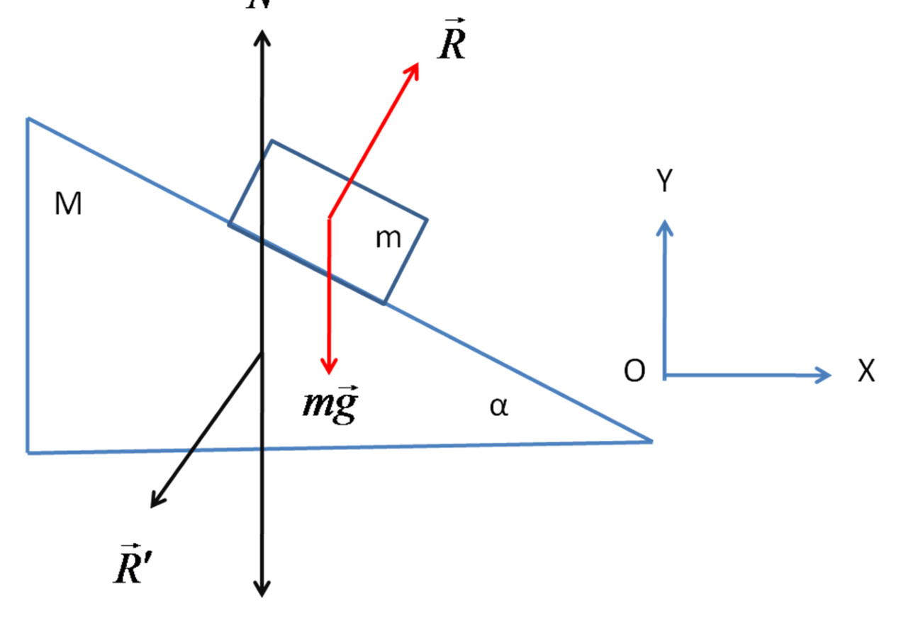
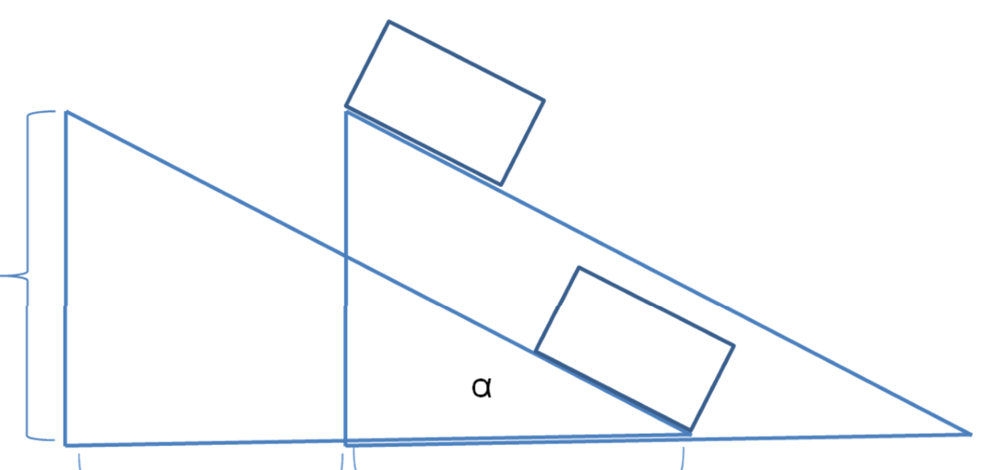

[[Състезания/esenno/11/2010|условия]] | [[Състезания/esenno/11/2011| 2011 ▸]]

Решение на Задача 1

 а) Имайки в предвид, че призмата ще се движи по хоризонталната равнина, въвеждаме
 координатната система по указания начин на Фиг. 1б.

 Фиг. 1б
 На призмата действат силата на тежестта $\vec{Mg}$, реакцията на хоризонталната равнина $\vec{N}$ и силата на натиск от страна на трупчето $\vec{R'}$, $\vec{R'} = -\vec{R}$. Вторият принцип на Нютон във
 векторна форма, записан за призмата, има вида:

$\vec{Mg} + \vec{R'} + \vec{N} = M\vec{a}_1$, (1.1)

където $\vec{a}_1$ е ускорението на призмата. Скаларните уравнения, съответстващи на (1.1), са:

$-R\sin\alpha = M a_{1X}$
$-R\cos\alpha - Mg + N = M a_{1Y}$
(1.2а-б)

 Тъй като призмата не се движи във вертикална посока
$a_{1Y} = 0$ (2 точки) (1.3)

 На трупчето действат силата на тежестта $\vec{mg}$ и реакцията на призмата $\vec{R}$, $\vec{R} = -\vec{R'}$.

 Вторият принцип на Нютон във векторна форма, записан за трупчето, има вида:

$\vec{mg} + \vec{R} = m\vec{a}_2$, (1.4)

където $\vec{a}_2$ е ускорението на трупчето. Скаларните уравнения, съответстващи на (1.4), са:

$R\sin\alpha = m a_{2X}$
$R\cos\alpha - mg = m a_{2Y}$
(1.5а-б)

 Уравненията (1.2) и (1.5) представляват система от четири уравнения за петте
неизвестни величини: R, N, $a_{1X}$, $a_{2X}$, $a_{2Y}$.

 Последното необходимо уравнение може да бъде получено чрез кинематичните
величини, описващи движението на двете тела.

 От фигурата се вижда, че

$\frac{s_{2Y}}{s_{1X} + s_{2X}} = \tan\alpha$ (1.6)

 И двете тела се движат равноускорително $a_{1X}$ < 0, $a_{2X}$ > 0, $a_{2Y}$ < 0 с нулеви начални
скорости.

$s_{1X} = \frac{a_{1X} t^2}{2}$, $s_{2X} = \frac{a_{2X} t^2}{2}$, $s_{2Y} = \frac{a_{2Y} t^2}{2}$ (1.7)

Използвайки (1.7), (1.6) може да бъде записано във вида:

$\frac{a_{2Y}}{a_{1X} - a_{2X}} = \tan\alpha$ (1.8)

Последното уравнение представлява и петото необходимо уравнение за намиране на
неизвестните величини: R, N, $a_{1X}$, $a_{2X}$, $a_{2Y}$.

Решение на получената система от 5 уравнения:

Разделяйки (1.2а) на (1.5а), получаваме:

$a_{1X} = -\frac{m}{M} a_{2X}$ (1.9)

Замествайки (1.9) в (1.8) получаваме:

$\frac{a_{2Y}}{a_{2X}} = -\left(1 + \frac{m}{M}\right)\tan\alpha$ (1.10)

Разделяйки (1.5б) на (1.5а) получаваме:

$\frac{a_{2Y}}{a_{2X}} = \frac{R\cos\alpha - mg}{R\sin\alpha}$ (1.11)

От приравняването на (1.10) и (1.11) получаваме

$R = \frac{Mmg\cos\alpha}{M + m\sin^2\alpha}$ (2 точки) (1.12)

Замествайки в (1.10), $a_{2X} = \frac{R\sin\alpha}{m}$ от (1.5а) и R с израза (1.12) получаваме:

$a_{2Y} = -\frac{(M + m) g \sin^2\alpha}{M + m\sin^2\alpha}$ (2 точки) (1.13)

Замествайки в (1.5а), (1.12) получаваме:

$a_{2X} = \frac{Mg\sin\alpha\cos\alpha}{M + m\sin^2\alpha}$ (1 точка) (1.14)

От (1.13) и (1.14) получаваме за ускорението на трупчето:

$a_2 = \sqrt{a_{2X}^2 + a_{2Y}^2} = \frac{g\sin^2\alpha}{M + m\sin^2\alpha}\sqrt{(2Mm + m^2)\sin^2\alpha + M^2}$ (1 точка) (1.15)

Използвайки (1.2а), и (1.12) получаваме:

$a_1 = -a_{1X} = \frac{mg\cos\alpha\sin\alpha}{M + m\sin^2\alpha}$ (2 точки) (1.16)

Решение на Задача 2

a) Параметрите на състоянието на въздуха в страната, ограничена с изпъкналата част на
буталото, ще обозначаваме с индекса 1. Параметрите на състоянието на въздуха в страната,
ограничена с плоската част на буталото, ще обозначаваме с индекса 2.

 Ако цилиндърът се постави вертикално така, че изпъкналата част на буталото да е
надолу, то заема равновесно положение, при което изпъкналата му част слиза до дъното на
цилиндъра, без да се опира в него (виж Фиг. 2а).

Уравнението за състоянието на идеалния газ в страната 2 има вида:

$p_2 V_2 = \frac{m_2}{M} R T_2$

Обемът $V_2$ е равен на $V_2 = (\pi r^2)(5r) = 5\pi r^3$. (1 точка)

Уравнението за състоянието на идеалния газ в страната 1 има вида:

$p_1 V_1 = \frac{m_1}{M} R T_1$

Обемът $V_1$ е равен на $V_1 = (\pi r^2)(r) - \frac{2}{3}\pi r^3 = \frac{1}{3}\pi r^3$. Тук $\frac{2}{3}\pi r^3$ е обемът на буталото. (1 точка)

 За да бъде буталото в равновесие, векторната сума от силите, които му действат, трябва
да бъде равна на нула:

$p_2 \pi r^2 + G = p_1 \pi r^2$,

където G е силата на тежестта, действаща върху буталото. С други думи, налягането на
въздуха от страната 2 плюс налягането дължащо се на буталото трябва да бъде равно на
налягането на въздуха от страна 1:

$p_2 + p_{БУТАЛО} = p_1$, където $p_{БУТАЛО} = \frac{G}{\pi r^2}$.

Следователно

$$p_\text{БУТАЛО} = p_1 - p_2 = \frac{R}{M}\left( 3\frac{m_1 T_1}{\pi r^3} - \frac{m_2 T_2}{5\pi r^3} \right) = \frac{R}{M\pi r^3}\left(3m_1 T_1 - \frac{m_2 T_2}{5}\right).$$

(1 точка)
(2.1)

 Ако цилиндърът се преобърне и пак е вертикален, равновесното положение на буталото
е такова, че плоската му част се намира на средата на цилиндъра (виж Фиг. 2б).

Уравнението за състоянието на идеалния газ в страната 2 има вида:

$p_2' V_2' = \frac{m_2}{M} R T_2$

Обемът $V_2'$ е равен на $V_2' = (\pi r^2)(3r) = 3\pi r^3$. (1 точка)

Уравнението за състоянието на идеалния газ в страната 1 има вида:

$p_1' V_1' = \frac{m_1}{M} R T_1$

Обемът $V_1'$ е равен на $V_1' = (\pi r^2)(3r) - \frac{2}{3}\pi r^3 = \frac{7}{3}\pi r^3$. (1 точка)

 Налягането на въздуха от страната 1 плюс налягането дължащо се на буталото трябва
да бъде равно на налягането на въздуха от страна 2:

$p_1' + p_{БУТАЛО} = p_2'$.

Следователно

$$p_\text{БУТАЛО} = p_2' - p_1' = \frac{R}{M}\left(\frac{m_2 T_2}{3\pi r^3} - \frac{3}{7}\frac{m_1 T_1}{\pi r^3} \right) = \frac{R}{M\pi r^3}\left(\frac{1}{3}m_2 T_2 - \frac{3}{7}m_1 T_1\right).$$

(1 точка)
(2.2)

Приравняването на двата израза за налягането на буталото дава:

$3 \cdot \frac{8}{7} m_1 T_1 = \frac{8}{15} m_2 T_2$.

Отчитайки, че $T_1/T_2 = n$, получаваме: $\frac{m_1}{m_2} = \frac{7}{45}\cdot\frac{T_2}{T_1} = \frac{7}{45 n}$ (1 точка)

б)

Уравнението за състоянието на идеалния газ в страната 2 има вида:

$p_2'' V_2'' = \frac{m_2}{M} R T_3$

Обемът $V_2''$ е равен на $V_2'' = (\pi r^2)(5r) = 5\pi r^3$.

Уравнението за състоянието на идеалния газ в страната 1 има вида:

$p_1'' V_1'' = \frac{m_1}{M} R T_1$

Обемът $V_1''$ е равен на $V_1'' = (\pi r^2)(r) - \frac{2}{3}\pi r^3 = \frac{1}{3}\pi r^3$. (1 точка)

 Налягането на въздуха от страната 1 плюс налягането дължащо се на буталото трябва
да бъде равно на налягането на въздуха от страна 2:

$p_1'' + p_{БУТАЛО} = p_2''$.

Следователно

$$p_\text{БУТАЛО} = p_2'' - p_1'' = \frac{R}{M}\left(\frac{m_2 T_3}{5\pi r^3} - 3\frac{m_1 T_1}{\pi r^3} \right) = \frac{R}{M\pi r^3}\left(\frac{1}{5}m_2 T_3 - 3m_1 T_1\right).$$

 (1 точка)

Приравняването на получения израз за налягането на буталото с някой от предишните два
израза (2.1) или (2.2) дава:

$$p_\text{БУТАЛО} =\frac{R}{M\pi r^3}\left(3m_1 T_1-\frac{m_2 T_2}{5}\right) = \frac{R}{M\pi r^3}\left(-3m_1 T_1+\frac{m_2 T_3}{5}\right) \Rightarrow T_3 = \frac{11}{3}T_2$$

 (1 точка)

Решение на задача 3.

a) Центростремителната сила е равна на кулоновата сила:

$m_e \frac{u^2}{r} = k \frac{e^2}{r^2}$ $\Rightarrow$ $r = k \frac{e^2}{m_e u^2}$, $k = \frac{1}{4\pi\varepsilon_0}$ (3.1)

Използвайки, че на кръгова стационарна орбита се нанасят цяло число дължини на вълната на
Дьо Бройл, т.е е в сила съотношението $2\pi r = n \frac{h}{p}$, получаваме за скоростта на електрона:

$r m_e u = n\hbar$ $\Rightarrow$ $u = \frac{n\hbar}{r m_e}$. (3.2)

Замествайки (3.2) в (3.1) получаваме следната формула за радиусите на стационарните орбити
на електроните във водородния атом:

$$r = k \frac{e^2}{m_e} \left(\frac{r m_e}{n\hbar}\right)^2 \Rightarrow r_n = n^2 \frac{\hbar^2}{k e^2 m_e} = n^2 r_1, \quad n = 1, 2, 3, \dots$$

(2 точки)
 (3.3)

б)

$$r_1 = \frac{\hbar^2}{k e^2 m_e} = \frac{(6,626\cdot10^{-34} \text{J}\cdot\text{s})^2}{4\pi^2\left(9\cdot 10^9 \frac{\text{N}\cdot\text{m}^2}{\text{C}^2}\right)(1,6\cdot10^{-19} \text{C})^2 (9,1\cdot10^{-31} \text{kg})} = 0,528\cdot 10^{-10} \text{m}$$

 (1 точка)

в) Пресмятаме пълната енергия на електрона. Кинетичната енергия на електрона е

$E_k = \frac{1}{2} m_e u^2 = \frac{1}{2} k \frac{e^2}{r}$. Потенциалната енергия на електрона е $E_p = -k \frac{e^2}{r}$. Следователно пълната енергия на електрона е: $E_p = -\frac{1}{2} k \frac{e^2}{r}$. (2 точки) (3.4)

 Замествайки (3.3) в (3.4) получаваме формулата за енергията на електрона на
различните стационарни орбити във водородния атом:

$E_n = -\frac{1}{2} k \frac{e^2}{r_n} = -\frac{1}{2} k \frac{e^2}{n^2 r_1} = -\frac{1}{n^2}\frac{(ke^2)^2 m_e}{2\hbar^2} = \frac{1}{n^2} E_1$, $E_1 = -\frac{(ke^2)^2 m_e}{2\hbar^2}$ (1 точка) (3.5)

г) Замествайки зададените физични константи в (3.5) получаваме:

$$E_1 = -\frac{(ke^2)^2 m_e}{2\hbar^2} = -\frac{\left(9\cdot10^9 \frac{\text{N}\cdot\text{m}^2}{\text{C}^2}\right)^2 (1,6\cdot10^{-19} \text{C})^4 (9,1\cdot10^{-31} \text{kg}) 4\pi^2}{2(6,626\cdot10^{-34} \text{J}\cdot\text{s})^2} = -2,17\cdot10^{-18} \text{J}$$

$1 \text{J} = \frac{1}{1,6\cdot10^{-19}} \text{eV}$ $\Rightarrow$ $E_1 = -2,17\cdot10^{-18} \text{J} = -2,17\cdot10^{-18}\cdot\frac{1}{1,6\cdot10^{-19}} \text{eV} = -13,55 \text{eV}$
(1 точка)

д) Използвайки втория постулат на Бор за излъчената или погълната енергия при преход на
електрона от една стационарна орбита на друга, и използувайки изведената формула за
енергиите на електрона на различните стационарни орбити във водородния атом (3.5)
получаваме:

$$\nu = \frac{1}{h}(E_m - E_n) = \frac{E_1}{h}\left(\frac{1}{m^2}-\frac{1}{n^2}\right), m > n.$$

Съпоставяйки този израз със зададената формула $\nu_{nm} = R\left(\frac{1}{n^2}-\frac{1}{m^2}\right), n < m$, се вижда, че
стойността на константата на Ридберг е:

$$R = \frac{-E_1}{h} = \frac{2,17\cdot10^{-18} \text{J}}{6,626\cdot10^{-34} \text{J}\cdot\text{s}} = 3,29\cdot10^{15} \left[\frac{1}{s}\right].$$
