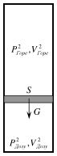
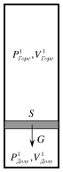

[[Състезания/esenno/11/2010|◂ 2010]] | [[Състезания/esenno/11/2011|условия]] | [[Състезания/esenno/11/2012| 2012 ▸]]

Задача 1.

 а) Използваме законите за запазване на енергията и импулса за два момента от време -
началният момент, когато заредената частица е безкрайно далеч от сферата и моментът, в
който частицата достига по-близкия отвор в повърхността на сферата и двете се движат
съответно със скорости $V_1$ и $V_2$.

$E_{k0} = E_{k1} + E_{k2} + E_p$
$\vec{p} = \vec{p}_1 + \vec{p}_2$

Полето на сферата извън нея е същото като полето на точков заряд със същата големина
и знак, който е поставен в центъра й.

Потенциалната енергия на системата от двете тела в момента, в който заредената
частица достига по-близкия отвор в повърхността на сферата е:

$E_p = \frac{qQ}{4\pi\varepsilon_0 R}$ \[1 т.\], ($\varepsilon_0$ - диелектрична проницаемост на вакуума)

$\frac{mV^2}{2} = \frac{mV_1^2}{2} + \frac{MV_2^2}{2} + \frac{qQ}{4\pi\varepsilon_0 R}$ \[1 т.\]
$mV = mV_1 + MV_2$ \[1 т.\]

Решаваме тази система уравнения и получаваме две двойки решения за скоростите $V_1$ и
$V_2$ на заредената частица и сферата в момента, в който точковият заряд достига по-
близкия отвор на сферата:

$V_1 = \frac{MV}{m+M}\left(\frac{m}{M} \pm \sqrt{1 - \frac{qQ(m+M)}{2\pi\varepsilon_0 R m M V^2}}\right)$ и $V_2 = \frac{mV}{m+M}\left(1 \mp \sqrt{1 - \frac{qQ(m+M)}{2\pi\varepsilon_0 R m M V^2}}\right)$. \[1 т.\]

При q = Q = 0 няма взаимодействие между сферата и заредената частица и
следователно $V_1$ = V, $V_2$ = 0. Това ни позволява да изберем правилната двойка решения:

$V_1 = \frac{MV}{m+M}\left(\frac{m}{M} + \sqrt{1 - \frac{qQ(m+M)}{2\pi\varepsilon_0 R m M V^2}}\right)$ и $V_2 = \frac{mV}{m+M}\left(1 - \sqrt{1 - \frac{qQ(m+M)}{2\pi\varepsilon_0 R m M V^2}}\right)$. \[1 т.\]

 б) Интензитетът на електричното поле на сферата вътре в нея е нула, следователно
движението на заредената частица вътре в сферата е равномерно \[1 т.\]. За определяне на
времето на движение е необходимо да пресметнем относителната скорост на движение на
заредената частица спрямо сферата.

$V_{отн.} = V_1 - V_2 = \pm V\sqrt{1 - \frac{qQ(m+M)}{2\pi\varepsilon_0 R m M V^2}}$, \[1 т.\]

Търсеното време е:

$t = \frac{2R}{V_{отн.}} = \frac{2R}{V\sqrt{1 - \frac{qQ(m+M)}{2\pi\varepsilon_0 R m M V^2}}}$ \[1 т.\]

 в) Изразът под корена трябва да е положителен за получаване на реално решение, от
където получаваме условие за минималната скорост, при която заредената частица
преминава през сферата:

$V > \sqrt{\frac{qQ(m+M)}{2\pi\varepsilon_0 R m M}}$ $\Rightarrow$ $V_{min} = \sqrt{\frac{qQ(m+M)}{2\pi\varepsilon_0 R m M}}$ \[1 т.\]

 г) При M >> m извършваме граничен преход $\frac{m}{M} \to 0$ и получаваме:

$V_{min} = \sqrt{\frac{qQ}{2\pi\varepsilon_0 R m}}$. \[1 т.\]

Същия резултат получаваме и от закона за запазване на енергията, като отчетем, че
сферата е неподвижна, а кинетичната енергия на заредената частица се е превърнала
изцяло в потенциална енергия на системата от две тела ($V_1$ = $V_2$ = 0), в момента, в който
заредената частица достига по-близкия отвор в сферата.

Задача 2.

 Използваните в решението означения са показани на фигура 1.

$(P_{Горе}, V_{Горе})_1$     $(P_{Горе}, V_{Горе})_2$

S     S

G     G

$(P_{Долу}, V_{Долу})_1$     $(P_{Долу}, V_{Долу})_2$

$\eta_1 = \frac{V_{Горе\,1}}{V_{Долу\,1}}$ (1)      $\eta_2 = \frac{V_{Горе\,2}}{V_{Долу\,2}}$ (2)

 Фиг. 1
Тъй като масата и площта на буталото са еднакви и в двете състояния (G, S = const), то
при равновесие на буталото, силата на тежестта трябва да се уравновесява от еднакви
разлики в наляганията.

$P_{Долу\,1} - P_{Горе\,1} = P_{Долу\,2} - P_{Горе\,2}$ \[2 т.\] (3)

Общият обем на съда остава постоянен следователно

$V_{Горе\,1} + V_{Долу\,1} = V_{Горе\,2} + V_{Долу\,2} = V$ \[2 т.\] (4)

Приемайки въздуха за идеален газ, можем да запишем уравнението на състоянието за
един мол идеален газ за четирите различни обема.

$P_{Горе\,1} V_{Горе\,1} = R T_1$ \[0,5 т.\] (5)
$P_{Долу\,1} V_{Долу\,1} = R T_1$ \[0,5 т.\] (6)
$P_{Горе\,2} V_{Горе\,2} = R T_2$ \[0,5 т.\] (7)
$P_{Долу\,2} V_{Долу\,2} = R T_2$ \[0,5 т.\] (8)

Решаването на системата уравнения (1) - (8) дава следния резултат:

$T_2 = T_1 \frac{\eta_2(\eta_1^2 - 1)}{\eta_1(\eta_2^2 - 1)} = 422$ K \[4 т.\]

Задача 3.

 а) Законът на Стефан-Болцман дава мощността на излъчването на единица площ за
абсолютно черно тяло: $W_0 = \sigma T_0^4$ [W/m²], а площта на Слънцето е $S_0 = 4\pi R_0^2$ [m²].

Следователно мощността на излъчената енергия от повърхността на Слънцето е $P_0 = W_0 S_0$
[W] \[1 т.\]. Излъчването е еднакво във всички посоки, а енергията се запазва и следователно
на разстояние L от центъра на Слънцето същата енергия ще е разпределена равномерно
върху площ $S = 4\pi L^2$.

$P_0 = W_0 S_0 = K S$ \[1 т.\] Търсената енергия, на единица площ за единица време е:

$$K = \frac{W_0 S_0}{S} = \frac{\sigma T_0^4 R_0^2}{L^2} = 1372 \left[\frac{W}{m^2}\right]$$

\[2 т.\].

 б) Напречното сечение на Земята е диск с площ $S_1 = \pi R_1^2$, където с $R_1$ е означен земният
радиус. Погълнатата от Земята енергия за единица време е $P_1$ = K$S_1$ \[1 т.\] и при условие, че
Земята се намира в топлинно равновесие, тя трябва да е точно равна на излъчената от
повърхността на Земята \[1 т.\] - $P_2 = W_2 S_2$ ($W_2 = \sigma T_1^4$ - мощност на излъчването на единица
площ, $S_2 = 4\pi R_1^2$ - площ на Земята).

$K \pi R_1^2 = \sigma T_1^4 4\pi R_1^2$ \[1 т.\]

Следователно $T_1 = T_0 \sqrt{\frac{R_0}{2L}} = 279$ K \[2 т.\]

 в) Използвайки законът на Вин, получаваме:

$\lambda_0 T_0 = \lambda_1 T_1$
$\lambda_1 = \frac{\lambda_0 T_0}{T_1} = \lambda_0 \sqrt{\frac{2L}{R_0}} = 10$ μm \[1 т.\].
