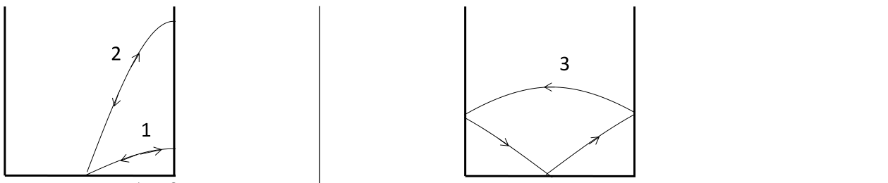
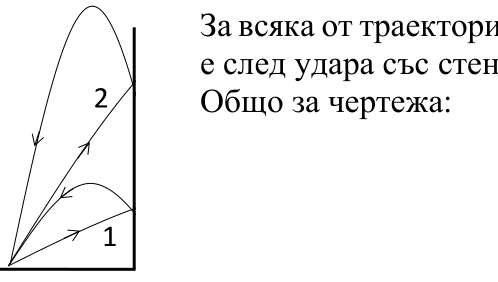
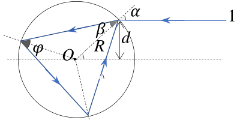
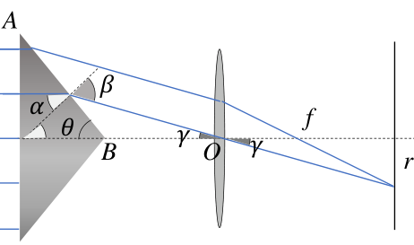

[[Състезания/esenno/11/2025|◂ 2025]] | [[Състезания/esenno/11/2026|условия]]

**Задача 1. Скуош**

а) Вертикалната компонента на скоростта на топката не се променя при удар със стената. Затова времето на полета на топката е същото, както при свободен полет:

$$t = \frac{2v_0\sin\alpha}{g} \qquad (1)$$ \[0,5 т.\]

Пътят d на топката в хоризонтално направление е съответно:

$$d = v_0\cos\alpha\, t = \frac{v_0^2\sin(2\alpha)}{g} \qquad (2)$$ \[0,5 т.\]

Първо ще разгледаме възможността топката да се върне в точката на изстрелване след удар само с една от стените. В този случай общият път в хоризонтално направление е $d = L$, който съответства на изминато разстояние L/2 в посока към стената и после още L/2 в противоположната посока след удара. Следователно:

$$L = \frac{v_0^2\sin(2\alpha)}{g} \qquad (3)$$ \[0,5 т.\]

и намираме

$$\sin(2\alpha) = \frac{gL}{v_0^2} = 0{,}5 \qquad (4)$$ \[0,5 т.\]

Уравнението има две решения:

$$\alpha_1 = 15^\circ \quad \text{и}\quad \alpha_2 = 90^\circ - 15^\circ = 75^\circ \qquad (5)$$ \[1,0 т.\]

(по 0,5 т за всяка от двете стойности).

Сега ще разгледаме възможността топката да се върне след два последователни удара със стените. В този случай общият път в хоризонтално направление е $d = 2L$, защото топката изминава разстояние L/2 надясно преди първия удар, L в противоположна посока до другата стена и отново L/2 след втория удар. Следователно:

$$2L = \frac{v_0^2\sin(2\alpha)}{g}\quad \text{или}\quad \sin(2\alpha) = \frac{2gL}{v_0^2} = 1 \qquad (6)$$ \[1,0 т.\]

Уравнението има единствено решение:

$$\alpha_3 = 45^\circ \qquad (7)$$ \[0,5 т.\]

Траекториите за трите възможни стойности на α са показани на фигурата по-долу.

- За всяка от траекториите 1 и 2: 1) 0,3 т, ако най-високата точка е в момента на удара със стената; 2) 0,2 т, ако траекторията преди удара съвпада с траекторията след удара.
- За траекторията 3: 1) 0,3 т, ако най-високата точка е над точката на изстрелване; 2) 0,2 т, ако траекторията е симетрична спрямо точката на изстрелване.

Максималният общ резултат за правилно построени графики е \[1,5 т.\].

б) Вертикалната компонента на скоростта е успоредна на стената и следователно не се мени при удар със стената. Затова общото време на полета се дава с уравнение (1), както в предишния случай. Хоризонталната компонента на скоростта обаче се променя по големина. Затова времето на движение надясно не е равно на времето на движение наляво след удара. При движение надясно времето до удара е съответно:

$$t_1 = \frac{L}{2v_0\cos\alpha} \qquad (8)$$ \[0,5 т.\]

понеже хоризонталната компонента на скоростта преди удара е $v_0\cos\alpha$. След удара хоризонталната компонента става $0{,}7v_0\cos\alpha$ и съответното време за движение в обратна посока е:

$$t_2 = \frac{L}{2\cdot 0{,}7v_0\cos\alpha} = \frac{L}{1{,}4v_0\cos\alpha} \qquad (9)$$ \[0,5 т.\]

Понеже общото време на движение е $t = t_1 + t_2$, като използваме уравнение (1), намираме:

$$\frac{2v_0\sin\alpha}{g} = \frac{L}{2v_0\cos\alpha} + \frac{L}{1{,}4v_0\cos\alpha} = \frac{1{,}7L}{1{,}4v_0\cos\alpha} \qquad (10)$$ \[0,5 т.\]

Следователно за възможните стойности на ъгъла α имаме уравнението:

$$\sin(2\alpha) = \frac{1{,}7gL}{1{,}4v_0^2} \approx 0{,}61 \qquad (11)$$ \[0,5 т.\]

В този случай двете решения са:

$$\alpha_1 \approx 19^\circ \quad \text{и}\quad \alpha_2 \approx 71^\circ \qquad (12)$$ \[1,0 т.\]

(по 0,5 т за всяка от двете стойности).

Лесно се съобразява, че след втори удар с лявата стена хоризонталната компонента става толкова малка, че тогава топката не би могла да се върне в точката на изстрелване, без да се удари в пода. Следователно $\alpha_1$ и $\alpha_2$ са единствените възможни стойности за ъгъла на изстрелване.

Съответните траектории в този случай са показани на фигурата по-долу. Понеже времето на движение до стената е по-малко от времето на движение в обратна посока, най-високата точка на траекторията се достига след удара със стената.

Графиките се оценяват по следния начин: за всяка от траекториите 1 или 2 по 0,5 т, ако върхът на траекторията е след удара със стената. Общо за чертежа: \[1,0 т.\].

**Задача 2. Поливане на градината**

а) Изпомпаната за време t вода изпълва част от тръбата с дължина $\ell = vt$ \[0,5 т.\] и обем $V = \ell S = vSt$ \[0,5 т.\]. Масата на водата в този обем е $m = \rho V = \rho vSt$ \[0,5 т.\]. Следователно масовият дебит е:

$$Q = \frac{m}{t} = \rho vS \qquad (4)$$ \[0,5 т.\]

б) Масата изпомпана вода за дадено време t е $m = Qt$ \[0,5 т.\]. Понеже водата се изкачва на височина h, потенциалната ѝ енергия нараства с

$$\Delta E_p = mgh = Qght \qquad (6)$$ \[1,0 т.\]

Понеже водата се ускорява от покой в езерото до скорост v в тръбата, кинетичната ѝ енергия за това време нараства с

$$\Delta E_k = \frac{mv^2}{2} = \frac{Qv^2}{2}t \qquad (7)$$ \[1,0 т.\]

За същия интервал от време помпата извършва върху водата механична работа $A = Pt$ \[1,0 т.\]. От ЗЗЕ е ясно, че тази работа съответства на промяната на пълната механична енергия на водата:

$$\frac{Qv^2}{2}t + Qght = Pt \quad \text{или}\quad \frac{Qv^2}{2} + Qgh = P \qquad (9)$$ \[1,0 т.\]

От връзката (4) изразяваме скоростта на водата като $v = Q/(\rho S)$ и получаваме търсеното уравнение за Q:

$$\frac{Q^3}{2(\rho S)^2} + Qgh = P \qquad (10)$$ \[1,0 т.\]

в) Уравнението може да се запише във вида $x = f(x)$ по следния начин:

$$Q = \frac{P}{gh} - \frac{Q^3}{2(\rho S)^2 gh} \qquad (11)$$ \[0,5 т.\]

Като начално приближение можем да пренебрегнем кинетичната енергия на водата, т.е. да положим:

$$Q_1 = \frac{P}{gh} = 0{,}5\ \text{kg/s} \qquad (12)$$ \[0,5 т.\]

Заместваме тази стойност в дясната страна на уравнение (11) и намираме второто приближение:

$$Q_2 = \frac{P}{gh} - \frac{Q_1^3}{2(\rho S)^2 gh} \approx 0{,}4931\ \text{kg/s} \qquad (13)$$ \[0,5 т.\]

За третото приближение намираме $Q_3 \approx 0{,}4931\ \text{kg/s}$, чиято стойност съвпада с второто приближение след закръгляне към втория знак след десетичната запетая \[0,5 т.\]. Следователно в рамките на желаната точност:

$$Q \approx 0{,}493\ \text{kg/s} \qquad (14)$$ \[0,5 т.\]

**Задача 3. Фигури от светлина**

а) На чертеж е изобразено, че ъгълът на падане на лъча 1 върху околната повърхност е равен на ъгъла α между лъча и радиуса към точката на падане \[0,5 т.\]. От чертежа е ясно, че $\sin\alpha = d/R$ \[0,5 т.\].

Ако лъчите вътре в капката образуват правилен k-ъгълник, ъгълът между падащ и отразен лъч е:

$$\varphi = 180^\circ - \frac{360^\circ}{k} \qquad (1)$$ \[0,5 т.\]

Тъй като падащият и отразеният лъч вътре във водата сключват равни ъгли с радиуса в точката на падане, следва:

$$\frac{\varphi}{2} = 90^\circ - \frac{180^\circ}{k} \qquad (2)$$ \[0,5 т.\]

От закона на Снелиус при пречупване на падащия лъч 1 следва:

$$n_0\sin\alpha = n_1\sin\beta \qquad (3)$$ \[0,5 т.\]

откъдето:

$$\frac{d}{R} = n_1\cos\left(\frac{180^\circ}{k}\right) \qquad (4)$$ \[0,5 т.\]

Ясно е, че $d \le R$, т.е. $d/R \le 1$ \[0,5 т.\].

Това условие определя вида на възможните правилни многоъгълници, образувани от лъчите. Първо ще изследваме възможността за образуване на равностранен триъгълник, т.е. $k = 3$. В този случай разстоянието $d_3$ между падащия лъч и центъра е:

$$d_3 = 1{,}33R\cos 60^\circ = 0{,}665R \qquad (5)$$ \[0,5 т.\]

За образуването на светлинен квадрат, $k = 4$, намираме съответното разстояние:

$$d_4 = 1{,}33R\cos 45^\circ \approx 0{,}940R \qquad (6)$$ \[0,5 т.\]

Образуването на правилен многоъгълник с пет или повече страни е невъзможно, защото в този случай дясната страна на уравнение (4) е по-голяма от единица, например 1,09 при $k = 5$, 1,169 при $k = 6$ и т.н. \[0,5 т.\]

б) Лъчите минават през основата, без да се пречупват, след което падат върху околната повърхност на конуса под еднакъв ъгъл:

$$\alpha = 90^\circ - \theta = 30^\circ \qquad (1)$$ \[0,5 т.\]

След пречупване, лъчите излизат във въздуха под еднакъв ъгъл β спрямо нормалата към околната повърхност. От закона на Снелиус:

$$\sin\beta = n_2\sin\alpha = 0{,}75 \qquad (2)$$ \[0,5 т.\]

откъдето $\beta \approx 48{,}6^\circ$. Съответно всички пречупени лъчи сключват еднакъв ъгъл

$$\gamma = \beta - \alpha \approx 18{,}6^\circ \qquad (3)$$ \[0,5 т.\]

с оста на конуса и съответно с оста на лещата.

За съпътстващ чертеж се дават следните точки:
- Изобразени са ъгълът на падане α и ъгълът на пречупване β \[0,5 т.\];
- Изобразен е лъч, който минава през оптичния център O, без да се пречупи \[0,5 т.\];
- Изобразен е ходът на поне още един лъч, минаващ през същата образуваща \[0,5 т.\].

Всички лъчи, падащи върху една и съща образуваща на конуса, напр. АВ, излизат от конуса като успореден светлинен сноп. След като минат през лещата, те се фокусират в една точка от екрана. Разстоянието r от точката на пресичане до оптичната ос може да бъде намерено, като проследим пътя на лъча, падащ върху оптичния център на лещата, защото той продължава, без да се пречупи. От чертежа е ясно, че:

$$r = f\,tg\,\gamma \approx 6{,}7\ \text{cm} \qquad (4)$$ \[1,0 т.\]

Ако проследим пътя на лъчите, падащи върху други образуващи на конуса, можем да направим извод, че върху екрана те се фокусират в множество точки, намиращи се на едно и също разстояние r от оптичната ос. Следователно върху екрана ще се наблюдава светла окръжност с радиус $r = 6{,}7\ \text{cm}$ \[1,0 т.\].

Уточнение. Численото определяне на ъглите β и γ в междинните формули (2) и (3) не е задължително. Вместо това, във формула (4) може да се използват тъждествата:

$$tg\beta = \frac{\sin\beta}{\sqrt{1 - \sin^2\beta}} \approx 1{,}134 \quad \text{и}\quad tg\gamma = \frac{tg\beta - tg\alpha}{1 + tg\beta\,tg\alpha} \approx 0{,}341$$
