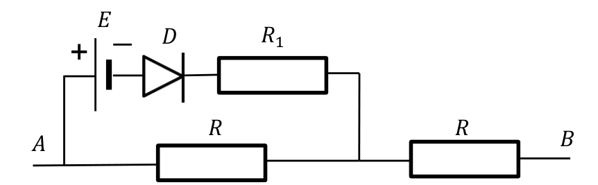

[[Състезания/esenno/12/2025|◂ 2025]] | [[Състезания/esenno/12r/2026|решения]]

**Задача 1. Тяло върху наклонена равнина**

Тяло с осева симетрия (диск, обръч, кълбо) е поставено върху наклонена равнина, сключваща ъгъл α с хоризонта. Тялото има маса m, радиус r и инерчен момент I. Земното ускорение е g. В началния момент тялото не се върти, но центърът му има скорост $v_0$, насочена нагоре, успоредна на наклонената равнина. Коефициентът на триене при хлъзгане между тялото и наклонената равнина е k.

a) Получете формула за ускорението a на тялото, докато се хлъзга нагоре. \[1,5 т.\]

б) Получете формула за ъгловото ускорение ε на тялото, докато се хлъзга нагоре. \[1,5 т.\]

в) Получете формула за скоростта $v_{хл}$ на тялото в момента, когато хлъзгането престане. \[3 т.\]

г) Получете формули за скоростта $v_{хл}$ в два частни случая: когато $k \approx 0$ и когато $k \gg 1$. \[1 т.\]

Оттук нататък разгледайте ситуацията при следните параметри: $I = mr^2$ (обръч), $k = 1$ и $\alpha = 45^\circ$.

д) Получете формула за изминатия път s от началното положение до положението, когато хлъзгането престане. \[1,5 т.\]

е) Получете формула за промяната на пълната механична енергия ΔE между началното положение на тялото и когато то отново се върне в това положение. \[1,5 т.\]

**Задача 2. Схема с диод, батерия и три резистора**

Електрическа верига съдържа два еднакви резистора, всеки със съпротивление R, трети резистор със съпротивление $R_1$, диод и батерия с електродвижещо напрежение E. Приема се, че диодът и батерията са идеални. Между двете крайни точки A и B на веригата се подава напрежение от външен източник, който не е показан на схемата, и се мери токът във веригата. При подаване на напрежение 12,0 V токът е 30,0 mA. При обръщане на поляритета на подаденото напрежение при същото напрежение 12,0 V токът става 32,5 mA, а при увеличаване на напрежението до 20,0 V токът нараства до 62,5 mA.

а) Получете формула (формули) за зависимостта на тока във веригата от подаденото напрежение $I = I(U)$ и от параметрите на веригата. Посочете коя формула при какъв интервал и поляритет на напрежението е валидна. \[5 т.\]

б) От дадените измервания изчислете графично (на дадената графична хартия) или числено (по Ваш избор) стойностите на R, $R_1$ и E. \[5 т.\]

**Задача 3. Вятърна турбина**

Вятърната турбина е машина, която преобразува кинетичната енергия на вятъра в механична работа (въртене на ротора ѝ). Турбината се задвижва от вятъра, който обтича лопатките ѝ. Тя се върти във вертикална равнина около хоризонтална ос, успоредна на вятъра. Турбината съдържа няколко лопати, които, като се въртят, покриват кръг с площ S.

Ще използваме следния модел: приемаме, че въздухът е несвиваем идеален флуид с плътност ρ. Далеч от турбината налягането на въздуха е $p_0$, а скоростта му е $v_1$ (насочена към турбината). Точно преди лопатите на турбината налягането на въздуха е $p_1$, а скоростта му намалява до v. При преминаване на въздуха през турбината скоростта му не се променя. Непосредствено зад турбината скоростта му е все още v, а налягането е $p_2$ ($p_2 < p_0$). След като се отдалечи от турбината, въздухът има скорост $v_2$ и налягане $p_0$.

а) Нарисувайте качествени фигури как се мени скоростта с координатата и как се мени налягането с координатата на въздуха, който доближава турбината и после се отдалечава от нея. \[1 т.\]

б) Получете формула за кинетичната енергия на въздуха, който преминава през турбината с площ S за единица време ΔE_кин/Δt. \[1 т.\]

в) Изразете силата F, с която вятърът действа на ротора, по два начина: 1. Чрез разликата в наляганията от двете страни на ротора, изразени чрез началната и крайната скорост на въздуха; 2. Чрез промяната на импулса на преминаващия през ротора въздух. \[3 т.\]

г) От получените две формули в подусловие в) изразете v чрез $v_1$ и $v_2$. \[1 т.\]

д) При какво отношение $v_2/v_1$ мощността, произвеждана от една турбина при фиксирана $v_1$, ще е максимална? Получете формула за тази максимална мощност. \[2 т.\]

е) Дължината на лопатите на турбината е $r = 55\ \text{m}$. Плътността на въздуха е $\rho = 1{,}2\ \text{kg/m}^3$. Скоростта на вятъра е $v_1 = 10\ \text{m/s}$. Изчислете максималната мощност, която може да произвежда тази вятърна турбина. \[1 т.\]

ж) Ако един от двата блока на АЕЦ „Козлодуй“ произвежда мощност 1000 MW, колко турбини могат да го „заменят“? \[1 т.\]
