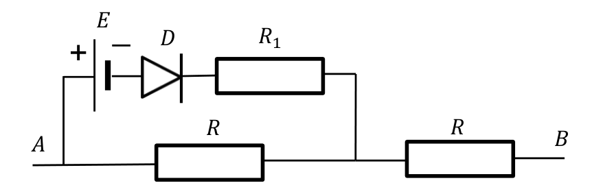
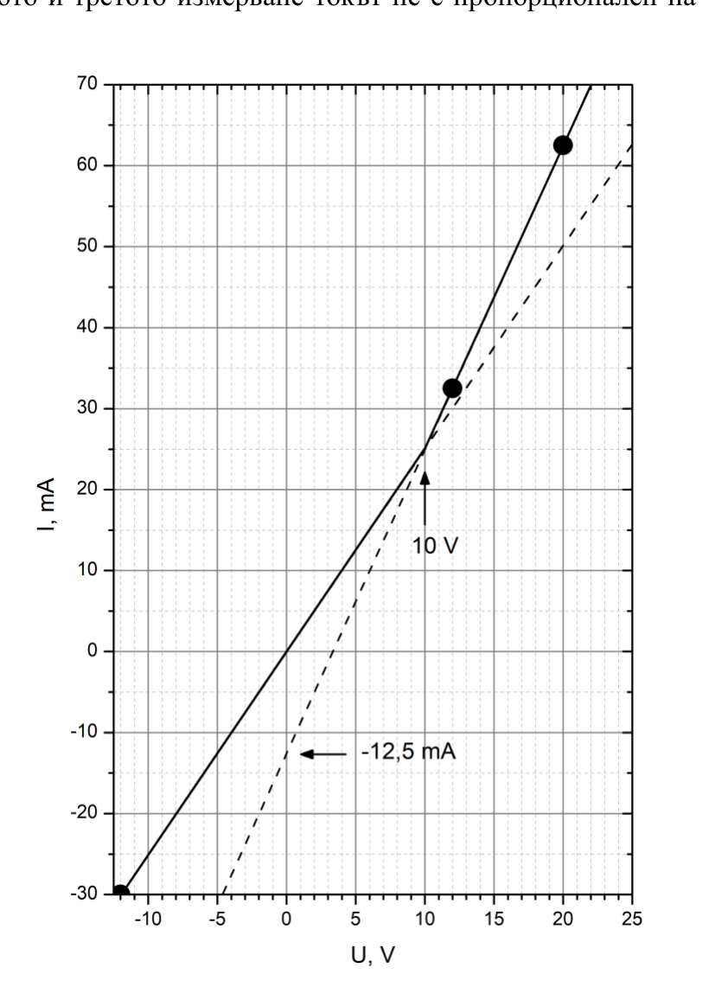
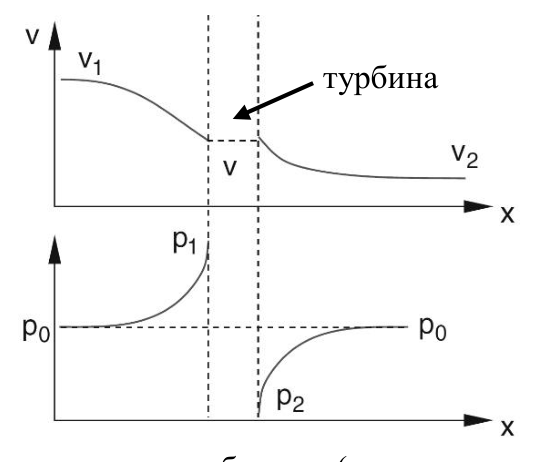

[[Състезания/esenno/12/2025|◂ 2025]] | [[Състезания/esenno/12/2026|условия]]

**Задача 1. Тяло върху наклонена равнина**

a) Тъй като тялото се хлъзга по наклонената равнина, реакцията на опората е $R = mg\cos\alpha$ \[0,5 т.\]. Силата на триене е $F_{тр} = kmg\cos\alpha$ \[0,5 т.\]. Ускорението на тялото, докато се хлъзга нагоре, се намира от уравнението $-F_{тр} - mg\sin\alpha = ma$, откъдето

$$a = -g(\sin\alpha + k\cos\alpha) \qquad (1)$$ \[0,5 т.\]

б) Тъй като спрямо центъра на масата на тялото само силата на триене има ненулев въртящ момент \[0,5 т.\], то $F_{тр}\cdot r = I\cdot\varepsilon$ \[0,5 т.\], и

$$\varepsilon = \frac{kmg\cos\alpha\cdot r}{I} \qquad (2)$$ \[0,5 т.\]

в) Хлъзгането ще престане, когато връзката между линейната и ъгловата скорост на тялото стане $v_{хл} = \omega r$ \[0,5 т.\]. Нека това се случи в момента $t_{хл}$. Тогава $v_{хл} = v_0 + a t_{хл}$ (4) и $\omega = \varepsilon t_{хл}$ (5). Замествайки в (3) с (4), (5), (1) и (2):

$$v_0 - g(\sin\alpha + k\cos\alpha)t_{хл} = \frac{kmg\cos\alpha\cdot r}{I}\cdot t_{хл}\cdot r \qquad [0{,}5\ \text{т.}]$$

откъдето

$$t_{хл} = \frac{v_0}{g(\sin\alpha + k\cos\alpha) + \dfrac{kmg\cos\alpha\cdot r^2}{I}} \qquad (6) \qquad [0{,}5\ \text{т.}]$$

Замествайки (6) в (4):

$$v_{хл} = v_0 - \frac{v_0\,g(\sin\alpha + k\cos\alpha)}{g(\sin\alpha + k\cos\alpha) + \dfrac{kmg\cos\alpha\cdot r^2}{I}} \qquad [0{,}5\ \text{т.}]$$

След опростяване:

$$v_{хл} = \frac{v_0\cdot\dfrac{kmg\cos\alpha\cdot r^2}{I}}{g(\sin\alpha + k\cos\alpha) + \dfrac{kmg\cos\alpha\cdot r^2}{I}} = v_0\,\frac{1}{1 + \dfrac{2}{k}\left(\dfrac{I}{mr^2} + 1\right)\tan\alpha} \qquad (7) \qquad [1\ \text{т.}]$$

г) Когато $k \approx 0$, $v_{хл} \approx 0$ \[0,3 т.\]. Когато $k \gg 1$,

$$v_{хл} \approx \frac{v_0}{1 + \dfrac{I}{mr^2}} \qquad [0{,}7\ \text{т.}]$$

д) При дадените параметри $\tan\alpha = 1$ и $a = -g\sqrt{2}$ \[0,2 т.\]. Уравнение (7) се преобразува до $v_{хл} = \frac{v_0}{3}$ \[0,3 т.\]. От връзката между изминат път, начална и крайна скорост и ускорение $s = \frac{v^2 - v_0^2}{2a}$ \[0,5 т.\], следва

$$s = \frac{\frac{v_0^2}{9} - v_0^2}{-2g\sqrt{2}} = \frac{2\sqrt{2}\,v_0^2}{9g} \qquad (8) \qquad [0{,}5\ \text{т.}]$$

е) След като хлъзгането престане, пълната механична енергия повече не се променя \[0,5 т.\]. Следователно:

$$\Delta E = \frac{mv_{хл}^2}{2} + \frac{I\omega_{хл}^2}{2} + mgs\sin\alpha - \frac{mv_0^2}{2} \qquad [0{,}5\ \text{т.}]$$

$$= \frac{mv_0^2}{18} + \frac{mr^2}{2}\left(\frac{v_0}{3r}\right)^2 + mg\cdot\frac{2\sqrt{2}v_0^2}{9g}\cdot\frac{1}{\sqrt{2}} - \frac{mv_0^2}{2} = \left(\frac{1}{18} + \frac{1}{18} + \frac{2}{9} - \frac{1}{2}\right)mv_0^2$$

$$\Delta E = -\frac{mv_0^2}{6} \qquad [0{,}5\ \text{т.}]$$

**Задача 2. Схема с диод, батерия и три резистора**

а) Ако $U_{AB} \in (-\infty, 2E)$, диодът е запушен \[0,5 т.\]. Тогава веригата съдържа само два последователно свързани еднакви резистора и токът е

$$I = \frac{U}{2R} \qquad [0{,}5\ \text{т.}]$$

При $U_{AB} > 2E$ диодът се отпушва ($U_{AB} \in (2E, \infty)$).

Нека бележим тока през диода, батерията и резистора $R_1$ с $I_1$, тока през успоредно свързания на тях резистор R с $I_2$, а токът в цялата верига (през десния на схемата резистор R) с I. Тогава

$$I = I_1 + I_2 \qquad (1) \qquad [0{,}5\ \text{т.}]$$

От равенството на двата пада на напрежение на успоредно свързаните елементи следва, че $RI_2 = E + R_1 I_1$ \[0,5 т.\] (2). Също така напрежението $U_{AB}$ е сума на падовете на напрежение на двата резистора R: $U_{AB} = RI_2 + RI$ \[0,5 т.\] (3).

Изразяваме $I_1$ от (1) и го заместваме в (2). Тогава (2) се превръща в $RI_2 = E + R_1(I - I_2)$, откъдето

$$I_2 = \frac{E + R_1 I}{R + R_1} \qquad (4)$$

Замествайки (4) в (3): $U_{AB} = R\frac{E + R_1 I}{R + R_1} + RI$ \[1 т.\]. След опростяване:

$$U_{AB} = \frac{RE + R(R + 2R_1)I}{R + R_1} = \frac{R}{R + R_1}E + \frac{R(R + 2R_1)}{R + R_1}I \qquad (5) \qquad [1\ \text{т.}]$$

От (5):

$$I = \frac{R + R_1}{R(R + 2R_1)}U_{AB} - \frac{E}{R + 2R_1} \qquad (6) \qquad [1{,}5\ \text{т.}]$$

б) **Числено решение.** Тъй като при второто и третото измерване токът не е пропорционален на напрежението, със сигурност при третото измерване диодът е отпушен \[0,2 т.\]. Ако при второто измерване диодът беше запушен, тогава това измерване трябваше да е идентично с първото, а то не е. Тогава и при второто измерване диодът е отпушен \[0,2 т.\]. Тогава при първото измерване диодът е запушен \[0,1 т.\] и от зависимостта $I = U/2R$ намираме

$$R = \frac{U}{2I} = \frac{12\ \text{V}}{2\cdot 30\ \text{mA}} = 200\ \Omega \qquad [0{,}5\ \text{т.}]$$

Нека напишем (6) като $I = aU_{AB} + b$, където

$$a = \frac{R + R_1}{R(R + 2R_1)} \qquad (7), \qquad b = -\frac{E}{R + 2R_1} \qquad (8)$$

Замествайки в (6) данните от второто и третото измерване: $32{,}5 = 12a + b$ (9) и $62{,}5 = 20a + b$ (10). Изваждайки (9) от (10): $30\ \text{mA} = a\cdot 8\ \text{V}$, откъдето $a = 3{,}75\ \text{k}\Omega^{-1}$. b може да се намери от (9): $b = 32{,}5 - 3{,}75\cdot 12 = -12{,}5\ \text{mA}$. Така от (7):

$$R_1 = R\,\frac{1 - aR}{2aR - 1} = 100\ \Omega \qquad [2\ \text{т.}]$$

а от (8):

$$E = -b(R + 2R_1) = 5{,}0\ \text{V} \qquad [2\ \text{т.}]$$

**Графично решение.** Тъй като при второто и третото измерване токът не е пропорционален на напрежението, със сигурност при третото измерване диодът е отпушен \[0,2 т.\]. Ако при второто измерване диодът беше запушен, тогава измерването трябваше да е идентично с първото, а то не е. Тогава и при второто измерване диодът е отпушен \[0,2 т.\]. Тогава при първото измерване диодът е запушен \[0,1 т.\]. Чертаем графика на зависимостта при запушен диод (права по точките (−12 V, −30 mA) и (0 V, 0 A)) и зависимостта при отпушен диод (втора права по точките (12 V, 32,5 mA) и (20 V, 62,5 mA)) \[2 т.\].

Тези две прави се пресичат в точка с координата 10,0 V \[0,5 т.\]. Следователно

$$E = \frac{10{,}0\ \text{V}}{2} = 5{,}0\ \text{V} \qquad [0{,}5\ \text{т.}]$$

От наклона на зависимостта при запушен диод намираме $R = \frac{U}{2I} = \frac{12\ \text{V}}{2\cdot 30\ \text{mA}} = 200\ \Omega$ \[0,5 т.\]. Свободният член на линейната зависимост – зависимостта при отпушен диод – е (виж (8)) $b = -\frac{E}{R + 2R_1} = -12{,}5\ \text{mA}$ \[0,5 т.\]. Оттук намираме:

$$R_1 = \frac{1}{2}\left(-\frac{E}{b} - R\right) = 100\ \Omega \qquad [0{,}5\ \text{т.}]$$

**Задача 3. Вятърна турбина**

а) Зависимостите как се мени скоростта с координатата и как се мени налягането с координатата на въздуха, който доближава турбината, преминава през нея и после се отдалечава от нея, качествено изглеждат така (използваме уравнението на Бернули за зоната преди турбината и за зоната след турбината) \[1 т.\].

б) Кинетичната енергия на въздуха, който преминава през турбината с площ S за единица време, е:

$$\frac{\Delta E_{кин}}{\Delta t} = \frac{\Delta m\,v^2}{2\Delta t} = \frac{\rho\,\Delta V\,v^2}{2\Delta t} = \frac{\rho S\,\Delta l\,v^2}{2\Delta t} = \frac{\rho S v^3}{2} \qquad (1) \qquad [1\ \text{т.}]$$

в) Силата F, с която вятърът действа на ротора. По първия начин:

$$F = (p_1 - p_2)S \qquad (2) \qquad [0{,}5\ \text{т.}]$$

Използвайки уравнението на Бернули за въздуха преди и след турбината (потенциалната енергия винаги е една и съща и може да се приеме за нула), получаваме съответно:

$$p_0 + \frac{\rho v_1^2}{2} = p_1 + \frac{\rho v^2}{2} \qquad (3)$$

$$p_0 + \frac{\rho v_2^2}{2} = p_2 + \frac{\rho v^2}{2} \qquad (4) \qquad [0{,}5\ \text{т.}]$$

Изваждайки (4) от (3):

$$p_1 - p_2 = \frac{\rho(v_1^2 - v_2^2)}{2} \qquad (5) \qquad [0{,}5\ \text{т.}]$$

Замествайки (5) в (2):

$$F = \frac{\rho S(v_1^2 - v_2^2)}{2} \qquad (6) \qquad [0{,}5\ \text{т.}]$$

по втория начин:

$$F = \frac{\Delta(mv)}{\Delta t} = \frac{\Delta m (v_1 - v_2)}{\Delta t} = \rho S v (v_1 - v_2) \qquad (7) \qquad [0{,}5\ \text{т.}]$$

г) Сравнявайки (6) и (7):

$$\frac{\rho S(v_1^2 - v_2^2)}{2} = \rho S v(v_1 - v_2) \qquad (8)$$

откъдето

$$v = \frac{v_1 + v_2}{2} \qquad (9) \qquad [1\ \text{т.}]$$

д) Мощността, произвеждана от една турбина, е $P = Fv$. Използвайки (7) и (9):

$$P = \rho S v^2(v_1 - v_2) = \rho S\left(\frac{v_1 + v_2}{2}\right)^2 (v_1 - v_2) = \frac{\rho S v_1^3}{4}\left[1 + \frac{v_2}{v_1} - \left(\frac{v_2}{v_1}\right)^2 - \left(\frac{v_2}{v_1}\right)^3\right] \qquad (10) \qquad [1\ \text{т.}]$$

Нека положим $x \equiv v_2/v_1$. Търсим максимум на $f(x) = 1 + x - x^2 - x^3$ за $x \in (0,1)$.

**Решение 1:** Когато функцията $f(x)$ има максимум, нейната производна $\frac{df(x)}{dx} = 1 - 2x - 3x^2 = 0$ \[0,5 т.\]. Корените на това квадратно уравнение са $x_{1,2} = \frac{2 \pm \sqrt{4 + 4\cdot 3}}{-6} = (-1,\ 1/3)$ \[0,5 т.\]. Само положителният корен има физичен смисъл. Следователно за максимална мощност

$$\frac{v_2}{v_1} = \frac{1}{3} \qquad (11) \qquad [0{,}5\ \text{т.}]$$

Тогава от (10):

$$P = \frac{\rho S v_1^3}{4}\cdot\frac{32}{27} = \frac{8}{27}\rho S v_1^3 \qquad (12) \qquad [0{,}5\ \text{т.}]$$

Проверка по таблицата \[1 т.\]:

| x | f(x) |
| --- | --- |
| 0,5 | 1,125 |
| 0,25 | 1,171875 |
| 0,75 | 0,765625 |
| 0,3 | 1,183 |
| 0,35 | 1,184625 |
| 0,33 | 1,185163 |
| 0,34 | 1,185096 |
| 0,333 | 1,185185 |
| 0,3333 | 1,185185 |

**Решение 2:** Максимумът на тази функция може да намерим числено (виж таблицата \[1 т.\]). Той се получава за $v_2/v_1 \approx 0{,}333 = 1/3$ \[0,5 т.\] и тогава от (10):

$$P = \frac{\rho S v_1^3}{4}\cdot 1{,}185 = 0{,}296\,\rho S v_1^3 \qquad (13) \qquad [0{,}5\ \text{т.}]$$

**Решение 3:** Тъй като

$$f(x) = 1 + x - x^2 - x^3 = (1+x)^2(1-x) = 4\left(\frac{1+x}{2}\right)^2 (1-x) = 4\sqrt{\left(\frac{1+x}{2}\right)^2\left(\frac{1+x}{2}\right)^2 (1-x)} \le 4\left(\frac{\frac{1+x}{2} + \frac{1+x}{2} + (1-x)}{3}\right)^3$$

\[1 т.\] (неравенство между средното кубично и средното аритметично)

$$= 4\left(\frac{2}{3}\right)^3 = \frac{32}{27}$$

Равенство се постига само при $\frac{1+x}{2} = 1 - x$ \[0,5 т.\], откъдето $x = 1/3$ и $f(1/3) = 32/27$ \[0,5 т.\].

е) При дадените стойности от (12) или (13) максималната $P \approx 3{,}38\ \text{MW}$ \[1 т.\].

ж) Броят турбини е $1000\ \text{MW}/3{,}38\ \text{MW} \approx 296$ \[1 т.\].
