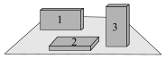
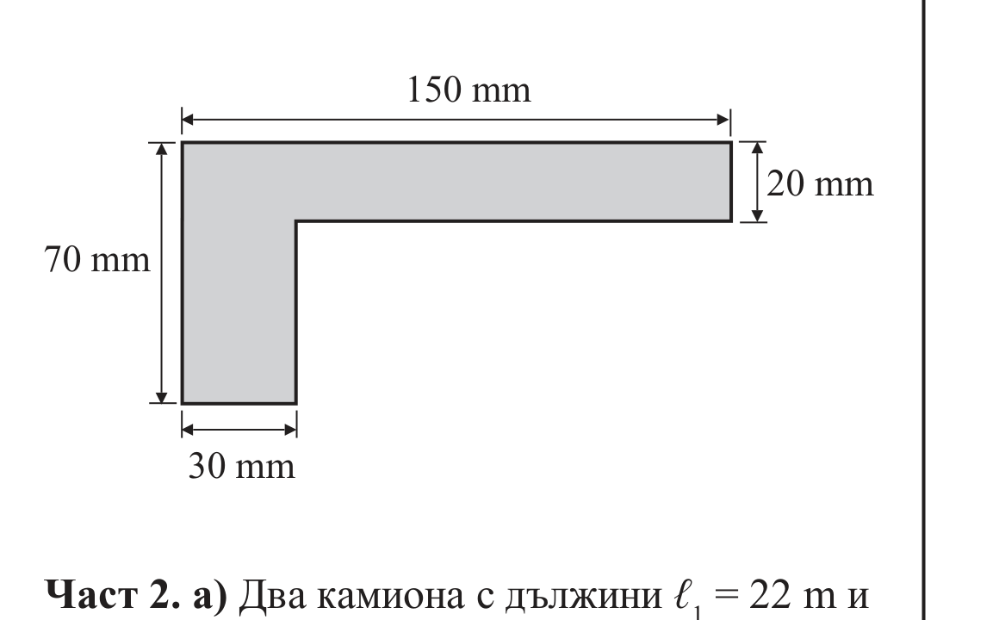

[[Състезания/esenno/7/2009|◂ 2009]] | [[Състезания/esenno/7r/2010|решения]] | [[Състезания/esenno/7/2011| 2011 ▸]]

# ЕСЕННО НАЦИОНАЛНО СЪСТЕЗАНИЕ ПО ФИЗИКА, 5.11–7.11 2010 г., гр. Варна — тема за 7. клас

## Задача 1. (В листа за отговорите оградете с кръгче верния отговор. Всеки верен отговор се оценява с 1 точка.)

**1.** Около далечна звезда обикалят по кръгови орбити две планети. Коя от тях има по-голяма маса, ако звездата ги привлича с равни по големина гравитационни сили?

а) планета 1, защото е по-близо до звездата

б) планета 2, защото е по-далече

в) планета 1, защото има по-голям обем

г) при равни сили масите също са равни

**2.** Дифузията е възможна защото:

а) на молекулите действа сила на тежестта

б) молекулите се привличат с електрични сили

в) молекулите са наредени плътно една до друга

г) молекулите извършват топлинно движение

**3.** Газ се свива при постоянна температура. При този процес намалява:

а) скоростта на молекулите на газа

б) диаметърът на молекулите

в) разстоянието между молекулите

г) плътността на газа

**4.** Учебник по физика лежи неподвижно върху хоризонтална опора. Опората действа на учебника със сила на реакция, която уравновесява:

а) силата на тежестта на учебника

б) теглото на учебника

в) сумата от теглото и силата на тежестта

г) разликата в големините на тези две сили

**5.** Кутийка се поставя върху хоризонтална опора по три различни начина. При кой от тях теглото на кутийката е най-голямо?

а) 1

б) 2

в) 3

г) и в трите случая теглото е едно и също

**6.** При каква температура плътността на водата е най-голяма?

а) 0 $^\circ$C

б) 4 $^\circ$C

в) 20 $^\circ$C

г) плътността на водата е точно $1\ \text{g/cm}^3$ и не зависи от температурата

**7.** Коя от посочените три стойности на налягането е най-голяма?

а) 20 hPa

б) 2 kPa

в) 2 N/cm²

г) трите са равни

**8.** Когато ключът от схемата е отворен:

а) свети само лампа 1

б) свети само лампа 2

в) светят и двете лампи

г) не свети нито една

**9.** През два консуматора тече винаги един и същ ток, ако консуматорите са:

а) еднакви

б) свързани успоредно

в) свързани последователно

г) свързани към една и съща батерия

**10.** На коя от схемите двете лампи са свързани успоредно?

схема 1

схема 2

а) само на схема 1

б) само на схема 2

в) и на двете схеми

г) на нито една от схемите

## Задача II. (В листа за отговорите попълнете само числените стойности и мерните единици на търсените величини. Всеки верен отговор се оценява с 1 точка.)

**1.** Графиката показва как се изменя температурата на течност при нагряване. Колко е температурата на кипене $t_к$ на течността?

**2.** Велосипедист се движи със скорост $v = 18\ \text{km/h}$. Пресметнете пътя $s$, който велосипедистът ще измине за време $t = 10\ \text{min}$.

**3.** Мравка се движи равномерно по окръжност с радиус 0,07 m. Пресметнете скоростта $v$ на мравката, ако за време $t = 22\ s$ тя извършва 2 пълни обиколки на окръжността.

Приемете $\pi = \frac{22}{7}$.

**4.** Парашутист с маса 70 kg пада с постоянна скорост 6 m/s. Колко е приблизително големината на силата на съпротивление на въздуха $F$, действаща на парашутиста?

**5.** Колко е най-малката сила $F$, с която трябва да теглим свободния край на въжето, за да издигнем товара? Теглото на товара е 50 N. Масата на макарите се пренебрегва.

**6.** Празничен балон с обем $V = 0{,}2\ \text{m}^3$ е напълнен с газ с маса $m = 180\ g$. Определете плътността $\rho$ на газа.

**7.** Отношението на масите на две тела е $\frac{m_1}{m_2} = 3$, а отношението на техните обеми е $\frac{V_1}{V_2} = 4$. Колко е отношението $\frac{\rho_1}{\rho_2}$ на плътностите на двете тела?

**8.** Теглилка е закачена на силомер. Когато теглилката е във въздуха, силомерът измерва сила 2,5 N. След потапяне на теглилката във вода силомерът измерва сила 2 N. Колко е изтласкващата сила $F_A$, с която водата действа на теглилката?

**9.** Когато детско корабче плава във вода, водата му действа с изтласкваща сила $F_{A1} = 2\ \text{N}$. Колко е изтласкващата сила $F_{A2}$, ако корабчето плава в течност, чиято плътност е с 25 % по-малка от плътността на водата?

**10.** Върху пода лежат две кубчета с ръб $a$ и $2a$. Кубчетата създават едно и също налягане $p = 200\ \text{Pa}$ върху пода. Колко ще бъде налягането $p_1$ върху пода, ако поставим малкото кубче върху голямото?

## Задача III. (В листа за отговорите представете подробно решение на задачата – можете да пишете и на обратната страна на листа. Двете части на задачата са независими.)

**Част 1.** От ламарина с дебелина 2 mm е изрязана метална пластинка с формата на буквата „г“. Размерите на пластинката са дадени на чертежа. Определете плътността на метала, от който е направена пластинката, ако нейната маса е 24,3 g. (4 точки)

**Част 2.** а) Два камиона с дължини $l_1 = 22\ \text{m}$ и $l_2 = 13\ \text{m}$ се движат по праволинеен участък от магистрала със скорости $v_1 = 15\ \text{m/s}$ и $v_2 = 20\ \text{m/s}$. Вторият камион настига и изпреварва първия. За колко секунди става изпреварването (вж. чертежа)? (3 точки)

начало на изпреварването

край на изпреварването

б) Два камиона с дължини $l_1 = 22\ \text{m}$ и $l_2 = 13\ \text{m}$ се движат един срещу друг по праволинеен участък от пътя със скорости $v_1 = 15\ \text{m/s}$ и $v_2 = 20\ \text{m/s}$. За колко секунди камионите ще се разминат (вж. чертежа)? (3 точки)

начало на разминаването

край на разминаването
