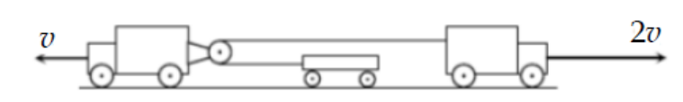
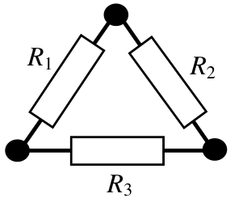
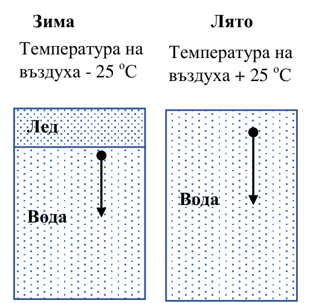

[[Състезания/esenno/7/2025|◂ 2025]] | [[Състезания/esenno/7r/2026|решения]]

**Зад. 1. Част 1. Дъждомер измерва количество валежи сняг**

На Черни връх, намиращ се в планина Витоша, се намира метеорологична станция. Провежда се измерване на плътността на снега с помощта на дъждомер. Дъждомерът е цилиндричен съд, в който се събира падащия сняг, с градуирана скала. Дъното на дъждомера е с площ S = 200 cm² и височина H = 40 cm. По време на измерването снежинките падат вертикално надолу със скорост v = 0,6 m/s. За време t = 6 h нивото на снега в дъждомера е h = 15 cm, а плътността на снега в дъждомера е ρ₀ = 0,15 g/cm³.

А) Определете масата на снега в съда. \[2 т.\]

Б) Определете плътността ρ на снега във въздуха по време на снеговалежа, т.е. масата на снега, намираща се в един кубичен метър въздух. \[6 т.\]

**Част 2. Плава ли?**

Парче лед, който е в твърдо състояние, плава във вода. Ще плава ли парче желязо в твърдо състояние в разтопено течно желязо? Обосновете отговора си! \[2 т.\]

**Зад. 2. Част 1. Накъде се движи?**

Два автомобила се движат в противоположни посоки съответно със скорости v и 2v. Към единия автомобил е закрепено въже, което преминава през макара на другия автомобил. Към втория край на въжето е закрепена количка. Намерете скоростта U на количката и посоката, в която тя ще се движи. \[2 т.\]

**Част 2. Размяна на пакети между два автомобила**

Между два града A и B, разстоянието между които е S, се движат два автомобила. Те едновременно тръгват от точка, намираща се на разстояние 2S/5 от град A — единият автомобил се движи към A със скорост vA; другият — към B, със скорост vB. След като достигнат съответните градове, автомобилите се обръщат и започват да се движат един към друг.

Известно е, че автомобилите се срещат на разстояние x₁ = S/5 от град B (първа среща след тръгване). След срещата автомобилите отново се обръщат и се движат към съответните си градове. Когато ги достигнат, отново се обръщат и се движат един към друг. Така продължават да се движат и да се срещат многократно.

А) Намерете отношението на скоростите vA/vB на двата автомобила. \[2 т.\]

Б) На какво разстояние x₂, x₃, x₄ от град А ще се осъществят съответно втората, третата и четвъртата среща? \[3 т.\]

В) На какво разстояние x₂₀₂₆ от град A ще се състои 2026-тата среща на автомобилите? \[1 т.\]

Г) Какво разстояние L ще измине от началната точка до 2026-тата среща автомобилът, който се обръща в град A? \[2 т.\]

Приемете, че автомобилите се движат през цялото време на движение с постоянни скорости vA, vB, а обръщанията са мигновени.

**Зад. 3. Част 1. Полуекспериментална задача**

Електрическа верига е изградена от три резистора със съпротивления R1, R2 и R3. Резисторите са включени към букси, така че могат свободно да се премахват или да се включват към буксите други елементи. Ученик има задача да измери експериментално съпротивлението на резисторите. Разполага с батерия с неизвестно напрежение, волтметър V, амперметър А и калкулатор.

1. Ученикът може да премахва от веригата само един резистор и да го заменя с волтметър или амперметър.
2. Ученикът може да включва батерията към произволни букси, като при това не премахва резистор.
3. Необходимо е да чертаете електрическата схема, с която показвате вашите действия за намиране на съпротивленията.

Помогнете му да се справи със задачата (да намери стойностите на трите съпротивления и напрежението на батерията от измерените данни на волтметъра и амперметъра), като съобразите, че ученикът не знае формули за еквивалентно (общо) съпротивление при последователно или успоредно свързване на резистори. \[6 т.\]

**Част 2. Потъваща ел. верига**

Знаете ли, че съпротивлението на метален проводник е правопропорционално на температурата? Най-бързо с температурата се изменя съпротивлението на никела.

Никелов проводник е свързан към полюсите на батерия. Батерията може да поддържа постоянно напрежение, независимо от температурата на околната среда. Тази електрична верига равномерно потъва в езеро.

А) Обяснете как и защо се променя (нараства, намалява, остава постоянен) електричния ток I през батерията с дълбочината на потапяне h, ако потапянето се осъществява от повърхността към дъното зимно време (вж фигурата). Повърхността на езерото е покрито със слой лед. \[2 т.\]

Б) Обяснете как и защо се променя (нараства, намалява, остава постоянен) електричния ток I през батерията с дълбочината на потапяне h, ако потапянето се осъществява от повърхността към дъното лятно време (вж фигурата). \[2 т.\]
