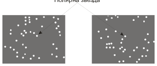
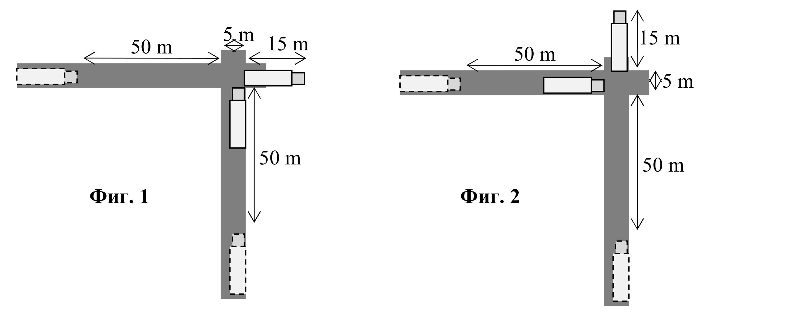

[[Състезания/esenno/7/2012|◂ 2012]] | [[Състезания/esenno/7/2013|условия]] | [[Състезания/esenno/7/2014| 2014 ▸]]

Задача 1. Поглед към Космоса
Част 1.

А) Двете снимки изглеждат по различен начин, заради видимото движение на небесната
сфера. \[1 т\]

Б) Полярната звезда е посочена на двете снимки.

За правилно посочена Полярна звезда и на двете снимки - \[1 т\]

За правилно посочена Полярна звезда само на една от снимките - \[0.5 т\]

За едно от следните обяснения (или еквивалентно на тях) - \[1 т\]
 - Полярната звезда не мени видомото си положение на небето. Посочената звезда е
 единствената, която е на едно и също място на двете снимки.
 - Полярната звезда се намира на мисленото продължение на отсечката, свързваща
 крайните звезди на съзвездието Голяма мечка (в този случай е нужен чертеж)
 - Полярната звезда се намира в края на "опашката" на съзвездието Малка мечка.

При грешно или липсващо обяснение - \[0 т\]

В) Звездите на втората снимка са завъртяни на ъгъл 90$^\circ$ около Полярната звезда спрямо
положенията си на първата снимка. \[1 т\]

Понеже за 24 часа небесната сфера прави пълна обиколка на 360 $^\circ$, следва, че времето
между двете снимки е четвърт денонощие, или 6 часа. \[1 т\]

Част 2. Пълен брой точки се дава за следното обяснение или за еквивалентно на него:
 \[2 т\]
- Когато бомбата бъде откачена от кораба, тя ще се движи със същата скорост като кораба
и ще продължи да обикаля заедно с него около Земята.

Частичен брой точки се дават за следното обяснение или за подобно обяснение, в което се
споменава, че бомбото се движи: \[1 т\]
 1
 - Когато бомбата бъде откачена, тя се движи пада на земята встрани от целта.

За липсващо или грешно обяснение \[0 т\]

Част. 3 Пътят, който изминава светлината за време t, е:
$s = ct = 300\,000\ \text{km/s} \cdot 2{,}52\ \text{s} = 756\,000\ \text{km}$ \[1 т\]

За това време светлината изминава разстоянието мужду Земята и Луната два пъти -
веднъж на отиване и веднъж на връщане. \[1 т\]

Следователно разстоянието между Земята и Луната е:

$L = \frac{s}{2} = 378\,000\ \text{km}$ \[1 т\]

Задача 2. Движение
Част 1. Топката А се забавя, докато се изкачва на издатината. \[1 т\]

Топката Б се ускорява, докато се спуска към вдлъбнатината. \[1 т\]

Топката Б изминава вдлъбнатината с по-голяма скорост от скоростта, с която топката А
изминава издатината. Следователно топката Б достига първа края на пътечката \[1 т\]

Част 2. Едната възможност е камионът 2 да достигне кръстовището, след като камионът 1
го е приминал. Най-голяма скорост $v_2$, при която това е възможно, съответства на
положението на камионите, изобразено на фиг. 1. В този случай камионът 1, докато
премине кръстовището, изминава път:

$s_1$ = 50 m + 5 m + 15 m = 70 m \[1 т\]
за време:

$t = \frac{s_1}{v_1} = \frac{70\ \text{m}}{10\ \text{m/s}} = 7\ \text{s}$ . \[0,5 т\]

За това време камионът 2 е изминал път:

$s_2$ = 50 m \[1 т\]
до кръстовището и следователно скоростта му е:
$v_2 = \frac{s_2}{t} = \frac{50\ \text{m}}{7\ \text{s}} \approx 7\ \text{m/s}$ . \[0,5 т\]
Другата възможност е камионът 2 да е преминал кръстовището, преди камионът 1 да е
стигнал до него. Най-малката скорост $v_2$, при която това е възможно, съответства на
положението на камионите, изобразено на фиг. 2. В този случай камионът 1 изминава път:

$s_1$ = 50 m \[1 т\]
за време

$t = \frac{s_1}{v_1} = \frac{50\ \text{m}}{10\ \text{m/s}} = 5\ \text{s}$ . \[0,5 т\]

Камионът 1 изминава за това време път:

$s_2$ = 50 m + 5 m + 15 m = 70 m \[1 т\]
със скорост:

$v_2 = \frac{s_2}{t} = \frac{70\ \text{m}}{5\ \text{s}} = 14\ \text{m/s}$ . \[0,5 т\]

Тъй като това са граничните скорости, безопасното разминаване на камионите е възможно
при $v_2 \le 7 \text{m/s}$ или при $v_2 \ge 14 \text{m/s}$. - за вярно записани неравенства \[1 т\]

Задача 3. Сили
Част 1. Буталото упражнява върху въздуха в помпата допълнително (над атмосферното)
налягане:

$p = \frac{F_1}{S_1} = \frac{200\ \text{N}}{0{,}0015\ \text{m}^2} \approx 133\,333\ \text{Pa}$ \[1 т\] (само за формулата)

Налягането се предава равномерно във всички точки от вътрешността на помпата и
свързания към нея маркуч. \[1 т\] (за формулирано твърдение)

Следователно въздухът ще упражнява върху пръста ви сила:

$F_2 = p S_2 = 133\,333\ \text{Pa} \cdot 0{,}00003\ \text{m}^2 = 4\ \text{N}$ \[1 т\] за формулата + \[1 т\] за числен резултат
Със същата по големина сила трябва да притискате отвора на маркуча, за да не излезе
въздухът през него.

Част 2. а) Обемът на кубчето е:

$V = a^3 = 8\ \text{cm}^3$ \[1 т\]
а неговата маса:
$m = \rho V = 4{,}8\ \text{g}$ \[1 т\]

Везната отчита общата маса на поставените тела, т.е.

$m_1$ = m $+ m_0$ = 64,8 g \[0,5 т\]

б) Понеже плътността на кубчето е по-малка от плътността на водата, кубчето ще плава
във водата. \[0,5 т\]

Следователно силата на тежестта, действаща на кубчето се уравновесява с изтласквашата
сила F:

$F = mg$ \[1 т\]

За да пресметнем F, е нужно да изразим масата на кубчето в килограми:
$m = 0{,}0048\ \text{kg}$ \[0,5 т\]

Тогава получаваме:

$F = 0{,}048\ \text{N}$ \[0,5 т\]

в) Общата маса на телата, които са поставени на везната, не се променя от това, че кубчето
е пуснато във водата. Следователно везната отново ще показва:

$m_1 = m + m_0 = 64{,}8\ \text{g}$ \[1 т\]
