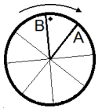
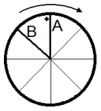

[[Състезания/esenno/7/2013|◂ 2013]] | [[Състезания/esenno/7/2014|условия]] | [[Състезания/esenno/7/2015| 2015 ▸]]

Задача 1. Стреляй в целта
Част 1.

Максималното време, с което разполага стрелата, за да премине между спиците, е

t $=\frac{ T}{ n}=$ 0, 01 s . \[2,5 т.\]

Например, ако върхът на стрелата достигне равнината на колелото в момент, в който спица
А е в положение "12 часа" (точката на "пронизване" е означена на чертежа), то стрелата
разполага с време за преминаване само докато съседната спица В на свой ред заеме
положение "12 часа" (в рамките на един оборот на колелото).

Имайки предвид дължината на стрелата, тя се нуждае от време $t_{\text{стрела}} = \frac{l}{v} = 0,012 \text{ s}$. \[1 т.\]

Сравняваме: $t_{\text{стрела}} > t$, следователно принцът не може да спечели принцесата. \[0,5 т.\]

**Забележка:** *Би могъл да я спечели, ако скъси стрелата си с поне $10 \text{ cm}$.*

**Част 2.**

Първоначалното опъване е със сила $F_1 = 120 \text{ N}$, следователно скоростта на първата стрела е $v_1 = 40 \text{ m/s}$. \[0,5 т.\]

Времето, за което първата стрела достига мишената, е $t = \frac{L}{v_1} = \frac{120}{40} = 3 \text{ s}$. \[0,5 т.\]

Втората стрела е изстреляна $t_0$ след първата със скорост $v_2$. Следователно $t = t_0 + \frac{L}{v_2}$,
откъдето $v_2 = \frac{L}{t - t_0} = \frac{120}{3 - 1} = 60 \text{ m/s}$. \[1 т.\]

От графиката - съответната сила на опъване е $F_2$ = 180 N . \[0,5 т.\]

Третата стрела има скорост $\nu_3$. Изстреляна е $t_0$ след втората и $2t_0$ след първата.

Следователно $t = 2t_0 + \frac{L}{\nu_3}$, откъдето $\nu_3 = \frac{L}{t - 2t_0} = \frac{120}{3 - 2} = 120 \text{ m/s}$. \[1 т.\]

От графикате – съответната сила на опъване е $F_3 = 360 \text{ N}$. \[0,5 т.\]

**Част 3.**

Ако разстоянието от Вилхелм до ябълката е $x$, то то от ябълката до мишената е $L - x$.

Времето, за което стрелата ще долети при ябълката е $t_1 = \frac{x}{\nu_0}$; времето, за което стрелата ще измине разстоянието от ябълката до мишената е $t_2 = \frac{L - x}{0,9\nu_0}$. \[0,5 т.\]

От условието следва, че $t_1 + t_2 = t_0$. Заместваме изразите за $t_1$ и $t_2$, т.е. $t_0 = \frac{x}{\nu_0} + \frac{L - x}{0,9\nu_0}$,
откъдето $x = 10L - 9t_0\nu_0 = 10 \cdot 100 - 9 \cdot 3 \cdot 35 = 55 \text{ m}$. \[1,5 т.\]

Задача 2. Солено или сладко
а)

Поради избора на стойност за $\rho_0$ $= 1,23 \text{g/cm}^{3}$, определянето на вида на разтвора - солен или сладък, може да стане само след намиране на плътността на солен разтвор, приготвен с максималното количество сол, т.е. най-соления разтвор.

В подточка а) се дават точки само за най-соления разтвор.

Ако е намерена плътността на най-сладкия разтвор, то се дават съответните точки от
подточка в).

За най-соления разтвор:

Обемът на $m_{\text{вода}} = 1 \text{ g}$ вода е $V_{\text{вода}} = 1 \text{ cm}^3$.

Обемът на $0,4 \text{ g}$ сол е $V_{\text{сол}} = \frac{m_{\text{сол}}}{\rho_{\text{сол}}} = \frac{0,4}{2,10} = 0,19 \text{ cm}^3$. $[0,2 \text{ т.}]$

Масата на най-соления разтвор е $m_{\text{солен р-р}} = m_{\text{сол}} + m_{\text{вода}} = 1 + 0,40 = 1,40 \text{ g}$. $[0,4 \text{ т.}]$

Обемът на най-соления разтвор е $V_{\text{солен р-р}} = V_{\text{вода}} + V_{\text{сол}} = 1 + 0,19 = 1,19 \text{ cm}^3$. $[0,4 \text{ т.}]$

Плътността на най-соления разтвор е $\rho_{\text{солен р-р}} = \frac{m_{\text{солен р-р}}}{V_{\text{солен р-р}}} = \frac{1,40}{1,19} \text{ g/cm}^3 \approx 1,18 \text{ g/cm}^3$. $[0,5 \text{ т.}]$

Разтворът е сладък, тъй като плътността му е по-голяма от максималната плътност за солен разтвор. $[0,5 \text{ т.}]$

**б)**

Плътността на разтвора е $\rho_0 = \frac{m_0}{V_0} = 1,23 \text{ g/cm}^3$.

Масата $m_0$ на разтвора, приготвен от $1 \text{ g}$ вода (по условие) и маса $m_x$ захар, е $m_0 = m_{\text{вода}} + m_x$. $[0,5 \text{ т.}]$

Обемът $V_0$ на разтвор, приготвен с обем $V_x$ захар, е $V_0 = V_{\text{вода}} + V_x$. $[0,5 \text{ т.}]$

От друга страна (плътността на захарта $\rho_{\text{захар}}$ е известна) $V_x = \frac{m_x}{\rho_{\text{захар}}}$. \[0,5 т.\]

Заместваме $\rho_0 = \frac{m_0}{V_0} = \frac{m_{\text{вода}} + m_x}{V_{\text{вода}} + V_x} = \frac{m_{\text{вода}} + m_x}{V_{\text{вода}} + \frac{m_x}{\rho_{\text{захар}}}}$, следователно $m_x = \rho_{\text{захар}} \frac{\rho_0 V_{\text{вода}} - m_{\text{вода}}}{\rho_{\text{захар}} - \rho_0}$ или

$m_x = 1,40 \frac{1,23 - 1}{1,40 - 1,23} \approx 1,89 \text{ g}$. \[1,5 т.\]

в)

За плътността на най-сладкия разтвор:

Обемът на $5 \text{ g}$ захар е $V_{\text{захар}} = \frac{m_{\text{захар}}}{\rho_{\text{захар}}} = \frac{5}{1,40} = 3,57 \text{ cm}^3$. \[0,2 т.\]

Масата на най-сладкия разтвор е $m_{\text{сладък р-р}} = m_{\text{захар}} + m_{\text{вода}} = 1 + 5 = 6 \text{ g}$. \[0,4 т.\]

Обемът на най-сладкия разтвор е $V_{\text{сладък р-р}} = V_{\text{вода}} + V_{\text{захар}} = 1 + 3,57 = 4,57 \text{ cm}^3$. \[0,4 т.\]

Плътността на най-сладкия разтвор е $\rho_{\text{сладък р-р}} = \frac{m_{\text{сладък р-р}}}{V_{\text{сладък р-р}}} = \frac{6}{4,57} \text{ g/cm}^3 \approx 1,31 \text{ g/cm}^3$. \[0,5 т.\]

За да плава топчето в сладък, но не и в солен разтвор, средната му плътност трябва да е по-голяма от тази на най-соления разтвор и по-малка от плътността на най-сладкия:

$\rho_{\text{солен р-р}} < \rho_{\text{топче}} < \rho_{\text{сладък р-р}}$ или $1,18 \text{ g/cm}^3 < \rho_{\text{топче}} < 1,31 \text{ g/cm}^3$. \[1 т.\]

Нека кухината заема част $V_{\text{кухина}} = x V_{\text{топче}}$ от обема на топчето. Тогава алуминият заема обем $V_{\text{алуминий}} = (1 - x) V_{\text{топче}}$.

Масата на топчето е $m_{\text{топче}} = \rho_{\text{алуминий}} V_{\text{алуминий}} = (1 - x) \rho_{\text{алуминий}} V_{\text{топче}}$. \[0,5 т.\]

Средната плътност на топчето е $\rho_{\text{топче}} = \frac{m_{\text{топче}}}{V_{\text{топче}}} = \frac{(1 - x) \rho_{\text{алуминий}} V_{\text{топче}}}{V_{\text{топче}}} = (1 - x) \rho_{\text{алуминий}}$. \[0,5 т.\]

Най-малката средна плътност на топчето определя максималната кухина. \[0,25 т.\]

Тя се намира от равенството $\rho$топче = $\rho$солен р-р или 1,18 = (1 - x ) 2,7 . Тогава $x \approx 0,56$ . \[0,5 т.\]

Най-голямата средна плътност на топчето определя минималната кухина. \[0,25 т.\]

Тя се намира от равенството $\rho$топче = $\rho$сладък р-р или 1,31 = (1 - x ) 2,7 . Тогава $x \approx 0,51$ . \[0,5 т.\]

Задача 3. Флуиди под налягане
Част 1. Точки се дават за следното или еквивалентно обяснение (може и нарисувано) :

При стискане на бутилката, налягането в нея се повишава. \[0,5 т.\]

Увеличеното налягане се предава и на водата в епруветката. \[1 т.\]

В резултат, още малко от водата навлиза в епруветката, а въздухът в нея намалява обема
си. \[1 т.\]

Епруветката, заедно с водата, става по-тежка (т.е. силата на тежестта става по-голяма от
изтласкващата) и потъва. \[0,5 т.\]

Част 2.
а)

Вследствие от закона на Паскал, налягането p, създадено от натиска върху бутало (2), се предава еднакво във всички посоки, включително върху върху буталата (1) и (3). \[1 т.\]

Това налягане е $p = \frac{F}{3A_0}$. \[0,5 т.\]

Налягането върху буталата (1) и (3) е еднакво. За да не се движат другите две бутала, върху всяко от тях трябва да действа сила (със същата посока като F)
$F_1 = pA_0 = \frac{F}{3A_0} A_0 = \frac{F}{3} \approx 67 \text{ N.}$

б)

Вследствие от закона на Паскал, всяко от буталата (2), (3) и (4) ще се премести на едно и също разстояние. \[1 т.\]

Тъй като веществото (флуидът) се запазва, то всяко бутало ще се премести в посока "навън" на разстояние $\frac{l}{3} = 1\ \mathrm{cm}$. \[1 т.\]

в)

Вследствие от закона на Паскал налягането върху буталата (2), (3) и (4) е еднакво. \[1 т.\]

Тъй като в този случай буталата са с еднаква площ, то върху тях трябва да се приложи същия по големина натиск, т.е. $F_2$, 3, 4 = 300 N. \[1 т.\]
