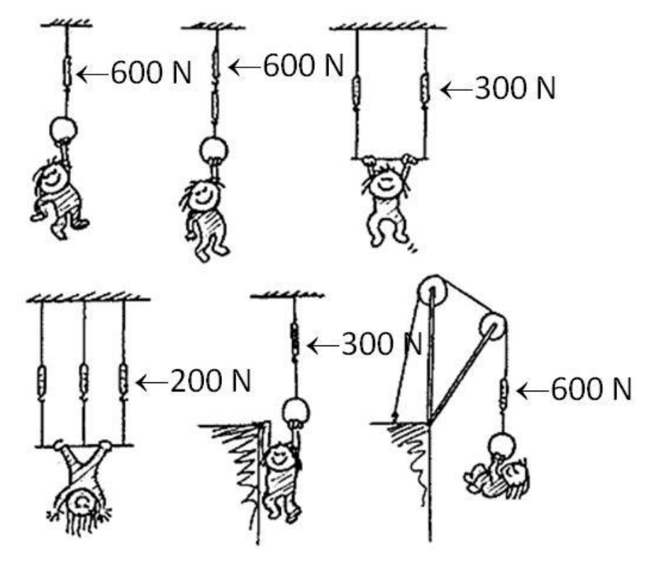
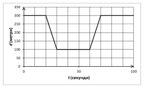

[[Състезания/esenno/7/2015|◂ 2015]] | [[Състезания/esenno/7/2016|условия]] | [[Състезания/esenno/7/2017| 2017 ▸]]

Задача 1. Съобразете!

Задачата се състои от няколко независими подточки. Към всяка подточка дайте кратко
описание на вашия отговор - не повече от 3-4 изречения. Ако е нужно, можете да
направите чертеж.

А) Железните стърготини могат да бъдат отделени с магнит, защото желязото се привлича
към магнити. [1] Останалата смес от алуминиеви и дървени стърготини може да бъде
изсипана в съд с вода. Дървените стърготини ще изплават [1], а алуминиевите - ще
останат на дъното. [1]

Б) Яйцето потъва в съда, в който плътността на водата е по-малка от плътността на яйцето
[1] и плава в съда, в който плътността на водата е по-голяма от плътността на яйцето. [1]

Солената вода има по-голяма плътност от прясната вода. [1] Следователно яйето плава в
съда със солена вода. [1]

В) За всяко правилно посочено показание се дават по 0.5 точки.

Задача 2. Легендата за Архимед

А) Обемът на парчето злато е:

$V_1 = \frac{m}{\rho_{\text{з}}} = 66$ cm³. [1]

Обемът на златото в короната е:

$V_{\text{з}} = \frac{m}{2\rho_{\text{з}}} = 33$ cm³, [0.5]

а на среброто:

$V_{\text{с}} = \frac{m}{2\rho_{\text{с}}} = 57$ cm³. [0.5]

Следователно обемът на короната е:

$V_2 = V_{\text{з}} + V_{\text{с}} = 90$ cm³. [1]

Разликата от двата обема е равна на допълнителния обем течност, изместен от короната:

$V = V_2 - V_1 = 24$ cm³. [1]

Площта на основата на съда е:

$S = 20 \times 20 = 400$ cm². [1]

Понеже съдът има форма на паралелепипед, имаме:

$V = Sh,$ [1]

откъдето:

$h = \frac{V}{S} = 0{,}06$ cm = 0,6 mm. [1]

Б) Когато телата са потопени във вода, им действа изтласкваща сила. [1] На короната
действа по-голяма изтласкваща сила, защото има по-голям обем. [1] Теглото на короната
(силата, с която действа на рамото на везната) ще намалее и везната ще се наклони към
парчето злато. [1]

Задача 3. Преминаване на мост

Докато автомобилите се движат с еднакви скорости $v_1$, разстоянието между тях не
се променя [1]. Разстоянието между тях започва да намалява в момента, в който първият
автомобил стъпва на моста, т.е. при $t = 20$ s [1]. Тогава вторият автомобил се намира на
300 m от моста [1]. В момента $t = 30$ s и вторият автомобил стъпва на моста, при което
двата автомобила продължават да се движат по моста с еднакви скорости $v_2$, а
разстоянието между тях остава постоянно до момента $t = 60$ s, когато първият автомобил
излиза от моста [1]. Оттук следва, че вторият автомобил изминава със скорост $v_1$
разстояние от 300 m за 10 s [1]. Така намираме:

$v_1 = \frac{300\ \text{m}}{10\ \text{s}} = 30$ m/s. [1]

В момента, когато вторият автомобил навлиза в моста, първият се е отдалечил от началото
на моста на разстояние 100 m [1]. Следователно:

$v_2 = \frac{100\ \text{m}}{10\ \text{s}} = 10$ m/s. [1]

Първият автомобил се движи по моста от двадесетата до шестдесетата секунда, т.е. общо
време 40 s [1]. За това време той изминава път, равен на дължината на моста, т.е.

$L = 10\ \text{m/s} \cdot 40\ \text{s} = 400$ m. [1]
