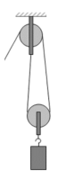

[[Състезания/esenno/7/2022|◂ 2022]] | [[Състезания/esenno/7/2023|условия]] | [[Състезания/esenno/7/2024| 2024 ▸]]

Задача 1. Разтоварване на захар

Схема на комбинация от подвижна и неподвижна макара: \[2 т\]

С подвижната макара печелим сила \[1 т\] а с неподвижната променяме
посоката ѝ \[0.5 т\]. Тогава максималната сила, която можем да приложим, е
$F_{max} = 2F_{Алекс} = 160\ N$ \[2 т\]. Toва отговаря на максимална маса за качване от
$m_{max} = \frac{F_{max}}{10} = 16\ kg$ \[1 т\]. Тогава Алекс може да поставя максимално по 3
пакета захар от по 5 kg \[1 т\]. Общия брой пакети е 10 \[0,5 т\]. Алекс трябва да
се качи 4 пъти до тавана. \[2 т\]

Задача 2. Плаващ съд
Всяко от кубчетата има обем $V = a^3$ \[0,5 т\], като $a = 10\ cm = 0{,}1\ m$ \[1 т\], а
$V = 0{,}1 \cdot 0{,}1 \cdot 0{,}1 = 0{,}001\ m^3$ \[0,5 т\]. Масата на третото кубче е $m_3 = 1\ kg$.
Тогава плътността му е $\rho_3 = \frac{m_3}{V_3} = \frac{1\ kg}{0{,}001\ m^3} = 1000\ kg/m^3$ \[1 т\].

След като съдът плава, като изцяло е потопен и е в равновесие, общата му плътност е колкото
 kg
тази на глицерина $\rho_{общ} = 1250\ kg/m^3$ \[1 т\].

Общата маса е $M = m_1 + m_2 + m_3$ \[0,5 т\]. Знаейки, че $\rho_2 = 4\rho_1$, то масата на второто кубче е
$m_2 = 4m_1$ \[0,5 т\]. Общата маса е $M = \rho_{общ} \cdot V_{общ} = \rho_{общ} \cdot 3V = 3{,}75\ kg$. \[0,5 т\] Масата на
първото и второто кубче е $m_1 + m_2 = M - m_3 = 2{,}75\ kg$. \[0.5 т\] Замествайки, определяме
$4m_1 + m_1 = 5m_1 = 2{,}75\ kg$, откъдето $m_1 = 0{,}55\ kg$ \[1 т\] и $m_2 = 4m_1 = 2{,}2\ kg$. \[1 т\].
Плътностите са $\rho_2 = \frac{m_2}{V_2} = 2200\ kg/m^3$ \[0,5 т\] и $\rho_1 = \frac{m_1}{V_1} = 550\ kg/m^3$. \[0,5 т\] Когато заеме
окончателното си равновесно положение съдът ще бъде вертикален спрямо повърхността
(трите кубчета ще са едно над друго), \[0,5 т\] като кубчето с плътност $\rho_1 = 550\ kg/m^3$ (първото)
ще е най-отгоре. \[0,5 т\]

Задача 3. Електрична верига

А) Съпротивлението на консуматора $R_1 = \frac{U_1}{I_1} = \frac{12\ V}{0{,}005\ A} = 24\ k\Omega$ \[1 т\].

Б) Вторият консуматор може да бъде свързан последователно или успоредно \[0,5 т\].

При последователно свързване $U_2 = U_{21} + U_{22} = I_2 R_1 + I_2 R_2$, откъдето
$I_2 = \frac{U_2}{R_1+R_2}$. \[1 т\] Тъй като $U_2 = 2U_1$, $I_2 = \frac{2U_1}{R_1+R_2} < \frac{2U_1}{R_1} = 2I_1$. \[1 т\]

При успоредно свързване $I_2 = I_{21} + I_{22} = \frac{U_2}{R_1} + \frac{U_2}{R_2} = \frac{U_2(R_1+R_2)}{R_1\cdot R_2}$.

Тъй като $U_2 = 2U_1$, $I_2 = \frac{2U_1(R_1+R_2)}{R_1\cdot R_2} > \frac{2U_1}{R_1} = 2I_1$. \[1 т\]

Тъй като в нашия случай $I_2 < 2I_1$, свързването е последователно. \[1 т\] Тогава
$R_2 = \frac{U_2}{I_2} - R_1 = \frac{24\ V}{0{,}0075\ A} - 24\ k\Omega = 8\ k\Omega$. \[1 т\]

В) Свързването в тази точка е успоредно. При успоредното свързване напрежението е еднакво
върху двата консуматора $U = 24$ V \[0,5 т\]. Токът през веригата е
$I_3 = \frac{U_2(R_1+R_2)}{R_1\cdot R_2}$ \[1 т\] = $\frac{24\ V(24\ k\Omega + 8\ k\Omega)}{24\ k\Omega \cdot 8\ k\Omega} = 4\ mA$. \[1 т\]
