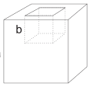

[[Състезания/esenno/7/2023|◂ 2023]] | [[Състезания/esenno/7/2024|условия]] | [[Състезания/esenno/7/2025| 2025 ▸]]

Задача 1. Куб в Куб.

А) За да плава тялото, общата му маса трябва да бъде равна на масата на течността, заемаща този обем $V = a^3 = 0{,}000015625\ \text{m}^{3}$ \[1 т.\]:

$m_{куб,вода} = \rho_{вода}\cdot V = 0{,}015625\ kg$

$m_{куб,гл} = \rho_{гл}\cdot V = 0{,}01953125\ kg$ \[1 т.\]

От условието на задачата знаем, че $m_{куб,вода} = m_{Al} + m_{слой,гл}$ и
$m_{куб,гл} = m_{Al} + m_{слой,в}$.
Слоят глицерин има обем на паралелепипед с две страни $b$ и височина 1 cm:

$V_{слой,гл} = b^2\cdot H_{слой,гл}$, $m_{слой,гл} = \rho_{гл}\cdot V_{слой,гл}$

Слоят вода има обем на паралелепипед с две страни $b$ и височина 2 cm:

$V_{слой,в} = b^2\cdot H_{слой,в}$, $m_{слой,в} = \rho_{в}\cdot V_{слой,в}$

\[1 т.\]

Ако изразим масата на алуминиевата част от тялото, получаваме:

$m_{Al} = m_{куб,вода} - m_{слой,гл} = m_{куб,гл} - m_{слой,в}$ или
$m_{слой,в} - m_{слой,гл} = m_{куб,гл} - m_{куб,вода}$

$\rho_{в}\cdot V_{слой,в} - \rho_{гл}\cdot V_{слой,гл} = \rho_{в}\cdot b^2\cdot H_{слой,в} - \rho_{гл}\cdot b^2\cdot H_{слой,гл} = m_{куб,гл} - m_{куб,вода}$

\[1 т.\]

Тогава получаваме краен резултат за $b^2 = \frac{(\rho_{гл}-\rho_{в})a^3}{\rho_{в}H_{слой,в}-\rho_{гл}H_{слой,гл}} = 5{,}21\cdot 10^{-4}\ m^2$ \[2 т.\]. От таблицата намираме, че такава стойност на квадрата отговаря на страна $b \approx 2{,}28\ cm$ \[1 т.\].

Б) Обемът на тялото е разлика между обема на куб със страна $a$ и "кух" куб със страна $b$.

$V_{Al} = a^3 - b^3 = 3{,}77\cdot 10^{-6}\ m^3$ ($V_{Al} = 3{,}74\cdot 10^{-6}\ \text{m}^{3}$ при заместване със закръглената стойност).
\[2 т.\]

$m_{Al} = \rho_{Al}\cdot V_{Al} = 0{,}0102\ kg$ ($m_{Al} = 0{,}0101\ kg$ при заместване със закръглената стойност)
\[1 т.\]

Задача 2. Лодка.

A) След като изразходваното гориво е 30% повече, то тогава $V_{AB} = V_{BA} + 30\%V_{BA}$,

$V_{AB} = k\cdot t + 3\ ml$, $V_{BA} = k\cdot t - 3\ ml$. Като извадим двете равенства, получаваме, че $V_{AB} - V_{BA} = 6\ ml$. \[2 т.\]

Тогава $30\%\cdot V_{BA} = 6\ ml$ или $V_{BA} = 20\ ml$ \[1 т.\], $V_{AB} = 26\ ml$. \[1 т.\]

Б) За 100 m по течението обемът изразходвано гориво е 4 ml, а лодката е изразходвала 20 ml гориво между А и В, тогава разстоянието $s$ между двете точки е $s = \frac{20\ ml\cdot 100\ m}{4\ ml} = 500\ m$. \[2 т.\]

В) $t = \frac{s}{v} = \frac{0{,}5\ km}{10\ km/h} = 0{,}05\ h = 3\ min$. \[1 т.\]

Г) Тъй като $V_{AB} = k\cdot t + 3\ ml$, то $k = \frac{V_{AB}-3\ ml}{t} = \frac{26\ ml - 3\ ml}{3\ min}$ \[1 т.\] $= 460\ ml/h$ ($\approx 7{,}7\ ml/min$) \[1 т.\]

Д) Тъй като лодката за време 3 min изразходва 26 ml гориво, то с 5 l гориво тя ще изразходва за време $T = \frac{26\ ml}{3\ min}\cdot 5\ l \approx 577\ min \approx 9{,}6\ h$. \[1 т.\]

Задача 3. Коледни лампички.

А) Знаем, че токът през една крушка е $I = 0{,}10\ A$, тогава напрежението е $U_{л} = IR = 6\ V$ \[1 т.\]. За 5 последователно свързани еднакви крушки е $U = 5U_{л} = 30\ V$, което и общото подадено максимално напрежение \[1 т.\]

Б) Знаем, че максималният ток през една крушка е $I = 0{,}20\ A$, тогава максималното напрежение на една лампа е $U = IR = 12\ V$ \[1 т.\], или максималното за 5 последователно свързани еднакви крушки е $U_{max} = 5U = 60\ V$, което и общото подадено максимално напрежение \[1 т.\].

В) За да "изгорят" лампичките (да бъде превишен токът) във всяка от 24-те вериги трябва да се превиши ограничението от $I = 0{,}2\ A$, при подаденото напрежение от т. А) $U = 30\ V$ \[1 т.\].

При 4 лампи в последователно свързаната верига, токът който ще тече, е $I_4 = \frac{U/4}{R} \approx 0{,}13\ A$ \[1 т.\]

При 3 лампи в последователно свързаната верига, токът който ще тече, е $I_3 = \frac{U/3}{R} \approx 0{,}17\ A$ \[1 т.\]

При 2 лампи в последователно свързаната верига, токът който ще тече, е $I_2 = \frac{U/2}{R} \approx 0{,}25\ A$ \[1 т.\]

За да спре напълно да работи, от всяка от 24-те успоредни вериги трябва да се премахнат (заменят
с проводник) по 3 лампички или общо 72 лампички. \[2 т.\]
