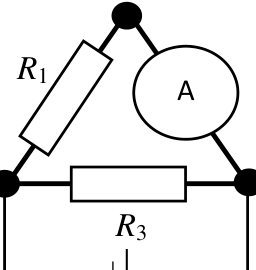

[[Състезания/esenno/7/2025|◂ 2025]] | [[Състезания/esenno/7/2026|условия]]

**Зад. 1. Част 1**

А) Масата на снега в съда е:

$m = \rho_0 S h$ \[1 т.\]

$m = 450\ \text{g}$ \[1 т.\]

Б) Да намерим обема, който заема масата сняг от подусловие А). Снегът пада вертикално надолу с постоянна скорост v. Тогава неговият обем във въздуха е:

$V = SH = Svt$ \[2 т.\]

$V = 259\,200\,000\ \text{cm}^3 = 259{,}2\ \text{m}^3$ \[1 т.\]

Плътността на снега във въздуха е:

$\rho = \frac{m_0}{V} = \frac{\rho_0 h}{vt}$ \[2 т.\]

$\rho \approx 1{,}74\ \text{g/m}^3$ \[1 т.\]

**Част 2.** Ледът има по-малка плътност от тази на водата (аномалия на водата). Това е причината, поради която ледът плава във вода. \[1 т.\]

При желязото няма аномалия (твърдото състояние има по-голяма плътност от течността (стопилката)) като при водата и следователно твърдото желязо има по-голяма плътност от тази на разтопеното. Следователно парчето твърдо желязо ще потъне. \[1 т.\]

**Зад. 2. Част 1.**

Нека разгледаме движението на автомобилите за интервал от време $\Delta t$ и да определим колко ще се премести количката за това време.

Тъй като десният автомобил ще се премести надясно на разстояние $2v\Delta t$, а лявият автомобил ще се премести наляво на разстояние $v\Delta t$, дължината на въжето между тях се е увеличила с $3v\Delta t$. Следователно дължината на участъка от въжето от лявата макара до количката е станала по-къса с тази стойност \[1 т.\]. Освен това точката, от която започва този участък, се е преместила наляво с $v\Delta t$. Следователно количката ще се премести наляво с $4v\Delta t$. Оттук следва, че скоростта на количката е насочена наляво \[0,5 т.\] и е равна на $U = 4v$ \[0,5 т.\].

**Част 2.**

А) Като използваме и съобразим изминатия път на двата автомобила до първата среща и че времената за движение от старта до срещата са равни, се получава:

(за автомобил към A, скорост $v_A$): $\frac{2S}{5} + \frac{4S}{5} = \frac{6S}{5}$ \[0,5 т.\]

(за автомобил към B, скорост $v_B$): $\frac{3S}{5} + \frac{S}{5} = \frac{4S}{5}$ \[0,5 т.\]

Като използваме, че $t_A = t_B$ и след кратки математически преобразования се получава

$\frac{v_A}{v_B} = 2$ \[1 т.\]

Б) Нека отбележим с $x_2$ разстоянието между град А и мястото на втората среща. Като използваме отново, че времената за двата автомобила са равни и полученото вече $\frac{v_A}{v_B} = 2$:

$\frac{4S}{5v_A} + \frac{x_2}{v_A} = \frac{S}{5v_B} + \frac{S - x_2}{v_B}$ \[0,5 т.\]

$x_2 = \frac{2S}{5}$ от град А \[0,5 т.\]

Забелязваме, че това е същото разстояние, от което започва движението на автомобилите (вж условието на задачата) \[0,5 т.\].

Следователно третата среща ще бъде на разстояние $x_3 = \frac{S}{5}$ от град B \[0,5 т.\].

Следователно за $x_4 = \frac{2S}{5}$ от град А \[0,5 т.\].

Получава се „цикъл на срещите“, а именно: нечетните срещи са на разстояние $\frac{S}{5}$ от град В, а четните – на $\frac{2S}{5}$ от град А. \[0,5 т.\]

В) 2026-тата среща ще се осъществи на разстояние $\frac{2S}{5}$ от град А. \[1 т.\]

Г) Автомобилът, който се обръща в град А, изминава път до първата среща: $\frac{2S}{5} + \frac{4S}{5} = \frac{6S}{5}$ \[0,5 т.\]. И същото това разстояние ще бъде изминато и до следващата среща \[0,5 т.\]. Следователно:

$L = 2026 \cdot \frac{6S}{5} = 2431{,}2\,S$ \[1 т.\]

**Зад. 3. Част 1.**

За да се намери напрежението на батерията е необходимо да се включи волтметъра към двете клеми на батерията, но при условие, че НЕ е включена към веригата. \[1 т.\]

За намиране на $R_1$: включваме батерията, както е показано на фигурата. Заменяме $R_2$ с амперметър и измерваме тока $I_1$ през него. Електричният ток $I_1$ е същият, който тече и през $R_1$ \[1 т.\]. Използваме закон на Ом, за да намерим $R_1$:

$R_1 = \frac{U}{I_1}$ \[1 т.\]

Аналогично за $R_2$ включваме амперметъра на мястото на $R_1$, като връщаме $R_2$ на мястото му. Сега амперметърът ще мери ток $I_2$ и $R_2 = \frac{U}{I_2}$ \[1 т.\].

За да намерим $R_3$ е необходимо да включим батерията към други две букси и повторяме предните стъпки. \[1 т.\]

За правилно начертани вериги \[1 т.\].

**Част 2.**

През зимата: Електрическата верига се намира близо до границата лед-вода. В тази точка температурата е 0 °C \[0,5 т.\]. С дълбочината температурата нараства (най-ниската температура на водата е на границата вода-лед) \[0,5 т.\]. Следователно съпротивлението на проводниците се увеличава \[0,5 т.\] и токът през батерията, съгласно закона на Ом, намалява \[0,5 т.\].

През лятото: Електрическата верига се намира близо до повърхността на водата. В тази точка температурата на водата има максимална стойност \[0,5 т.\]. С дълбочината температурата намалява \[0,5 т.\]. Следователно съпротивлението на проводниците намалява \[0,5 т.\] и токът през батерията, съгласно закона на Ом, нараства \[0,5 т.\].
