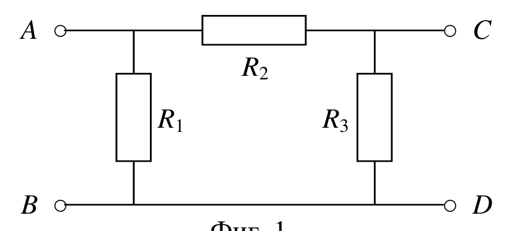
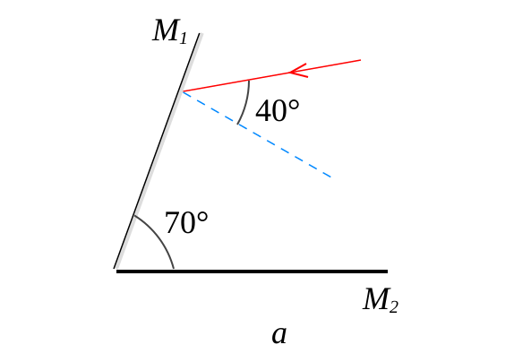

[[Състезания/esenno/8r/2010|решения]] | [[Състезания/esenno/8/2011| 2011 ▸]]

Задача 1. На фиг. 1 е показана част от електрическа верига, в която са свързани неизвестните съпротивления $R_1$ , $R_2$ , $R_3$ . Когато между точките A и B се свърже източник с напрежение $U_1 = 12$ V, а между точките C и D – волтметър, той показва напрежение $V_1 = 3$ V. Тогава през съпротивлението $R_2$ протича ток $I = 0{,}15$ A. Когато между точките C и D се свърже източник с напрежение $U_2 = 6$ V, а между точките A и B – волтметър, той показва напрежение $V_2 = 2{,}4$ V.

 Фиг. 1

а) Начертайте двете електрически схеми с включен източник на напрежение и волтметър. \[1 т.\]

б) Намерете съпротивленията $R_2$ и $R_3$ . \[5 т.\]

в) Определете съпротивлението $R_1$ . \[4 т.\]

Задача 2. Към източник с неизвестно напрежение U се включват два последователно свързани консуматори. Единият от тях е с неизвестно съпротивление R , а другият има съпротивление $R_1$ = 4 $\Omega$ и неговата мощност е P = 9 W . Когато във веригата заменим консуматора със съпротивление $R_1$ с друг със съпротивление $R_2$ = 9 $\Omega$ , неговата мощност също е P=9W.

а) Начертайте двете схеми на описаните електрически вериги. \[1 т.\]

б) Определете неизвестното съпротивление R . \[6 т.\]

в) Намерете напрежението на източника. \[3 т.\]

 !

 Задача 3. A) Две плоски огледала сключват ъгъл $\beta = 70^\circ$ помежду си, както е показано на фиг. 2. Светлинен лъч пада под ъгъл $\alpha_1 = 40^\circ$ към първото огледало $M_1$. Определете ъгъла на отражение $\alpha_2'$ от второто огледало $M_2$. \[2,5 т.\]

 фиг.2

В) Момиче стои пред стенно огледало.

а) При какво условие то ще може да се види в цял ръст? \[5,5 т.\]

б) Каква част от своя образ в огледалото ще вижда момичето, когато не е изпълнено това условие? \[2 т.\]