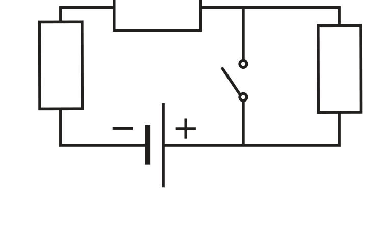
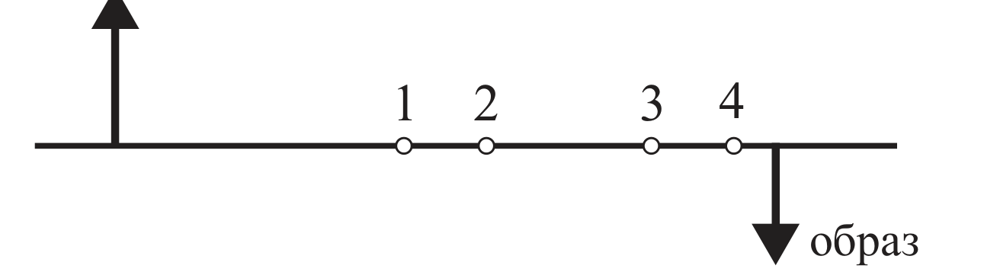
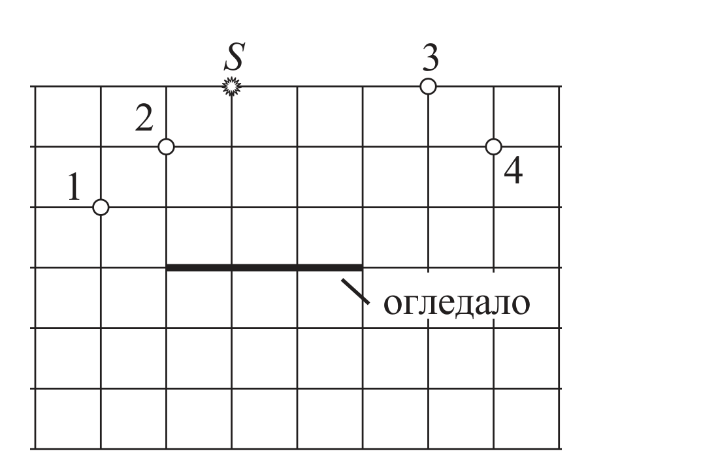
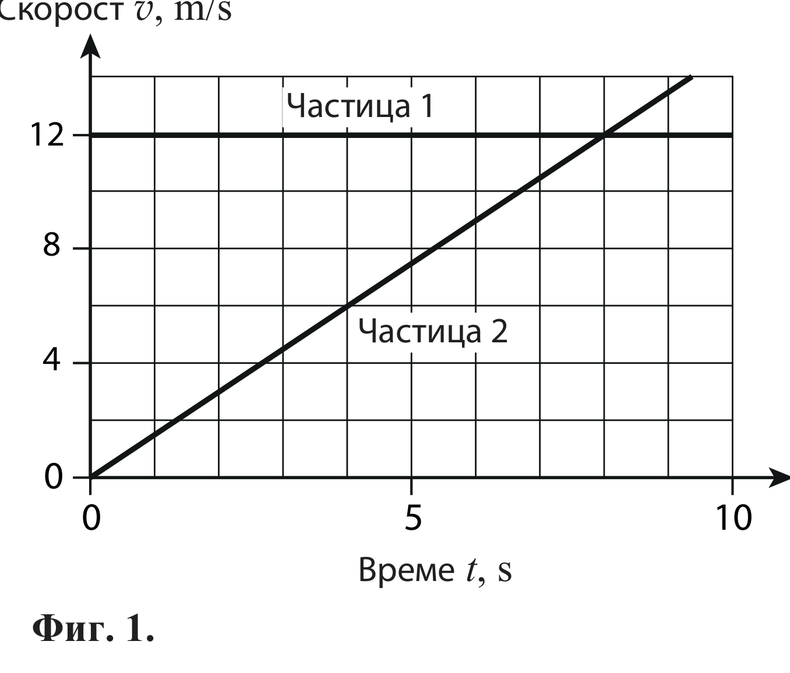
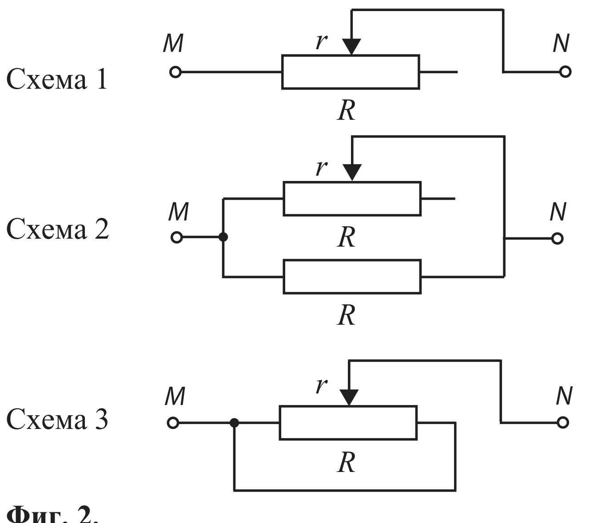

[[Състезания/esenno/8/2010|◂ 2010]] | [[Състезания/esenno/8r/2011|решения]] | [[Състезания/esenno/8/2012| 2012 ▸]]

Задача 1. Заградете с кръгче верния отговор. Всеки верен отговор се оценява с 1 точка.

**1.** Вземаме две стъклени бутилки. Напълваме първата догоре с вода, а втората – с живак. Какво ще стане, ако първата бутилка потопим във вода, а втората – в живак?

а) и двете бутилки ще потънат

б) и двете бутилки ще изплуват на повърхността

в) първата бутилка ще потъне във водата, а втората ще изплува на повърхността на живака

г) първата ще изплува, а втората ще потъне

**2.** За време $t$ = 2 min през напречното сечение на проводник преминава електричен заряд
$q$ = 0,006 C. Токът по проводника е

а) 0,003 А   б) 12 mA   в) 0,5 mA   г) 0,05 mA

**3.** По проводник, за който е в сила законът на Ом, тече постоянен ток. Ако увеличим тока $I$
два пъти, съпротивлението $R$ на проводника

а) няма да се промени

б) ще нарасне два пъти

в) ще намалее два пъти

г) ще намалее повече от два пъти

**4.** Разполагате с две лампи. На първата е написано 6 V; 3 W, а на втората: 6 V; 12 W. Ако
съставите електрическа верига, в която двете лампи са свързани последователно към акумулатор с
напрежение 12 V, има опасност

а) само за първата лампа да изгори

б) само за втората лампа да изгори

в) и за двете лампи да изгорят

г) лампите ще светят нормално, защото на всяка от тях ще е подадено работното напрежение 6 V

**5.** Трите консуматора в електрическата верига, показана на схемата, имат еднакво
съпротивление. Когато ключът е отворен, от батерията се черпи ток 3 А. Ако затворим ключа,
токът става

а) 1 А   б) 2 А   в) 4,5 А   г) 6 А

**6.** На фигурата са показани предмет и неговият образ от събирателна леща. В коя от
означените точки се намира фокусът $F$ на лещата?

а) 1   б) 2   в) 3   г) 4

**7.** Точков източник на светлина $S$ е поставен над плоско огледало. През кои от означените
на схемата точки ще преминат отразените от огледалото светлинни лъчи?

а) само през 1   б) през 2 и 3   в) през 1, 2 и 3   г) през 1, 2, 3 и 4

**8.** Теглилка, окачена на пружина, трепти с честота $\nu$ = 4 Hz и амплитуда $A$ = 2,5 cm.
Определете средната скорост на теглилката за време, равно на един период на трептене.

а) 0,1 m/s   б) 0,2 m/s   в) 0,3 m/s   г) 0,4 m/s

**9.** Автомобил тръгва от град $A$ за град $B$. Отначало той се движи два часа със средна
скорост 60 km/h. След това се движи още един час със средна скорост 90 km/h. Останалата част
от пътя автомобилът изминава със средна скорост 70 km/h. Колко е средната скорост на
автомобила за цялото пътуване (от $A$ до $B$)?

а) 65 km/h   б) 70 km/h   в) 75 km/h   г) няма достатъчно данни, за да се пресметне средната скорост.

**10.** Тяло, което се движи равноускорително, за време $t$ = 2 s изминава път $s$ = 10 m.
Колко е крайната скорост $v$ на тялото, ако началната скорост е $v_0$ = 3 m/s?

а) 4 m/s   б) 5 m/s   в) 6 m/s   г) 7 m/s

Задача II. Праволинейно движение

В началния момент $t$ = 0 две частици излизат от една и съща точка и започват да се движат
праволинейно в една и съща посока. На фиг. 1 са представени графиките на скоростите на
двете частици.

Използвайте данните от графиките и решете следните задачи:

а) Определете вида на движението на всяка от частиците и го характеризирайте с по една
физична величина. Определете стойностите на тези величини. (3 точки)

б) Колко секунди след началото на движението частиците ще попаднат отново в една и съща
точка (ще се срещнат)? (3 точки)

в) Какъв път ще измине всяка частица до срещата? (1 точка)

г) На какво максимално разстояние двете частици се отдалечават една от друга преди
срещата? (3 точки)

Задача III. Еквивалентно съпротивление

На фиг. 2 са показани схеми на части от електрически вериги с реостат, чието пълно
съпротивление е $R$. Във втората схема е свързан и резистор с постоянно съпротивление $R$,
равно на пълното съпротивление на реостата. Да означим с $r$ съпротивлението на лявата (по
отношение на схемата) част от реостата.

а) За всяка от трите схеми начертайте подходяща еквивалентна схема, включваща един или
два резистора, която ще ви помогне по-лесно да пресметнете еквивалентното съпротивление на
веригите между точките $M$ и $N$. (3 точки)

б) Пресметнете еквивалентното съпротивление $R_0$ между точките $M$ и $N$ при $r = 0$,
$r = R/2$ и $r = R$. (3 точки)

в) Постройте графики на зависимостта на еквивалентното съпротивление $R_0$ на всяка от
трите вериги от съпротивлението $r$ на лявата част на реостата. (4 точки)

*Указание.* Когато зависимостта не е линейна, свържете с плавни криви точките, чиито
стойности сте пресметнали числено.

Една от графиките е съставена от две части. Дайте аргументи защо тези части са симетрични.
Потвърдете това, като пресметнете еквивалентното съпротивление $R_0$ за още две стойности
на $r$, които подберете сами.
